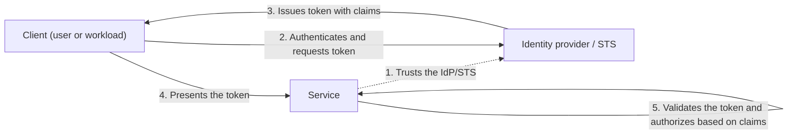

# Federated Identity

## Description

The Federated Identity pattern delegates authentication of users (and workloads) to an external, trusted identity provider (IdP) instead of implementing it in the application code. The application establishes a trust relationship with the IdP or with a security token service (STS) and starts accepting tokens issued by it as proof of identity.

The client authenticates with the IdP, which issues a signed token containing *claims* about the user: identity, roles, groups, or more granular permissions. The STS can transform or enrich those claims using predefined rules before returning the token. The client presents the token to the service, which validates it and decides what to allow based on the claims. This model is also called claims-based access control.

As a result, authentication and authorization are separated: the IdP handles credentials and the identity lifecycle, while each application applies its own authorization rules. The pattern relies on open protocols (such as OpenID Connect, OAuth 2.0, and SAML) and enables single sign-on (SSO) across applications and across the domains of different organizations.

## Problems it solves

- Users have to maintain different credentials for each application, which leads to a fragmented experience and forgotten or reused passwords.
- Accounts of former employees or former partners stay active in several applications because deactivation has to be done in each one separately.
- Administrators spend effort on user registration, password resets, and other tasks repeated in every system.
- Each application reimplements authentication logic, password storage, MFA, and threat detection, increasing the attack surface.
- Partners, SaaS customers, and automated processes with no user present need to access services without having accounts in the organization's directory.

## When to use

- Enterprise SSO for cloud-hosted applications outside the company's security perimeter, with no new logins on each access.
- B2B applications that need to authenticate employees and partners who aren't in the corporate directory, including merger scenarios or resource sharing between companies.
- Multi-tenant SaaS applications where each tenant uses its own IdP (corporate credentials for business users, social identities for consumers).
- Workload access, such as CI/CD pipelines, automations, or tenant applications, that call APIs using federated workload identities instead of long-lived secrets.

### When to avoid

- All users authenticate against a single IdP and there's no expectation of supporting others (for example, an internal application tied directly to the corporate directory over a VPN or private network).
- The application uses an incompatible authentication mechanism (such as its own user store) and doesn't handle claims-based protocols; adapting legacy systems can be expensive and complex.

## Trade-offs

| Benefit | Cost / Risk |
| --- | --- |
| Credentials are exposed only to the IdP; the application only sees the token | The IdP becomes a critical dependency and a possible single point of failure |
| SSO and a unified login experience | Configuring trust, metadata, certificates, and key rotation between parties |
| Centralized account deactivation and less administration | Social IdPs usually provide few claims (sometimes just an identifier), requiring complementary local registration |
| Advanced features (MFA, conditional access, threat detection) without implementing them in the application | With multiple IdPs, you have to solve home realm discovery |
| Less authentication code and application resources freed up for the business | Correct token validation (signature, issuer, audience, expiration) becomes the responsibility of each service |

- **Availability:** deploy or choose the identity mechanism in the same regions as the application so you don't compromise multi-region resilience; on the other hand, the workload's disaster recovery plan doesn't need to cover authentication components.
- **Authorization:** use the claims (roles, scopes, tenant) to apply granular role-based access control (RBAC) in each service.
- **Home realm discovery:** the STS can pick the IdP based on the email domain, application subdomain, IP range, or a cookie; when it can't, it shows a page for the user to choose.
- **Latency and sessions:** tokens with an appropriate lifetime and refresh tokens avoid frequent trips to the IdP; tokens that live too long make revocation harder.
- **Observability:** correlate the IdP's login logs with the application's to audit access and investigate incidents.

## Diagram

The service trusts the IdP/STS in advance; the client authenticates only with the IdP and receives a token with claims, which it presents to the service. The service validates the token and applies its authorization rules without ever handling the user's credentials. A concrete example is Microsoft Entra ID acting as the IdP with the OpenID Connect Authorization Code + PKCE flow.

## Related patterns

- [Gatekeeper](/cloud/cloud-design-patterns/security-and-access/gatekeeper) — a gatekeeper can centralize token validation before forwarding requests to internal services.
- [Gateway Offloading](/cloud/cloud-design-patterns/gateways-and-edge/gateway-offloading) — authentication validation is a cross-cutting concern commonly offloaded to the gateway.
- [Valet Key](/cloud/cloud-design-patterns/security-and-access/valet-key) — after authenticating the user via a federated identity, the application can issue restricted, temporary access keys to resources.
- [Backends for Frontends](/cloud/cloud-design-patterns/gateways-and-edge/backends-for-frontends) — each BFF can drive the login flow suited to its client type and propagate tokens to the APIs.
- [Deployment Stamp](/cloud/cloud-design-patterns/deployment-and-topology/deployment-stamp) — in multi-tenant, multi-region solutions, federated identity lets all stamps trust the same IdP.

## Reference

- [Documentation in the Azure Architecture Center](https://learn.microsoft.com/en-us/azure/architecture/patterns/federated-identity)
