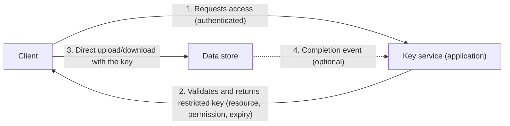

# Valet Key

## Description

The Valet Key pattern gives the client a token or key that grants direct but restricted access to a specific resource, such as a file in an object store or a queue. This way, the application no longer intermediates the data transfer. Like a car's valet key, it unlocks only what's needed: a defined resource, predefined operations (for example, write-only), and a short validity period.

The flow is simple. The client authenticates with the application and asks for access. The application validates the request and generates a signed key that the data store itself can validate. The client then uses that key to read from or write to the store directly. When the time limit ends, the key expires, and the application can also revoke it earlier, for example when the client reports that it has finished the operation.

As a result, the application keeps control over who accesses what and for how long, without spending compute, memory, and bandwidth to relay the bytes. It also doesn't need to create permanent users or permissions in the store for each client.

## Problems it solves

- The application consumes CPU, memory, and bandwidth just to relay uploads and downloads between the client and storage.
- Exposing the store's credentials to clients takes the gatekeeper role away from the application and creates long-lived secrets that are hard to revoke.
- A proxy layer adds latency and a network hop, and has to scale along with the transfer volume.
- Transferring data across regions or networks through the application incurs additional traffic costs.
- Creating and removing permanent identities or permissions per client in the store is laborious and risky.

## When to use

- When clients frequently upload or download data, especially large files or high volumes.
- When the application has little compute capacity, because of hosting or cost limits, and there are many simultaneous transfers.
- To reduce operating costs and the number of compute instances dedicated to moving data.
- When the data lives in a remote store or another region, and going through the application would generate extra traffic.
- When untrusted clients, such as browsers or mobile apps, need one-off, temporary access to specific resources.

### When to avoid

- When clients already authenticate individually against the target resource with identity-based access control.
- When the application needs to process the data before storing or delivering it, for example to validate, transform, or log each access.
- When you must control how many times the operation happens or keep an audit trail, and the key mechanism doesn't offer notifications or events.
- When you need to limit the size of the data uploaded, something the key generally can't enforce.
- When the existing architecture makes it hard to change how data is delivered and received.

## Trade-offs

| Benefit | Cost / Risk |
| --- | --- |
| Takes data transfer out of the application, which then needs fewer resources | You lose some control over usage: generally you can't limit the size or the number of times the key is used |
| Access with limited scope and duration, with no permanent credentials | A leaked key gives access to the resource for as long as it's valid |
| Less latency and fewer network hops between client and data | The service that issues the keys becomes a privileged component and needs strict protection |
| Scales well: issuing a key is usually just a cryptographic signature | Uploads and downloads repeated by client mistakes can cause unexpected costs |
| Simpler revocation and auditing than managing users in the store | Uploaded data arrives without passing through the application and has to be validated afterward |

- **Validity and scope:** use short lifetimes, but long enough to complete the operation, and allow the key to be renewed. Restrict the resource to the smallest possible target (a single item, not the whole container) and the permissions to the minimum, such as "create only" for uploads, which makes the token practically single-use.
- **Clocks:** set the start of validity slightly before the server's current time to tolerate clock differences on clients.
- **Secure delivery:** deliver the key only to authenticated and authorized clients, always over HTTPS, and require TLS for direct access to the store.
- **Logs:** URLs containing keys can end up recorded in logs. Restrict access to those logs or delay shipping them elsewhere until the keys expire.
- **Content validation:** verify and, if necessary, sanitize all uploaded data before using it, because it didn't pass through the application.
- **Observability:** log key issuance and the operations on the store, and correlate the two. Use store events to detect when operations finish, bill by volume, and identify authentication failures.
- **Web clients:** direct browser access to another domain requires CORS configured on the store.

## Diagram

The client obtains from the application a key with limited scope, permissions, and lifetime, and transfers data directly with the store, which validates the key on its own. The application only takes part in authorization and, if desired, receives events for auditing or revocation.

## Related patterns

- [Gatekeeper](/cloud/cloud-design-patterns/security-and-access/gatekeeper) — protects services with a dedicated layer that validates requests. In Valet Key, the application plays that role only when issuing the key.
- [Static Content Hosting](/cloud/cloud-design-patterns/deployment-and-topology/static-content-hosting) — also takes content traffic off the application. Valet Key secures that direct access when the content isn't public.
- [Gateway Routing](/cloud/cloud-design-patterns/gateways-and-edge/gateway-routing) — is the proxy alternative, where all traffic goes through an intermediary endpoint. It pays off only when the intermediary adds something to the transaction.
- [Federated Identity](/cloud/cloud-design-patterns/security-and-access/federated-identity) — authenticates the client with the service that issues the keys before any access is granted.
- [Claim Check](/cloud/cloud-design-patterns/messaging/claim-check) — also stores large payloads in external storage, and Valet Key can give temporary access to them.

## Reference

- [Documentation in the Azure Architecture Center](https://learn.microsoft.com/en-us/azure/architecture/patterns/valet-key)
