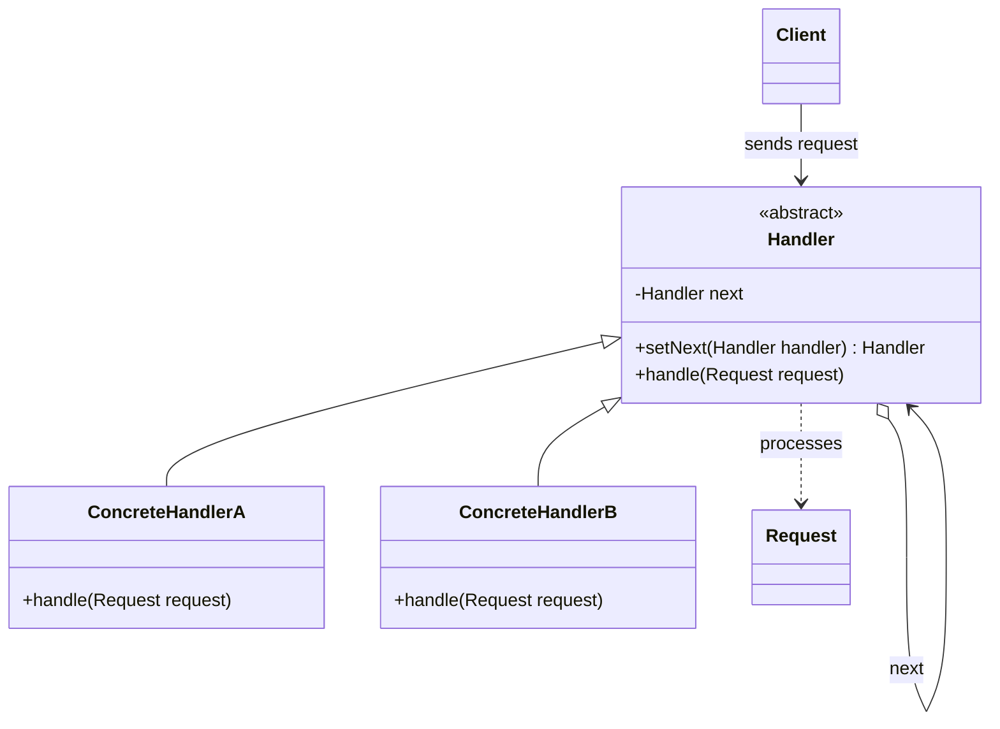

# Chain of Responsibility

## Description

Chain of Responsibility avoids coupling the sender of a request to its receiver by giving more than one object a chance to handle it. The receiving objects (handlers) are chained together, and the request is passed along the chain until one of them handles it, or until the chain ends.

Each handler implements a common interface and keeps a reference to the next element in the chain. When it receives the request, it decides whether to process it, pass it to its successor, or both (a common variation in middleware pipelines). The client only knows the first link and doesn't need to know which object will actually handle the request.

Because the chain is assembled at runtime, you can add, remove, or reorder handlers without changing the client code or the other handlers.

## Problems it solves

- A sender tightly coupled to a specific receiver, with long `if/else` or `switch` chains to decide who handles the request
- The need to apply a configurable sequence of checks (authentication, authorization, validation, rate limiting) before processing a request
- Tiered escalation of requests (for example, expense approval by authority level, or first-, second-, and third-level support)
- A set of handlers that must change dynamically without recompiling or modifying the client

## When to use

- More than one object can handle a request and the handler isn't known in advance
- You want to issue a request to one of several objects without explicitly specifying the receiver
- The set and order of handlers must be defined or changed dynamically
- Processing pipelines such as HTTP middleware, servlet filters, interceptors, and UI event handling (event bubbling)

## When to avoid

- There is exactly one known, stable handler: a direct call is simpler
- Every request must be handled and there's no default handler at the end of the chain
- The chain is very long and performance is critical, since each request may traverse many links
- The handler order creates implicit dependencies that are hard to understand and debug

## Trade-offs

| Benefit | Cost / Risk |
| --- | --- |
| Decouples sender and receiver | There's no guarantee that the request will be handled |
| Flexibility to add, remove, and reorder handlers at runtime | Chain order becomes an implicit, fragile dependency |
| Each handler has a single responsibility (SRP) and follows the Open/Closed Principle | Harder debugging: the flow is spread across several objects |
| Handlers are reusable in different chains | Extra latency when the request crosses many links |

- **Coupling:** the client depends only on the `Handler` abstraction; each handler only knows the next one.
- **Testability:** handlers can be tested in isolation with a fake (mock) successor.
- **Complexity:** chain assembly should be centralized (for example, in a builder or in configuration) to avoid cycles and forgotten links.
- **Performance:** in long chains, consider putting the most likely handlers first.

## Diagram



The `Client` sends the `Request` to the first `Handler` in the chain. Each `ConcreteHandler` decides whether to handle the request or pass it to the successor referenced by `next`, forming a linked list of handlers.

## Example

An expense reimbursement system routes each request through approval levels: the team lead approves up to $1,000, the manager up to $10,000, and the directors anything above that.

```typescript
abstract class Approver {
  private next?: Approver;

  setNext(next: Approver): Approver {
    this.next = next;
    return next;
  }

  handle(amount: number): string {
    if (this.next) return this.next.handle(amount);
    return `Request for ${amount} rejected: no approver`;
  }
}

class TeamLead extends Approver {
  handle(amount: number): string {
    return amount <= 1_000 ? `TeamLead approved ${amount}` : super.handle(amount);
  }
}

class Manager extends Approver {
  handle(amount: number): string {
    return amount <= 10_000 ? `Manager approved ${amount}` : super.handle(amount);
  }
}

class Director extends Approver {
  handle(amount: number): string {
    return `Director approved ${amount}`;
  }
}

const chain = new TeamLead();
chain.setNext(new Manager()).setNext(new Director());
console.log(chain.handle(500));    // TeamLead approved 500
console.log(chain.handle(25_000)); // Director approved 25000
```

## Related patterns

- [Composite](/coding/gof/structural/composite) — the chain often follows a Composite hierarchy, passing the request from child to parent (event bubbling)
- [Command](/coding/gof/behavioral/command) — requests can be encapsulated as Commands and passed along the chain
- [Decorator](/coding/gof/structural/decorator) — a similar recursive chaining structure, but a Decorator always delegates and adds behavior, while a handler can stop the chain
- [Mediator](/coding/gof/behavioral/mediator) — another way to decouple senders and receivers, but it centralizes communication instead of distributing it along a chain
- [Observer](/coding/gof/behavioral/observer) — also decouples senders and receivers, but notifies all interested parties instead of a single handler
- [Null Object](/coding/gof/behavioral/null-object) — can serve as the last link in the chain, eliminating null-successor checks

## Reference

- [Design Patterns Cheat Sheet](https://iretha.github.io/design-patterns/cheat-sheet)
- [Chain of Responsibility on Refactoring.Guru](https://refactoring.guru/design-patterns/chain-of-responsibility)
