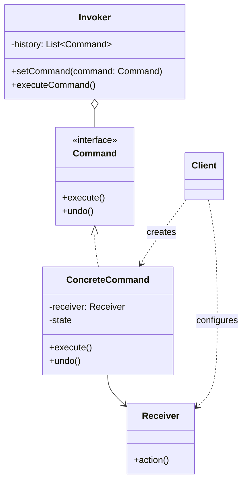

# Command

## Description

Command encapsulates a request as an object, containing everything needed to execute it: the action, the object that performs it (the receiver), and the parameters. This makes it possible to parameterize clients with different requests, queue them, log them, and support operations that can be undone.

The pattern separates whoever triggers the operation (the Invoker, such as a button or a scheduler) from whoever knows how to perform it (the Receiver). The Invoker only knows the `Command` interface with the `execute()` method; each concrete command delegates the work to the appropriate receiver. Optionally, the command stores the state needed to implement `undo()`.

Because commands are first-class objects, they can be stored in a history, composed into macros, serialized for later execution or execution in another process, and re-executed (for example, for recovery after failures).

## Problems it solves

- Direct coupling between the interface element (button, menu, shortcut) and the business logic it triggers
- The need to undo/redo operations while keeping a history of actions
- Queuing, scheduling, or running operations asynchronously or remotely
- Logging operations for auditing or to replay them after a failure
- Grouping several operations into a single composite action (macro or transaction)

## When to use

- When you need to parameterize objects with actions to perform (object-oriented callbacks)
- When requests must be specified, queued, and executed at different times
- When the system needs to support undo/redo
- When operations must be logged and replayable (journaling, simplified event sourcing)
- When different triggers (button, shortcut, menu, API) must fire the same operation

## When to avoid

- When the operation is simple, synchronous, and called from a single place: a direct method call or a function/lambda is enough
- When there's no need for history, queue, log, or decoupling between sender and receiver
- When the number of command classes would grow a lot without real reuse benefit

## Trade-offs

| Benefit | Cost / Risk |
| --- | --- |
| Decouples the invoker from the executor | Increases the number of classes (one per operation) |
| Enables undo/redo, queues, logs, and macros | Implementing `undo()` correctly requires storing state and can be complex |
| New commands are added without changing existing code (Open/Closed) | Extra indirection makes the execution flow harder to follow |
| Commands can be serialized and executed later or remotely | Serialized commands require versioning and care with missing receivers |

- **Coupling:** the Invoker depends only on the `Command` abstraction; coupling to the Receiver is concentrated in the concrete commands.
- **Testability:** commands are small, isolated units, easy to test with fake receivers.
- **Performance:** keeping unlimited undo history consumes memory; it's common to cap the size or use Memento for snapshots.
- **Modern languages:** in languages with first-class functions, closures can replace simple commands, but they lose undo and metadata.

## Diagram



The `Client` creates the `ConcreteCommand` and associates it with a `Receiver`; the `Invoker` stores commands and calls `execute()` without knowing the receiver. The `ConcreteCommand` translates the call into one or more actions on the `Receiver` and can store state for `undo()`.

## Example

Each movement in an account's ledger is a command with `execute()` and `undo()`, and the history lets you reverse the last operation. In accounting a reversal is a new entry: `undo()` posts the inverse entry and the original stays in the ledger.

<Tabs groupId="lang" queryString>
<TabItem value="java" label="Java">

```java
enum EntryType { DEBIT, CREDIT }

// reversalOf: reverses the entry at the given index (null otherwise)
record LedgerEntry(EntryType type, long amountCents, Integer reversalOf) {}

class Account {                              // Receiver
    final List<LedgerEntry> entries = new ArrayList<>();

    int post(EntryType type, long amountCents, Integer reversalOf) {
        entries.add(new LedgerEntry(type, amountCents, reversalOf));
        return entries.size() - 1;           // the entry index serves as its identifier
    }

    long balanceCents() {
        return entries.stream()
                .mapToLong(e -> e.type() == EntryType.CREDIT ? e.amountCents() : -e.amountCents())
                .sum();
    }
}

interface LedgerCommand { void execute(); void undo(); }

class CreditCommand implements LedgerCommand {
    private final Account account;
    private final long amountCents;
    private Integer entryId;

    CreditCommand(Account account, long amountCents) { this.account = account; this.amountCents = amountCents; }
    public void execute() { entryId = account.post(EntryType.CREDIT, amountCents, null); }
    public void undo() { account.post(EntryType.DEBIT, amountCents, entryId); }
}

class DebitCommand implements LedgerCommand {
    private final Account account;
    private final long amountCents;
    private Integer entryId;

    DebitCommand(Account account, long amountCents) { this.account = account; this.amountCents = amountCents; }
    public void execute() { entryId = account.post(EntryType.DEBIT, amountCents, null); }
    public void undo() { account.post(EntryType.CREDIT, amountCents, entryId); }
}

class LedgerHistory {                        // Invoker
    private final Deque<LedgerCommand> history = new ArrayDeque<>();

    void run(LedgerCommand cmd) { cmd.execute(); history.push(cmd); }
    void undo() { if (!history.isEmpty()) history.pop().undo(); }
}

Account account = new Account();
LedgerHistory history = new LedgerHistory();
history.run(new CreditCommand(account, 100_000));
history.run(new DebitCommand(account, 30_000));
System.out.println(account.balanceCents());  // 70000
history.undo();                              // posts a reversal credit; the original debit stays in the ledger
System.out.println(account.balanceCents());  // 100000
System.out.println(account.entries.size());  // 3
```

</TabItem>
<TabItem value="python" label="Python">

```python
from dataclasses import dataclass
from typing import Optional, Protocol

@dataclass(frozen=True)
class LedgerEntry:
    type: str  # "DEBIT" or "CREDIT"
    amount_cents: int
    reversal_of: Optional[int] = None  # reverses the entry at the given index

class Account:  # Receiver
    def __init__(self) -> None:
        self.entries: list[LedgerEntry] = []

    def post(self, type: str, amount_cents: int, reversal_of: Optional[int] = None) -> int:
        self.entries.append(LedgerEntry(type, amount_cents, reversal_of))
        return len(self.entries) - 1  # the entry index serves as its identifier

    @property
    def balance_cents(self) -> int:
        return sum(e.amount_cents if e.type == "CREDIT" else -e.amount_cents for e in self.entries)

class LedgerCommand(Protocol):
    def execute(self) -> None: ...
    def undo(self) -> None: ...

class CreditCommand:
    def __init__(self, account: Account, amount_cents: int) -> None:
        self._account, self._amount_cents = account, amount_cents
        self._entry_id: Optional[int] = None

    def execute(self) -> None:
        self._entry_id = self._account.post("CREDIT", self._amount_cents)

    def undo(self) -> None:
        self._account.post("DEBIT", self._amount_cents, self._entry_id)

class DebitCommand:
    def __init__(self, account: Account, amount_cents: int) -> None:
        self._account, self._amount_cents = account, amount_cents
        self._entry_id: Optional[int] = None

    def execute(self) -> None:
        self._entry_id = self._account.post("DEBIT", self._amount_cents)

    def undo(self) -> None:
        self._account.post("CREDIT", self._amount_cents, self._entry_id)

class LedgerHistory:  # Invoker
    def __init__(self) -> None:
        self._history: list[LedgerCommand] = []

    def run(self, cmd: LedgerCommand) -> None:
        cmd.execute()
        self._history.append(cmd)

    def undo(self) -> None:
        if self._history:
            self._history.pop().undo()

account = Account()
history = LedgerHistory()
history.run(CreditCommand(account, 100_000))
history.run(DebitCommand(account, 30_000))
print(account.balance_cents)  # 70000
history.undo()                # posts a reversal credit; the original debit stays in the ledger
print(account.balance_cents)  # 100000
print(len(account.entries))   # 3
```

</TabItem>
<TabItem value="go" label="Go">

```go
type EntryType string

const (
	Debit  EntryType = "DEBIT"
	Credit EntryType = "CREDIT"
)

type LedgerEntry struct {
	Type        EntryType
	AmountCents int64
	ReversalOf  *int // reverses the entry at the given index
}

type Account struct { // Receiver
	Entries []LedgerEntry
}

func (a *Account) Post(entryType EntryType, amountCents int64, reversalOf *int) int {
	a.Entries = append(a.Entries, LedgerEntry{entryType, amountCents, reversalOf})
	return len(a.Entries) - 1 // the entry index serves as its identifier
}

func (a *Account) BalanceCents() int64 {
	var sum int64
	for _, e := range a.Entries {
		if e.Type == Credit {
			sum += e.AmountCents
		} else {
			sum -= e.AmountCents
		}
	}
	return sum
}

type LedgerCommand interface {
	Execute()
	Undo()
}

type CreditCommand struct {
	account     *Account
	amountCents int64
	entryID     int
}

func (c *CreditCommand) Execute() { c.entryID = c.account.Post(Credit, c.amountCents, nil) }
func (c *CreditCommand) Undo()    { c.account.Post(Debit, c.amountCents, &c.entryID) }

type DebitCommand struct {
	account     *Account
	amountCents int64
	entryID     int
}

func (c *DebitCommand) Execute() { c.entryID = c.account.Post(Debit, c.amountCents, nil) }
func (c *DebitCommand) Undo()    { c.account.Post(Credit, c.amountCents, &c.entryID) }

type LedgerHistory struct { // Invoker
	history []LedgerCommand
}

func (h *LedgerHistory) Run(cmd LedgerCommand) {
	cmd.Execute()
	h.history = append(h.history, cmd)
}

func (h *LedgerHistory) Undo() {
	if len(h.history) == 0 {
		return
	}
	last := h.history[len(h.history)-1]
	h.history = h.history[:len(h.history)-1]
	last.Undo()
}

func main() {
	account := &Account{}
	history := &LedgerHistory{}
	history.Run(&CreditCommand{account: account, amountCents: 100_000})
	history.Run(&DebitCommand{account: account, amountCents: 30_000})
	fmt.Println(account.BalanceCents()) // 70000
	history.Undo()                      // posts a reversal credit; the original debit stays in the ledger
	fmt.Println(account.BalanceCents()) // 100000
	fmt.Println(len(account.Entries))   // 3
}
```

</TabItem>
<TabItem value="typescript" label="TypeScript">

```typescript
type EntryType = "DEBIT" | "CREDIT";

interface LedgerEntry {
  type: EntryType;
  amountCents: number;
  reversalOf?: number; // reverses the entry at the given index
}

class Account {                          // Receiver
  readonly entries: LedgerEntry[] = [];

  post(type: EntryType, amountCents: number, reversalOf?: number): number {
    this.entries.push({ type, amountCents, reversalOf });
    return this.entries.length - 1;      // the entry index serves as its identifier
  }

  get balanceCents(): number {
    return this.entries.reduce(
      (sum, e) => sum + (e.type === "CREDIT" ? e.amountCents : -e.amountCents), 0);
  }
}

interface LedgerCommand { execute(): void; undo(): void; }

class CreditCommand implements LedgerCommand {
  private entryId?: number;
  constructor(private account: Account, private amountCents: number) {}
  execute() { this.entryId = this.account.post("CREDIT", this.amountCents); }
  undo() { this.account.post("DEBIT", this.amountCents, this.entryId); }
}

class DebitCommand implements LedgerCommand {
  private entryId?: number;
  constructor(private account: Account, private amountCents: number) {}
  execute() { this.entryId = this.account.post("DEBIT", this.amountCents); }
  undo() { this.account.post("CREDIT", this.amountCents, this.entryId); }
}

class LedgerHistory {                    // Invoker
  private history: LedgerCommand[] = [];
  run(cmd: LedgerCommand) { cmd.execute(); this.history.push(cmd); }
  undo() { this.history.pop()?.undo(); }
}

const account = new Account();
const history = new LedgerHistory();
history.run(new CreditCommand(account, 100_000));
history.run(new DebitCommand(account, 30_000));
console.log(account.balanceCents);       // 70000
history.undo();                          // posts a reversal credit; the original debit stays in the ledger
console.log(account.balanceCents);       // 100000
console.log(account.entries.length);     // 3
```

</TabItem>
</Tabs>

## Related patterns

- [Memento](/coding/gof/behavioral/memento) — can store the receiver's state before execution to make `undo()` possible
- [Composite](/coding/gof/structural/composite) — allows building macros, commands made up of other commands
- [Chain of Responsibility](/coding/gof/behavioral/chain-of-responsibility) — also decouples sender and receiver; handlers can be represented as commands
- [Strategy](/coding/gof/behavioral/strategy) — similar structure, but Strategy varies *how* something is done, while Command represents *what* to do as an object
- [Prototype](/coding/gof/creational/prototype) — useful for copying commands before putting them in the history
- [Observer](/coding/gof/behavioral/observer) — commands can notify observers or be triggered by events

## Reference

- [Design Patterns Cheat Sheet](https://iretha.github.io/design-patterns/cheat-sheet)
- [Command on Refactoring.Guru](https://refactoring.guru/design-patterns/command)
