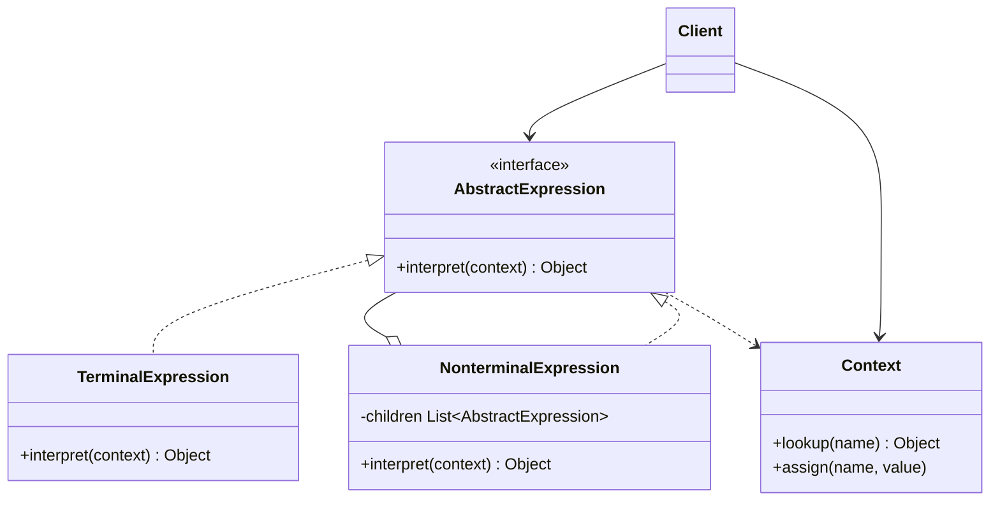

# Interpreter

## Description

Interpreter defines a representation for the grammar of a simple language and an interpreter that uses that representation to evaluate sentences in the language. Each grammar rule becomes a class, and a sentence is represented as an abstract syntax tree (AST) made up of instances of those classes.

The common `AbstractExpression` interface declares the `interpret(context)` operation. Terminal expressions (such as literals and variables) resolve their value directly; non-terminal expressions (such as addition, `and`, `or`) recursively combine the results of their subexpressions. A `Context` carries global information needed for interpretation, such as variable values.

The pattern doesn't deal with parsing: it assumes the tree has already been built, either manually by the client or by a separate parser.

## Problems it solves

- Repeatedly evaluating expressions of a small, well-defined language (business rules, filters, simple queries)
- Avoiding giant conditionals when interpreting commands or user-configurable expressions
- Allowing the language to be extended by adding new rules as new classes
- Representing expressions as objects that can be combined, reused, and evaluated with different contexts

## When to use

- The grammar is simple and relatively stable
- Efficiency isn't the main concern
- It's useful to express the problem as sentences of a DSL (for example, validation rules, boolean expressions, search specifications)
- The same expressions need to be evaluated against several contexts

## When to avoid

- The grammar is large or complex: the number of classes explodes and maintenance gets hard; prefer parser generators or expression libraries
- Performance is critical: recursively interpreting an AST is slower than compiled code or state tables
- A ready-made language or rules engine already meets the need

## Trade-offs

| Benefit | Cost / Risk |
| --- | --- |
| Easy to change and extend the grammar (new rule = new class) | Large grammars produce many classes that are hard to maintain |
| Straightforward implementation of each rule, isolated and testable | Recursive evaluation can be slow and consume stack on deep trees |
| Combinable, reusable expressions | Doesn't solve parsing; the AST has to be built some other way |
| New ways of interpreting can be added | Adding operations requires changing every class, unless Visitor is used |

- Coupling: each class only knows its own rule and its subexpressions.
- Testability: terminal and non-terminal expressions can be tested in isolation.
- Complexity: grows linearly with the number of grammar rules.
- Performance: consider caching results or compiling the AST when evaluations are frequent.

## Diagram



The `Client` builds (or receives) the tree of `AbstractExpression` and calls `interpret`, passing a `Context`. `TerminalExpression` represents the leaves of the grammar and `NonterminalExpression` aggregates subexpressions, forming a recursive structure similar to Composite.

## Example

The fraud service evaluates boolean rules such as `high_amount AND (new_device OR night_time)` against the signals of each transaction. The context is a map of signals, and each rule is an expression tree.

```typescript
interface Expression {
  interpret(ctx: Map<string, boolean>): boolean;
}

class Variable implements Expression {
  constructor(private name: string) {}
  interpret(ctx: Map<string, boolean>): boolean {
    return ctx.get(this.name) ?? false;
  }
}

class And implements Expression {
  constructor(private left: Expression, private right: Expression) {}
  interpret(ctx: Map<string, boolean>): boolean {
    return this.left.interpret(ctx) && this.right.interpret(ctx);
  }
}

class Or implements Expression {
  constructor(private left: Expression, private right: Expression) {}
  interpret(ctx: Map<string, boolean>): boolean {
    return this.left.interpret(ctx) || this.right.interpret(ctx);
  }
}

const rule = new And(
  new Variable("high_amount"),
  new Or(new Variable("new_device"), new Variable("night_time")),
);
const ctx = new Map([["high_amount", true], ["night_time", true]]);
console.log(rule.interpret(ctx)); // true

const calm = new Map([["high_amount", true]]);
console.log(rule.interpret(calm)); // false
```

## Related patterns

- [Composite](/coding/gof/structural/composite) — the abstract syntax tree is an instance of Composite
- [Flyweight](/coding/gof/structural/flyweight) — allows sharing repeated terminal symbols in the AST
- [Iterator](/coding/gof/behavioral/iterator) — can be used to traverse the tree structure
- [Visitor](/coding/gof/behavioral/visitor) — concentrates operations on the AST nodes in a single class, avoiding changes to each expression

## Reference

- [Design Patterns Cheat Sheet](https://iretha.github.io/design-patterns/cheat-sheet)
- [Interpreter on SourceMaking](https://sourcemaking.com/design_patterns/interpreter)
