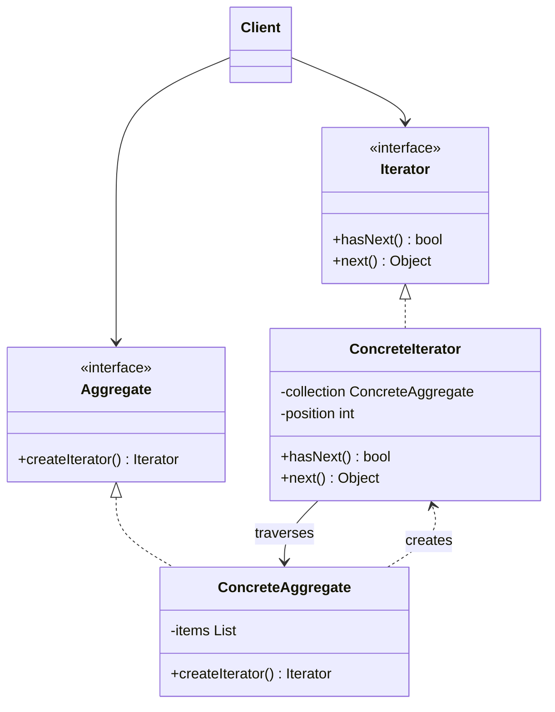

# Iterator

## Description

Iterator provides a way to access the elements of a collection (aggregate) sequentially without exposing its internal representation. Instead of the client knowing whether the data lives in an array, a linked list, a tree, or a paginated source, it talks only to a uniform iteration interface, with operations such as `hasNext()` and `next()`.

The responsibility for traversing the collection moves out of the aggregate and into a separate iterator object, which holds the traversal state (current position, stack of visited nodes, page cursor, and so on). This way, the same collection can have several active iterators at once and offer different traversal strategies (in order, reverse, filtered, breadth-first, depth-first).

The aggregate acts as an iterator factory through a method such as `createIterator()`. Many languages build the pattern in natively (`Iterable`/`Iterator` in Java, `IEnumerable` in C#, the iteration protocol in Python and JavaScript, generators with `yield`).

## Problems it solves

- Client code gets coupled to the collection's internal structure (indexes, node pointers, cursors) and breaks when it changes.
- Different collections require different loops, which prevents generic algorithms that work over any structure.
- You need to support multiple ways of traversing the same collection without bloating its interface with traversal methods.
- Several simultaneous, independent traversals over the same collection need to keep their own state.
- Traversing large volumes of data (streams, paginated results) without loading everything into memory.

## When to use

- The collection has a complex structure (tree, graph, composition) and you want to hide that complexity from clients.
- You need a uniform interface to traverse heterogeneous collections (polymorphic iteration).
- You need multiple traversal strategies or lazy iteration over external sources.
- You want to reduce duplication of traversal code scattered across the application.

## When to avoid

- The collection is simple (a native array or list) and the language already offers adequate iteration; creating your own iterators only adds ceremony.
- Random access by index is the main use case, and sequential iteration is slower or less expressive.
- The collection is modified frequently during traversal and there's no clear policy for handling concurrent modifications.

## Trade-offs

| Benefit | Cost / Risk |
| --- | --- |
| Encapsulates the collection's internal structure | More classes and interfaces to maintain |
| Allows multiple simultaneous, independent traversals | Iterators can become invalid if the collection changes during traversal |
| Supports several traversal strategies without changing the aggregate | Can be less efficient than direct access in specialized collections |
| Enables lazy iteration and iteration over infinite sources | Iteration state needs care in concurrent scenarios |
| Makes generic algorithms easier (Single Responsibility, Open/Closed) | Overkill for trivial collections |

- **Coupling:** the client depends only on the `Iterator` and `Aggregate` interfaces, not on the concrete classes.
- **Testability:** iterators can be tested in isolation and replaced by simple test doubles.
- **Robustness:** choose between *fail-fast* iterators (throw an error on concurrent modification) and snapshot-based ones.
- **Internal vs. external iterator:** external iterators give the client control; internal ones (e.g., `forEach` with a callback) are simpler but less flexible.

## Diagram



The `Client` obtains an `Iterator` from the `Aggregate` and walks the elements without knowing the internal structure. The `ConcreteAggregate` creates the `ConcreteIterator`, which keeps the current traversal position over the collection.

## Example

An account statement has thousands of entries and the API returns them in cursor-based pages. The consumer only calls `hasNext()` and `next()`: the `PagedStatementIterator` fetches the next page when the current one runs out, and the `ReverseStatementIterator` walks the same collection from the most recent entry to the oldest.

```typescript
interface StatementEntry {
  date: string;
  description: string;
  amountCents: number;
}

interface Page {
  entries: StatementEntry[];
  nextCursor?: number;
}

interface StatementIterator {
  hasNext(): boolean;
  next(): StatementEntry;
}

class Statement {
  constructor(private entries: StatementEntry[], private pageSize = 2) {}

  // simulates the paginated API: returns one page and the cursor of the next
  fetchPage(cursor = 0): Page {
    const end = cursor + this.pageSize;
    return {
      entries: this.entries.slice(cursor, end),
      nextCursor: end < this.entries.length ? end : undefined,
    };
  }

  createIterator(): StatementIterator {
    return new PagedStatementIterator(this);
  }

  createReverseIterator(): StatementIterator {
    return new ReverseStatementIterator(this.entries);
  }
}

class PagedStatementIterator implements StatementIterator {
  private buffer: StatementEntry[] = [];
  private position = 0;
  private cursor: number | undefined = 0;
  constructor(private statement: Statement) {}

  hasNext(): boolean { this.fill(); return this.position < this.buffer.length; }
  next(): StatementEntry { this.fill(); return this.buffer[this.position++]; }

  private fill(): void {
    if (this.position < this.buffer.length || this.cursor === undefined) return;
    const page = this.statement.fetchPage(this.cursor); // only fetches when the current page is exhausted
    this.buffer = page.entries;
    this.position = 0;
    this.cursor = page.nextCursor;
  }
}

class ReverseStatementIterator implements StatementIterator {
  private position: number;
  constructor(private entries: StatementEntry[]) {
    this.position = entries.length - 1;
  }

  hasNext(): boolean { return this.position >= 0; }
  next(): StatementEntry { return this.entries[this.position--]; }
}

const statement = new Statement([
  { date: "2026-03-01", description: "Pix received", amountCents: 25_000 },
  { date: "2026-03-02", description: "Boleto paid", amountCents: -8_990 },
  { date: "2026-03-03", description: "Card purchase", amountCents: -4_550 },
]);

const it = statement.createIterator();
while (it.hasNext()) console.log(it.next().description);  // Pix received, Boleto paid, Card purchase

const recent = statement.createReverseIterator();
console.log(recent.next().description);                   // Card purchase
```

## Related patterns

- [Composite](/coding/gof/structural/composite) — iterators are often used to traverse recursive Composite structures.
- [Factory Method](/coding/gof/creational/factory-method) — `createIterator()` is a Factory Method that lets each collection instantiate the appropriate iterator.
- [Memento](/coding/gof/behavioral/memento) — can capture the state of an iteration to resume or undo it later.
- [Visitor](/coding/gof/behavioral/visitor) — combines with Iterator: the iterator traverses the collection and the Visitor applies the operation to each element.
- [Null Object](/coding/gof/behavioral/null-object) — an empty iterator (Null Iterator) avoids null checks on collections with no elements.

## Reference

- [Design Patterns Cheat Sheet](https://iretha.github.io/design-patterns/cheat-sheet)
- [Iterator on Refactoring.Guru](https://refactoring.guru/design-patterns/iterator)
