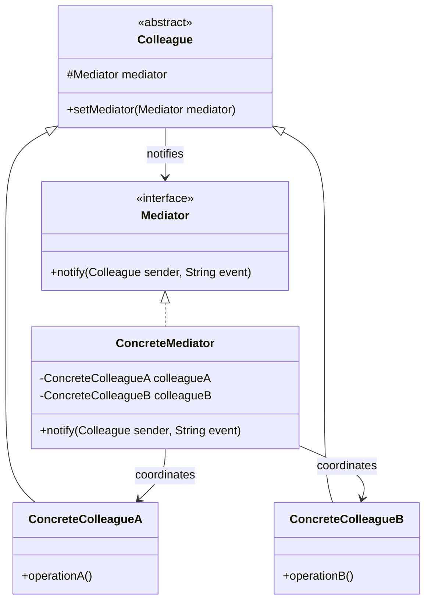

# Mediator

## Description

Mediator defines an object that encapsulates how a set of objects interact. Instead of the objects (called colleagues) referencing and calling each other directly, they communicate only through the mediator, which promotes loose coupling between them.

Each colleague only knows the `Mediator` abstraction and notifies it when something relevant happens. The concrete mediator concentrates the coordination logic: it decides which other colleagues should react and in what order. A many-to-many web of dependencies is thus turned into several one-to-many relationships centered on the mediator.

Since the collaborative behavior lives in a single place, you can change how the components interact by swapping or extending the mediator, without modifying the colleague classes, which become easier to reuse.

## Problems it solves

- Many objects referencing each other directly, forming a web of dependencies that's hard to understand and maintain
- Components that are hard to reuse because they depend on several other specific components
- Interaction logic spread across several classes, requiring changes in many of them to alter a flow
- Coordinating UI elements in forms (enabling buttons, validating fields, updating lists according to selections)
- Communication between participants of a system, such as users in a chat room or aircraft at a control tower

## When to use

- A set of objects communicates in well-defined but complex ways, and the resulting interdependencies are unstructured
- Reusing an object is difficult because it references and communicates with many others
- Behavior distributed across several classes should be customizable without creating many subclasses
- You want to centralize orchestration rules among components (for example, UI dialogs, workflows, command handlers in CQRS)

## When to avoid

- Few objects with simple interactions — direct calls are clearer
- The mediator tends to accumulate too many rules and become a hard-to-maintain "god object"
- Communication is essentially broadcast with no coordination logic — Observer is usually enough
- Performance is critical and the extra indirection in each interaction isn't justified

## Trade-offs

| Benefit | Cost / Risk |
| --- | --- |
| Reduces coupling between colleagues | The mediator can become monolithic and complex (god object) |
| Centralizes interaction logic in a single place | Single point of failure and of change contention |
| Colleagues become simpler and more reusable | Indirect flow makes tracing interactions less obvious |
| Replaces many-to-many relationships with one-to-many | Concrete mediators are usually not very reusable across contexts |

- **Coupling:** colleagues depend only on the `Mediator` interface; coupling is concentrated in the concrete mediator.
- **Testability:** colleagues can be tested with a fake mediator; the mediator can be tested with simulated colleagues.
- **Complexity:** split large mediators by context or use case to keep them from growing indefinitely.
- **Performance:** indirection is cheap, but it can add up in flows with many chained notifications.

## Diagram



The `Mediator` defines the communication interface used by the colleagues. The `ConcreteMediator` knows the concrete colleagues and implements the coordination between them. Each `Colleague` keeps a reference to the mediator and notifies it instead of talking directly to the others.

## Example

Participant banks do not send payment orders directly to each other: the clearing house (mediator) receives the order and delivers it to the destination bank.

```typescript
interface ClearingHouse {
  register(bank: ParticipantBank): void;
  send(order: PaymentOrder): void;
}

interface PaymentOrder {
  from: string;
  to: string;
  amountCents: number;
}

class InstantPaymentClearing implements ClearingHouse {
  private banks = new Map<string, ParticipantBank>();

  register(bank: ParticipantBank): void {
    this.banks.set(bank.code, bank);
  }

  send(order: PaymentOrder): void {
    const destination = this.banks.get(order.to);
    if (!destination) throw new Error(`Bank ${order.to} is not a clearing participant`);
    destination.receive(order);
  }
}

class ParticipantBank {
  constructor(public code: string, private clearing: ClearingHouse) {
    clearing.register(this);
  }
  pay(to: string, amountCents: number): void {
    this.clearing.send({ from: this.code, to, amountCents });
  }
  receive(order: PaymentOrder): void {
    console.log(`[${this.code}] order from ${order.from}: ${order.amountCents} cents`);
  }
}

const clearing = new InstantPaymentClearing();
const alpha = new ParticipantBank("001", clearing);
new ParticipantBank("237", clearing);
alpha.pay("237", 15_000); // [237] order from 001: 15000 cents
```

## Related patterns

- [Observer](/coding/gof/behavioral/observer) — often used to implement communication between colleagues and mediator; Observer distributes the communication, while Mediator centralizes it
- [Facade](/coding/gof/structural/facade) — also simplifies interactions, but it's unidirectional and abstracts a subsystem; Mediator coordinates colleagues that know it and communicate through it
- [Chain of Responsibility](/coding/gof/behavioral/chain-of-responsibility) — another way to decouple senders and receivers, passing the request along a chain instead of centralizing it
- [Command](/coding/gof/behavioral/command) — commands can be routed by a mediator to their handlers, as in mediator libraries for CQRS
- [Singleton](/coding/gof/creational/singleton) — the mediator usually has a single instance per context

## Reference

- [Design Patterns Cheat Sheet](https://iretha.github.io/design-patterns/cheat-sheet)
- [Mediator on Refactoring.Guru](https://refactoring.guru/design-patterns/mediator)
