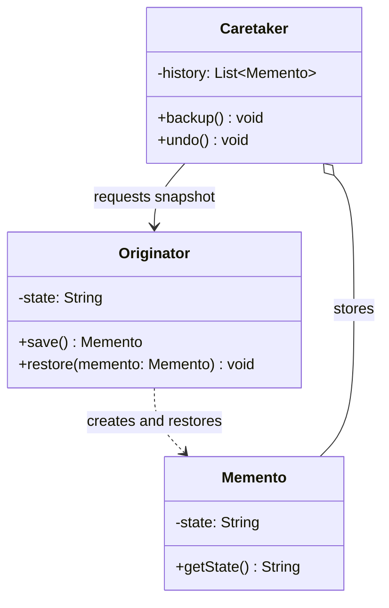

# Memento

## Description

Memento captures and externalizes an object's internal state, without violating its encapsulation, so that the object can be restored to that state later. It's the classic pattern behind undo features, checkpoints, and rollback.

The pattern involves three participants. The Originator is the object whose state you want to save: it knows how to create a memento with a snapshot of its own state and how to restore itself from a memento. The Memento is the object that stores that snapshot, normally immutable. The Caretaker keeps the mementos (for example, in a history stack) and decides when to save and when to restore, but never reads or changes their contents.

The central point is encapsulation: the Memento exposes a "narrow" interface to the Caretaker (which only stores it and hands it back) and a "wide" interface only to the Originator (which accesses the state). In languages without `friend` or package visibility, this is usually achieved with nested classes, opaque interfaces, or immutable objects.

## Problems it solves

- Implementing undo/redo without exposing the object's internal fields to other classes
- Creating checkpoints to revert an object after an operation that failed or was canceled
- Preventing external code (history, transaction manager) from depending on the internal structure of the saved object
- Keeping previous versions of a state for comparison or navigation (edit history)

## When to use

- You need to save snapshots of an object's state so you can restore it later
- Direct access to the object's fields would break encapsulation or expose implementation details
- Editors, forms, games (save/load), or wizards need undo, history, or local rollback
- In-memory transactional operations that may need to be reverted

## When to avoid

- The state is large and snapshots are frequent, causing high memory consumption — prefer storing diffs or using [Command](/coding/gof/behavioral/command) with inverse operations
- The object is simple and fully public; a direct copy or a [Prototype](/coding/gof/creational/prototype) does the job
- Long-term persistence is the goal — serialization, event sourcing, or database versioning are more appropriate

## Trade-offs

| Benefit | Cost / Risk |
| --- | --- |
| Preserves the Originator's encapsulation | Full snapshots can consume a lot of memory |
| Simplifies the Originator by delegating history to the Caretaker | The Caretaker has to manage the lifecycle of the mementos (limits, disposal) |
| Makes undo/redo and rollback easier | In dynamic languages it's hard to guarantee that only the Originator accesses the state |
| Immutable mementos are safe to share | A shallow copy of mutable state can cause incorrect restores |

- **Coupling:** the Caretaker depends only on the opaque memento type, not on the internal state.
- **Performance:** consider incremental snapshots, compression, or a history limit for large states.
- **Testability:** saving and restoring is easy to verify by comparing the state before and after.
- **Consistency:** make sure to deep-copy collections and mutable objects inside the memento.

## Diagram



The Originator creates mementos with its state and uses them to restore itself; the Caretaker keeps the history of mementos and triggers save/restore on the Originator without accessing the contents of the snapshots.

## Example

In a loan simulation, the customer changes the amount, term and rate and can go back to earlier simulations: before each change, the history (Caretaker) asks the simulation (Originator) for a snapshot with those three values.

<Tabs groupId="lang" queryString>
<TabItem value="java" label="Java">

```java
record SimulationSnapshot(long principalCents, int months, double monthlyRate) {}

class LoanSimulation {                       // Originator
    long principalCents;
    int months;
    double monthlyRate;

    LoanSimulation(long principalCents, int months, double monthlyRate) {
        this.principalCents = principalCents;
        this.months = months;
        this.monthlyRate = monthlyRate;
    }

    SimulationSnapshot save() {
        return new SimulationSnapshot(principalCents, months, monthlyRate);
    }

    void restore(SimulationSnapshot s) {
        principalCents = s.principalCents();
        months = s.months();
        monthlyRate = s.monthlyRate();
    }
}

class SimulationHistory {                    // Caretaker
    private final Deque<SimulationSnapshot> stack = new ArrayDeque<>();
    private final LoanSimulation simulation;

    SimulationHistory(LoanSimulation simulation) { this.simulation = simulation; }

    void backup() { stack.push(simulation.save()); }
    void undo() { if (!stack.isEmpty()) simulation.restore(stack.pop()); }
}

LoanSimulation simulation = new LoanSimulation(1_000_000, 10, 0.02);
SimulationHistory history = new SimulationHistory(simulation);

history.backup();
simulation.months = 24;
history.backup();
simulation.principalCents = 2_000_000;

history.undo();
System.out.println(simulation.principalCents + " " + simulation.months); // 1000000 24
history.undo();
System.out.println(simulation.principalCents + " " + simulation.months); // 1000000 10
```

</TabItem>
<TabItem value="python" label="Python">

```python
from dataclasses import dataclass

@dataclass(frozen=True)
class SimulationSnapshot:
    principal_cents: int
    months: int
    monthly_rate: float

@dataclass
class LoanSimulation:  # Originator
    principal_cents: int
    months: int
    monthly_rate: float

    def save(self) -> SimulationSnapshot:
        return SimulationSnapshot(self.principal_cents, self.months, self.monthly_rate)

    def restore(self, s: SimulationSnapshot) -> None:
        self.principal_cents = s.principal_cents
        self.months = s.months
        self.monthly_rate = s.monthly_rate

class SimulationHistory:  # Caretaker
    def __init__(self, simulation: LoanSimulation) -> None:
        self._simulation = simulation
        self._stack: list[SimulationSnapshot] = []

    def backup(self) -> None:
        self._stack.append(self._simulation.save())

    def undo(self) -> None:
        if self._stack:
            self._simulation.restore(self._stack.pop())

simulation = LoanSimulation(1_000_000, 10, 0.02)
history = SimulationHistory(simulation)

history.backup()
simulation.months = 24
history.backup()
simulation.principal_cents = 2_000_000

history.undo()
print(simulation.principal_cents, simulation.months)  # 1000000 24
history.undo()
print(simulation.principal_cents, simulation.months)  # 1000000 10
```

</TabItem>
<TabItem value="go" label="Go">

```go
// Unexported fields: outside the package, the snapshot is opaque to the Caretaker.
type SimulationSnapshot struct {
	principalCents int64
	months         int
	monthlyRate    float64
}

type LoanSimulation struct { // Originator
	PrincipalCents int64
	Months         int
	MonthlyRate    float64
}

func (l *LoanSimulation) Save() SimulationSnapshot {
	return SimulationSnapshot{l.PrincipalCents, l.Months, l.MonthlyRate}
}

func (l *LoanSimulation) Restore(s SimulationSnapshot) {
	l.PrincipalCents = s.principalCents
	l.Months = s.months
	l.MonthlyRate = s.monthlyRate
}

type SimulationHistory struct { // Caretaker
	simulation *LoanSimulation
	stack      []SimulationSnapshot
}

func (h *SimulationHistory) Backup() { h.stack = append(h.stack, h.simulation.Save()) }

func (h *SimulationHistory) Undo() {
	if len(h.stack) == 0 {
		return
	}
	last := h.stack[len(h.stack)-1]
	h.stack = h.stack[:len(h.stack)-1]
	h.simulation.Restore(last)
}

func main() {
	simulation := &LoanSimulation{PrincipalCents: 1_000_000, Months: 10, MonthlyRate: 0.02}
	history := &SimulationHistory{simulation: simulation}

	history.Backup()
	simulation.Months = 24
	history.Backup()
	simulation.PrincipalCents = 2_000_000

	history.Undo()
	fmt.Println(simulation.PrincipalCents, simulation.Months) // 1000000 24
	history.Undo()
	fmt.Println(simulation.PrincipalCents, simulation.Months) // 1000000 10
}
```

</TabItem>
<TabItem value="typescript" label="TypeScript">

```typescript
class SimulationSnapshot {
  constructor(
    readonly principalCents: number,
    readonly months: number,
    readonly monthlyRate: number,
  ) {}
}

class LoanSimulation {                   // Originator
  constructor(
    public principalCents: number,
    public months: number,
    public monthlyRate: number,
  ) {}

  save(): SimulationSnapshot {
    return new SimulationSnapshot(this.principalCents, this.months, this.monthlyRate);
  }
  restore(s: SimulationSnapshot) {
    this.principalCents = s.principalCents;
    this.months = s.months;
    this.monthlyRate = s.monthlyRate;
  }
}

class SimulationHistory {                // Caretaker
  private stack: SimulationSnapshot[] = [];
  constructor(private simulation: LoanSimulation) {}

  backup() { this.stack.push(this.simulation.save()); }
  undo() {
    const s = this.stack.pop();
    if (s) this.simulation.restore(s);
  }
}

const simulation = new LoanSimulation(1_000_000, 10, 0.02);
const history = new SimulationHistory(simulation);

history.backup();
simulation.months = 24;
history.backup();
simulation.principalCents = 2_000_000;

history.undo();
console.log(simulation.principalCents, simulation.months); // 1000000 24
history.undo();
console.log(simulation.principalCents, simulation.months); // 1000000 10
```

</TabItem>
</Tabs>

## Related patterns

- [Command](/coding/gof/behavioral/command) — commands can use mementos to store the state needed for `undo()`
- [Iterator](/coding/gof/behavioral/iterator) — a memento can record the state of an iteration so it can be resumed later
- [Prototype](/coding/gof/creational/prototype) — cloning the object is a simpler alternative to a memento when the state is public and direct
- [State](/coding/gof/behavioral/state) — mementos can save and restore the current state of a state machine

## Reference

- [Design Patterns Cheat Sheet](https://iretha.github.io/design-patterns/cheat-sheet)
- [Memento on Refactoring.Guru](https://refactoring.guru/design-patterns/memento)
