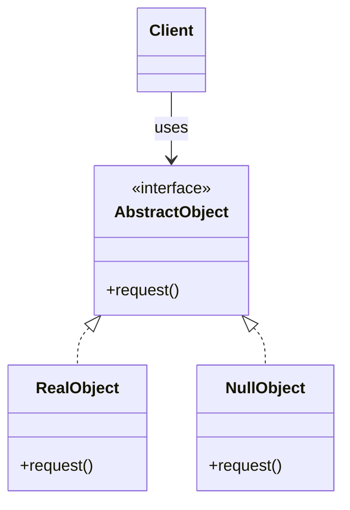

# Null Object

## Description

Null Object replaces null references with an object that implements the same interface the client expects, but whose behavior is neutral, that is, "do nothing". This way the client can call methods without first checking whether the reference exists.

The pattern defines an abstraction (interface or abstract class), one or more real implementations, and a null implementation. The null implementation returns safe default values (empty list, zero, empty string) or simply ignores the call. Since it holds no state, it's usually shared as a single instance.

In practice, the pattern swaps the conditional handling scattered across the code (`if (x != null)`) for polymorphism: the decision about what to do when an object is absent is concentrated in a single class.

## Problems it solves

- Null checks repeated in many places in the code, which clutter the logic and are easy to forget
- Runtime failures (`NullPointerException`, `TypeError`) caused by missing references
- Optional dependencies (logger, notifier, cache) that require conditional logic every time they're used
- The lack of a well-defined default behavior when a collaborator isn't available

## When to use

- The client needs a collaborator that may be absent, and "doing nothing" is an acceptable reaction
- There are many null-check points for the same abstraction
- You want to provide a safe default value for optional dependencies (for example, a `NullLogger` in tests)
- The neutral behavior can be expressed clearly and predictably

## When to avoid

- The absence of the object is an error that needs to be detected and reported; the Null Object would hide the failure
- The client needs to react differently when the object doesn't exist (in that case, prefer `Optional`/`Maybe` or explicit checking)
- There's no reasonable neutral behavior (for example, a method that must return a valid identifier)
- The language already offers suitable mechanisms, such as safe-navigation operators, and the extra abstraction doesn't pay off

## Trade-offs

| Benefit | Cost / Risk |
| --- | --- |
| Eliminates null checks scattered across the code | Can mask real errors, delaying the discovery of bugs |
| Simpler, more readable client code | One extra class for each abstraction that needs a null version |
| Default behavior centralized in a single place | Every interface change also requires updating the null implementation |
| Makes testing easier by replacing optional dependencies | The "do nothing" may not be obvious to whoever reads the code |

- **Coupling:** the client depends only on the abstraction, without knowing the null implementation.
- **Testability:** null objects work as simple test doubles for dependencies that don't matter to the test.
- **Performance:** the null implementation is usually a stateless Singleton, with negligible cost.
- **Semantics:** document the neutral behavior well so you don't surprise whoever consumes the interface.

## Diagram



`Client` depends only on `AbstractObject`. `RealObject` performs the actual behavior, while `NullObject` implements the same interface with a neutral behavior, letting the client use it without checking for nulls.

## Example

The transfer service applies a fee policy. Exempt accounts get a `NoFeePolicy`, which returns zero, instead of the service checking whether a policy exists on every transfer. The fee amount is illustrative.

```typescript
interface FeePolicy {
  feeCents(amountCents: number): number;
}

class PerTransferFeePolicy implements FeePolicy {
  constructor(private readonly flatCents: number) {}
  feeCents(_amountCents: number): number {
    return this.flatCents;
  }
}

class NoFeePolicy implements FeePolicy {
  static readonly instance = new NoFeePolicy();
  feeCents(_amountCents: number): number {
    return 0;                            // exempt account: zero fee
  }
}

class TransferService {
  constructor(private readonly feePolicy: FeePolicy) {}

  // total debited from the account
  transfer(amountCents: number): number {
    const fee = this.feePolicy.feeCents(amountCents); // no if (policy != null)
    return amountCents + fee;
  }
}

console.log(new TransferService(new PerTransferFeePolicy(350)).transfer(10_000)); // 10350
console.log(new TransferService(NoFeePolicy.instance).transfer(10_000));          // 10000
```

## Related patterns

- [Strategy](/coding/gof/behavioral/strategy) — Null Object can be seen as a strategy that does nothing
- [State](/coding/gof/behavioral/state) — a "null" or initial state can be modeled as a Null Object
- [Singleton](/coding/gof/creational/singleton) — since it has no state, the null object is usually a single shared instance
- [Flyweight](/coding/gof/structural/flyweight) — the null instance can be shared like a flyweight with no intrinsic state
- [Proxy](/coding/gof/structural/proxy) — both stand in for the real object, but Proxy controls access to it while Null Object replaces it
- [Iterator](/coding/gof/behavioral/iterator) — an empty iterator is a classic case of Null Object
- [Command](/coding/gof/behavioral/command) — a "no-op" command is used as the default value instead of a null command

## Reference

- [Design Patterns Cheat Sheet](https://iretha.github.io/design-patterns/cheat-sheet)
- [Null Object on SourceMaking](https://sourcemaking.com/design_patterns/null_object)
