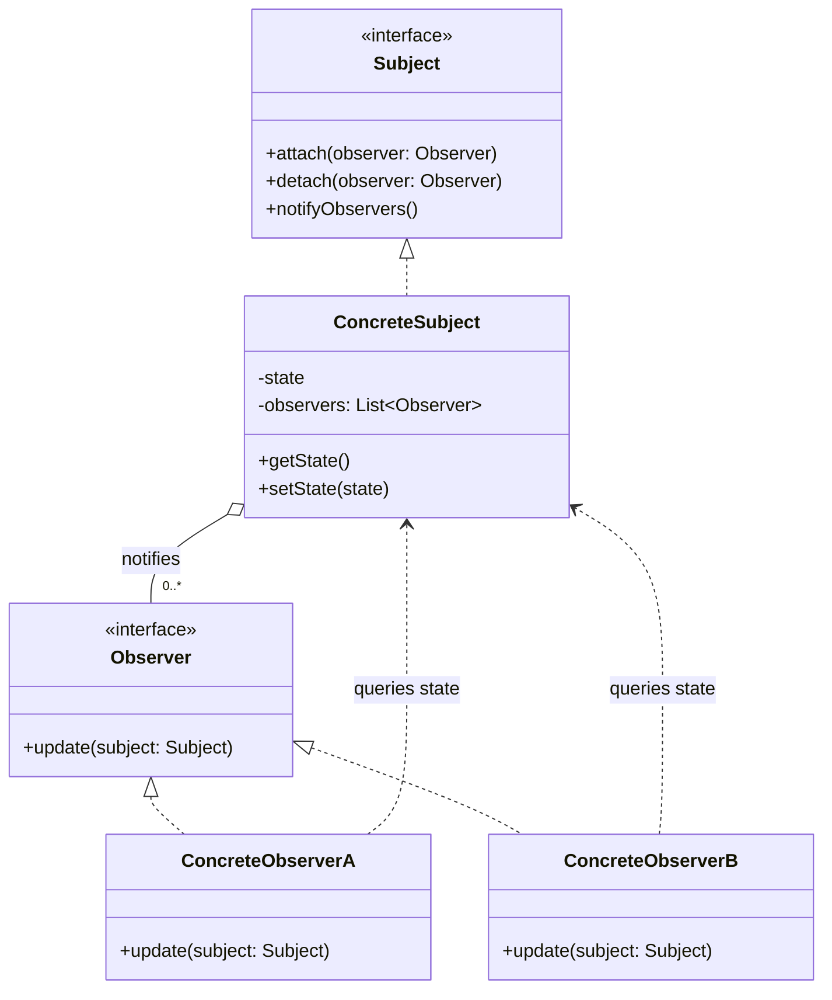

# Observer

## Description

Observer defines a one-to-many dependency between objects, so that when one object (the *subject*) changes state, all its dependents (the *observers*) are notified and updated automatically.

The subject keeps a list of registered observers and exposes operations to subscribe (`attach`) and unsubscribe (`detach`). When its state changes, it walks the list and calls a common method (`update`) on each observer. The subject only knows the `Observer` interface, not the concrete classes, which keeps coupling low.

Notification can follow the *push* model (the subject sends the changed data along with the notification) or *pull* (the observer receives only the notice and queries the subject to get what it needs). The pattern is the basis of event mechanisms, data binding, and reactive programming.

## Problems it solves

- Keeping several objects in sync with another object's state without coupling them to each other's concrete classes
- Avoiding polling: dependents don't need to repeatedly check whether something changed
- Allowing interested parties to be added to or removed from an event at runtime, without changing the emitter
- Separating the domain logic (model) from the presentation logic (views) that reacts to it

## When to use

- When a change in one object requires changing others and you don't know in advance how many or which ones
- When an object should notify others without making assumptions about who they are
- In event systems, graphical interfaces (MVC), news subscriptions, caches that need to be invalidated, etc.

## When to avoid

- When there's only one fixed, known dependent; a direct call is simpler
- When the notification order is critical and must be guaranteed
- When cascading update chains can create cycles or make the flow hard to trace
- When communication has to cross processes or services with delivery guarantees; prefer a message broker (publish/subscribe)

## Trade-offs

| Benefit | Cost / Risk |
| --- | --- |
| Low coupling between subject and observers | Implicit control flow, harder to debug |
| Observers can be added/removed at runtime (Open/Closed) | Notification order is generally not guaranteed |
| Natural support for event broadcast | Cascading updates can cause performance problems or loops |
| Independent reuse of subjects and observers | Memory leaks if observers aren't removed (*lapsed listener*) |

- **Coupling:** the subject depends only on the `Observer` interface.
- **Testability:** observers can easily be replaced by mocks; however, testing the full interaction requires verifying indirect effects.
- **Performance:** synchronous notifications block the subject until all observers finish; consider asynchronous notification when there are many observers or heavy processing.
- **Concurrency:** the observer list must be protected against modification during iteration.

## Diagram



The `ConcreteSubject` holds its state and the list of registered `Observer`s, notifying them on every change. The concrete observers implement `update` and, in the *pull* model, query the subject's state to react.

## Example

When a Pix is credited, the app must send a push, the merchant must receive a webhook and reconciliation must record the receipt, without the receipt service knowing about any of these channels.

<Tabs groupId="lang" queryString>
<TabItem value="java" label="Java">

```java
interface PixReceivedListener {
    void onPixReceived(String txid, long amountCents);
}

class PixReceiptService {
    private final List<PixReceivedListener> listeners = new ArrayList<>();

    void attach(PixReceivedListener l) { listeners.add(l); }
    void detach(PixReceivedListener l) { listeners.remove(l); }

    void receive(String txid, long amountCents) {
        // credits the account and notifies the interested parties
        listeners.forEach(l -> l.onPixReceived(txid, amountCents)); // push model: the data travels with the event
    }
}

class PushNotifier implements PixReceivedListener {
    public void onPixReceived(String txid, long amountCents) {
        System.out.printf("Push: Pix received: R$ %d.%02d%n", amountCents / 100, amountCents % 100);
    }
}

class MerchantWebhook implements PixReceivedListener {
    public void onPixReceived(String txid, long amountCents) {
        System.out.println("Webhook: pix.received " + txid);
    }
}

class ReconciliationRecorder implements PixReceivedListener {
    public void onPixReceived(String txid, long amountCents) {
        System.out.println("Reconciliation: " + txid + " = " + amountCents);
    }
}

PixReceiptService service = new PixReceiptService();
service.attach(new PushNotifier());
service.attach(new MerchantWebhook());
service.attach(new ReconciliationRecorder());
service.receive("txid-8f3a", 12_990);
```

</TabItem>
<TabItem value="python" label="Python">

```python
from typing import Protocol

class PixReceivedListener(Protocol):
    def on_pix_received(self, txid: str, amount_cents: int) -> None: ...

class PixReceiptService:
    def __init__(self) -> None:
        self._listeners: list[PixReceivedListener] = []

    def attach(self, listener: PixReceivedListener) -> None:
        self._listeners.append(listener)

    def detach(self, listener: PixReceivedListener) -> None:
        self._listeners.remove(listener)

    def receive(self, txid: str, amount_cents: int) -> None:
        # credits the account and notifies the interested parties
        for listener in self._listeners:
            listener.on_pix_received(txid, amount_cents)  # push model: the data travels with the event

class PushNotifier:
    def on_pix_received(self, txid: str, amount_cents: int) -> None:
        print(f"Push: Pix received: R$ {amount_cents // 100}.{amount_cents % 100:02d}")

class MerchantWebhook:
    def on_pix_received(self, txid: str, amount_cents: int) -> None:
        print(f"Webhook: pix.received {txid}")

class ReconciliationRecorder:
    def on_pix_received(self, txid: str, amount_cents: int) -> None:
        print(f"Reconciliation: {txid} = {amount_cents}")

service = PixReceiptService()
service.attach(PushNotifier())
service.attach(MerchantWebhook())
service.attach(ReconciliationRecorder())
service.receive("txid-8f3a", 12_990)
```

</TabItem>
<TabItem value="go" label="Go">

```go
type PixReceivedListener interface {
	OnPixReceived(txid string, amountCents int64)
}

type PixReceiptService struct {
	listeners []PixReceivedListener
}

func (s *PixReceiptService) Attach(l PixReceivedListener) { s.listeners = append(s.listeners, l) }

func (s *PixReceiptService) Detach(l PixReceivedListener) {
	s.listeners = slices.DeleteFunc(s.listeners, func(x PixReceivedListener) bool { return x == l })
}

func (s *PixReceiptService) Receive(txid string, amountCents int64) {
	// credits the account and notifies the interested parties
	for _, l := range s.listeners {
		l.OnPixReceived(txid, amountCents) // push model: the data travels with the event
	}
}

type PushNotifier struct{}

func (PushNotifier) OnPixReceived(txid string, amountCents int64) {
	fmt.Printf("Push: Pix received: R$ %d.%02d\n", amountCents/100, amountCents%100)
}

type MerchantWebhook struct{}

func (MerchantWebhook) OnPixReceived(txid string, amountCents int64) {
	fmt.Println("Webhook: pix.received", txid)
}

type ReconciliationRecorder struct{}

func (ReconciliationRecorder) OnPixReceived(txid string, amountCents int64) {
	fmt.Printf("Reconciliation: %s = %d\n", txid, amountCents)
}

func main() {
	service := &PixReceiptService{}
	service.Attach(PushNotifier{})
	service.Attach(MerchantWebhook{})
	service.Attach(ReconciliationRecorder{})
	service.Receive("txid-8f3a", 12_990)
}
```

</TabItem>
<TabItem value="typescript" label="TypeScript">

```typescript
interface PixReceivedListener {
  onPixReceived(txid: string, amountCents: number): void;
}

class PixReceiptService {
  private listeners: PixReceivedListener[] = [];

  attach(l: PixReceivedListener) { this.listeners.push(l); }
  detach(l: PixReceivedListener) { this.listeners = this.listeners.filter(x => x !== l); }

  receive(txid: string, amountCents: number) {
    // credits the account and notifies the interested parties
    this.listeners.forEach(l => l.onPixReceived(txid, amountCents)); // push model: the data travels with the event
  }
}

class PushNotifier implements PixReceivedListener {
  onPixReceived(txid: string, amountCents: number) {
    console.log(`Push: Pix received: R$ ${(amountCents / 100).toFixed(2)}`);
  }
}

class MerchantWebhook implements PixReceivedListener {
  onPixReceived(txid: string, amountCents: number) {
    console.log(`Webhook: pix.received ${txid}`);
  }
}

class ReconciliationRecorder implements PixReceivedListener {
  onPixReceived(txid: string, amountCents: number) {
    console.log(`Reconciliation: ${txid} = ${amountCents}`);
  }
}

const service = new PixReceiptService();
service.attach(new PushNotifier());
service.attach(new MerchantWebhook());
service.attach(new ReconciliationRecorder());
service.receive("txid-8f3a", 12_990);
```

</TabItem>
</Tabs>

## Related patterns

- [Mediator](/coding/gof/behavioral/mediator) — both decouple senders and receivers; Mediator centralizes communication, while Observer distributes it. A Mediator can be implemented with Observer.
- [Singleton](/coding/gof/creational/singleton) — a global event manager/subject is often implemented as a Singleton.
- [Command](/coding/gof/behavioral/command) — notifications can be encapsulated as commands, allowing them to be queued or undone.
- [Chain of Responsibility](/coding/gof/behavioral/chain-of-responsibility) — also connects senders and receivers, but passes the request sequentially until a handler takes it, instead of broadcasting it to all.

## Reference

- [Design Patterns Cheat Sheet](https://iretha.github.io/design-patterns/cheat-sheet)
- [Observer on Refactoring.Guru](https://refactoring.guru/design-patterns/observer)
