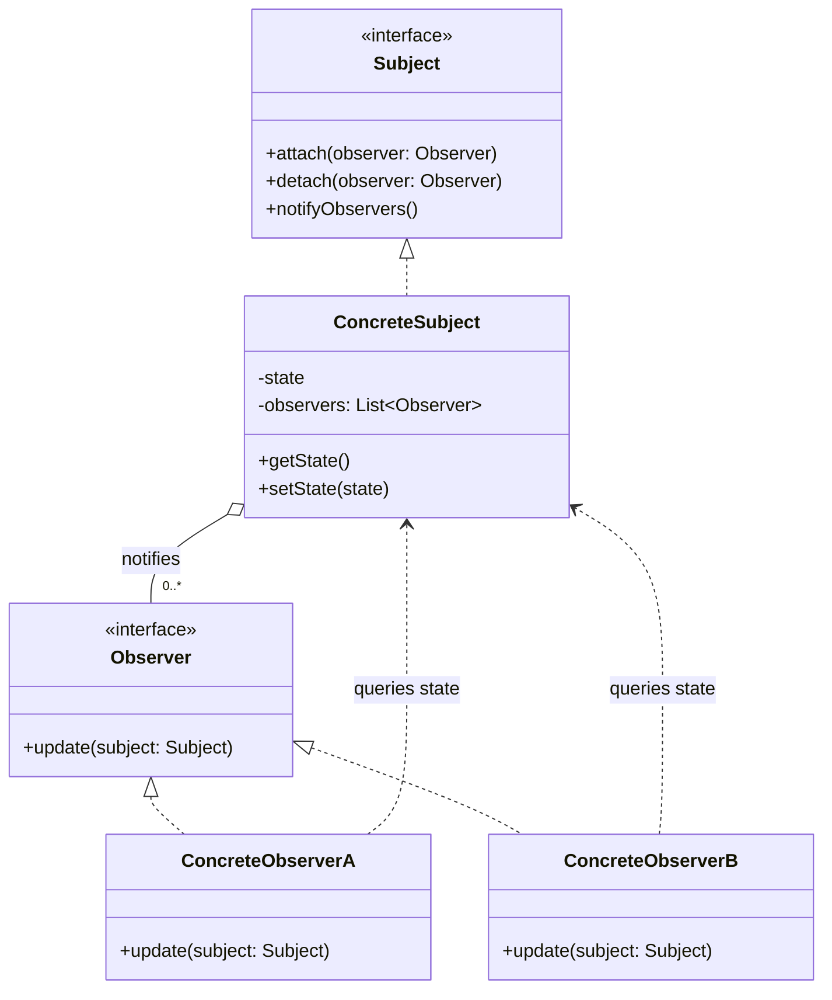

# Observer

## Description

Observer defines a one-to-many dependency between objects, so that when one object (the *subject*) changes state, all its dependents (the *observers*) are notified and updated automatically.

The subject keeps a list of registered observers and exposes operations to subscribe (`attach`) and unsubscribe (`detach`). When its state changes, it walks the list and calls a common method (`update`) on each observer. The subject only knows the `Observer` interface, not the concrete classes, which keeps coupling low.

Notification can follow the *push* model (the subject sends the changed data along with the notification) or *pull* (the observer receives only the notice and queries the subject to get what it needs). The pattern is the basis of event mechanisms, data binding, and reactive programming.

## Problems it solves

- Keeping several objects in sync with another object's state without coupling them to each other's concrete classes
- Avoiding polling: dependents don't need to repeatedly check whether something changed
- Allowing interested parties to be added to or removed from an event at runtime, without changing the emitter
- Separating the domain logic (model) from the presentation logic (views) that reacts to it

## When to use

- When a change in one object requires changing others and you don't know in advance how many or which ones
- When an object should notify others without making assumptions about who they are
- In event systems, graphical interfaces (MVC), news subscriptions, caches that need to be invalidated, etc.

## When to avoid

- When there's only one fixed, known dependent; a direct call is simpler
- When the notification order is critical and must be guaranteed
- When cascading update chains can create cycles or make the flow hard to trace
- When communication has to cross processes or services with delivery guarantees; prefer a message broker (publish/subscribe)

## Trade-offs

| Benefit | Cost / Risk |
| --- | --- |
| Low coupling between subject and observers | Implicit control flow, harder to debug |
| Observers can be added/removed at runtime (Open/Closed) | Notification order is generally not guaranteed |
| Natural support for event broadcast | Cascading updates can cause performance problems or loops |
| Independent reuse of subjects and observers | Memory leaks if observers aren't removed (*lapsed listener*) |

- **Coupling:** the subject depends only on the `Observer` interface.
- **Testability:** observers can easily be replaced by mocks; however, testing the full interaction requires verifying indirect effects.
- **Performance:** synchronous notifications block the subject until all observers finish; consider asynchronous notification when there are many observers or heavy processing.
- **Concurrency:** the observer list must be protected against modification during iteration.

## Diagram



The `ConcreteSubject` holds its state and the list of registered `Observer`s, notifying them on every change. The concrete observers implement `update` and, in the *pull* model, query the subject's state to react.

## Example

An online store needs to alert different channels (email and admin dashboard) when a product's stock changes, without the inventory class knowing about those channels.

```typescript
interface StockObserver {
  update(sku: string, quantity: number): void;
}

class Inventory {
  private observers: StockObserver[] = [];
  private stock = new Map<string, number>();

  attach(o: StockObserver) { this.observers.push(o); }
  detach(o: StockObserver) { this.observers = this.observers.filter(x => x !== o); }

  setQuantity(sku: string, quantity: number) {
    this.stock.set(sku, quantity);
    this.observers.forEach(o => o.update(sku, quantity)); // push
  }
}

class EmailAlert implements StockObserver {
  update(sku: string, quantity: number) {
    if (quantity === 0) console.log(`Email: ${sku} out of stock`);
  }
}

class AdminDashboard implements StockObserver {
  update(sku: string, quantity: number) {
    console.log(`Dashboard: ${sku} = ${quantity}`);
  }
}

const inventory = new Inventory();
inventory.attach(new EmailAlert());
inventory.attach(new AdminDashboard());
inventory.setQuantity("SKU-42", 0);
```

## Related patterns

- [Mediator](/coding/gof/behavioral/mediator) — both decouple senders and receivers; Mediator centralizes communication, while Observer distributes it. A Mediator can be implemented with Observer.
- [Singleton](/coding/gof/creational/singleton) — a global event manager/subject is often implemented as a Singleton.
- [Command](/coding/gof/behavioral/command) — notifications can be encapsulated as commands, allowing them to be queued or undone.
- [Chain of Responsibility](/coding/gof/behavioral/chain-of-responsibility) — also connects senders and receivers, but passes the request sequentially until a handler takes it, instead of broadcasting it to all.

## Reference

- [Design Patterns Cheat Sheet](https://iretha.github.io/design-patterns/cheat-sheet)
- [Observer on Refactoring.Guru](https://refactoring.guru/design-patterns/observer)
