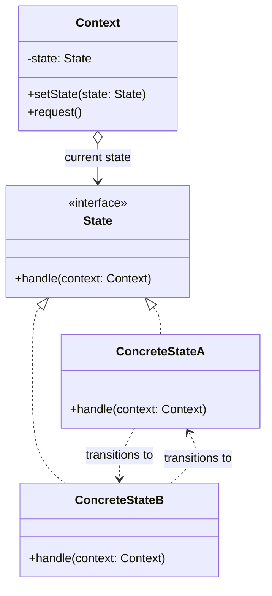

# State

## Description

State lets an object alter its behavior when its internal state changes, giving the impression that the object changed class. Instead of concentrating conditionals (`if`/`switch`) on a state variable in every method, each possible state is encapsulated in its own class that implements a common interface.

The main object, called the context (`Context`), keeps a reference to the current state and delegates state-dependent operations to it. Transitions happen by swapping that reference for another state instance, which can be done by the context itself or by the concrete states, which know which transitions are valid from them.

In practice, the pattern is an object-oriented way to implement a finite state machine: each state knows how to react to events and which state to move to next.

## Problems it solves

- Methods full of large conditionals that check the current state before deciding what to do
- Transition rules scattered across the code, making it hard to understand which state changes are allowed
- Difficulty adding new states without modifying many existing methods (an Open/Closed violation)
- Inconsistent behavior when an operation is called in a state where it shouldn't be allowed

## When to use

- An object's behavior depends heavily on its state and must change at runtime
- There are many states and well-defined transitions (orders, documents in a workflow, network connections, vending machines)
- The same conditionals on the state are repeated across several methods of the class
- New states tend to appear frequently and should be added in isolation

## When to avoid

- The object has few states or its behavior rarely changes; an `enum` with a simple `switch` is more readable
- Transitions are trivial and there's no state-specific behavior
- The flow is better described declaratively (transition table or a state machine library)

## Trade-offs

| Benefit | Cost / Risk |
| --- | --- |
| Eliminates lengthy conditionals on the state | Increases the number of classes |
| Each state is isolated and cohesive (Single Responsibility) | The overall view of the flow is spread across several classes |
| New states are added without changing the existing ones | States that know their successors become coupled to each other |
| Transitions are explicit and controlled | Overkill for small state machines |

- **Coupling:** if the concrete states decide the transitions, they know each other; centralizing transitions in the context reduces that coupling, but concentrates logic.
- **Testability:** each state can be tested in isolation, verifying the action and the resulting state.
- **Performance:** states with no attributes of their own can be shared (as Singletons or Flyweights), avoiding creating objects on every transition.

## Diagram



The `Context` delegates `request()` to the current `State`. Each `ConcreteState` implements that state's behavior and can call `setState()` on the context to trigger the transition to another state.

## Example

A Pix charge goes through the states "active", "paid", "expired" and "refunded"; the actions `pay()`, `expire()` and `refund()` are only valid in certain states: `pay()` only applies to an active charge and `refund()` only to a paid one.

<Tabs groupId="lang" queryString>
<TabItem value="java" label="Java">

```java
interface ChargeState {
    void pay(PixCharge charge);
    void expire(PixCharge charge);
    void refund(PixCharge charge);
}

class Active implements ChargeState {
    public void pay(PixCharge charge) { charge.setState(new Paid()); }
    public void expire(PixCharge charge) { charge.setState(new Expired()); }
    public void refund(PixCharge charge) { throw new IllegalStateException("An active charge cannot be refunded"); }
}

class Paid implements ChargeState {
    public void pay(PixCharge charge) { throw new IllegalStateException("Charge has already been paid"); }
    public void expire(PixCharge charge) { throw new IllegalStateException("A paid charge does not expire"); }
    public void refund(PixCharge charge) { charge.setState(new Refunded()); }
}

class Expired implements ChargeState {
    public void pay(PixCharge charge) { throw new IllegalStateException("Charge has expired"); }
    public void expire(PixCharge charge) { throw new IllegalStateException("Charge has expired"); }
    public void refund(PixCharge charge) { throw new IllegalStateException("Charge has expired"); }
}

class Refunded implements ChargeState {
    public void pay(PixCharge charge) { throw new IllegalStateException("Charge has already been refunded"); }
    public void expire(PixCharge charge) { throw new IllegalStateException("Charge has already been refunded"); }
    public void refund(PixCharge charge) { throw new IllegalStateException("Charge has already been refunded"); }
}

class PixCharge {
    private ChargeState state = new Active();

    void setState(ChargeState state) { this.state = state; }
    void pay() { state.pay(this); }
    void expire() { state.expire(this); }
    void refund() { state.refund(this); }
}
```

</TabItem>
<TabItem value="python" label="Python">

```python
from __future__ import annotations

from typing import Protocol

class InvalidTransition(Exception):
    pass

class ChargeState(Protocol):
    def pay(self, charge: PixCharge) -> None: ...
    def expire(self, charge: PixCharge) -> None: ...
    def refund(self, charge: PixCharge) -> None: ...

class Active:
    def pay(self, charge: PixCharge) -> None:
        charge.state = Paid()

    def expire(self, charge: PixCharge) -> None:
        charge.state = Expired()

    def refund(self, charge: PixCharge) -> None:
        raise InvalidTransition("An active charge cannot be refunded")

class Paid:
    def pay(self, charge: PixCharge) -> None:
        raise InvalidTransition("Charge has already been paid")

    def expire(self, charge: PixCharge) -> None:
        raise InvalidTransition("A paid charge does not expire")

    def refund(self, charge: PixCharge) -> None:
        charge.state = Refunded()

class Expired:
    def pay(self, charge: PixCharge) -> None:
        raise InvalidTransition("Charge has expired")

    expire = refund = pay  # every action fails the same way

class Refunded:
    def pay(self, charge: PixCharge) -> None:
        raise InvalidTransition("Charge has already been refunded")

    expire = refund = pay  # every action fails the same way

class PixCharge:
    def __init__(self) -> None:
        self.state: ChargeState = Active()

    def pay(self) -> None:
        self.state.pay(self)

    def expire(self) -> None:
        self.state.expire(self)

    def refund(self) -> None:
        self.state.refund(self)
```

</TabItem>
<TabItem value="go" label="Go">

```go
type ChargeState interface {
	Pay(charge *PixCharge) error
	Expire(charge *PixCharge) error
	Refund(charge *PixCharge) error
}

type Active struct{}

func (Active) Pay(charge *PixCharge) error    { charge.state = Paid{}; return nil }
func (Active) Expire(charge *PixCharge) error { charge.state = Expired{}; return nil }
func (Active) Refund(*PixCharge) error        { return errors.New("an active charge cannot be refunded") }

type Paid struct{}

func (Paid) Pay(*PixCharge) error           { return errors.New("charge has already been paid") }
func (Paid) Expire(*PixCharge) error        { return errors.New("a paid charge does not expire") }
func (Paid) Refund(charge *PixCharge) error { charge.state = Refunded{}; return nil }

type Expired struct{}

func (Expired) Pay(*PixCharge) error    { return errors.New("charge has expired") }
func (Expired) Expire(*PixCharge) error { return errors.New("charge has expired") }
func (Expired) Refund(*PixCharge) error { return errors.New("charge has expired") }

type Refunded struct{}

func (Refunded) Pay(*PixCharge) error    { return errors.New("charge has already been refunded") }
func (Refunded) Expire(*PixCharge) error { return errors.New("charge has already been refunded") }
func (Refunded) Refund(*PixCharge) error { return errors.New("charge has already been refunded") }

type PixCharge struct {
	state ChargeState
}

func NewPixCharge() *PixCharge { return &PixCharge{state: Active{}} }

func (c *PixCharge) Pay() error    { return c.state.Pay(c) }
func (c *PixCharge) Expire() error { return c.state.Expire(c) }
func (c *PixCharge) Refund() error { return c.state.Refund(c) }
```

</TabItem>
<TabItem value="typescript" label="TypeScript">

```typescript
interface ChargeState {
  pay(charge: PixCharge): void;
  expire(charge: PixCharge): void;
  refund(charge: PixCharge): void;
}

class Active implements ChargeState {
  pay(charge: PixCharge) { charge.setState(new Paid()); }
  expire(charge: PixCharge) { charge.setState(new Expired()); }
  refund(_: PixCharge) { throw new Error("An active charge cannot be refunded"); }
}

class Paid implements ChargeState {
  pay(_: PixCharge) { throw new Error("Charge has already been paid"); }
  expire(_: PixCharge) { throw new Error("A paid charge does not expire"); }
  refund(charge: PixCharge) { charge.setState(new Refunded()); }
}

class Expired implements ChargeState {
  pay(_: PixCharge) { throw new Error("Charge has expired"); }
  expire(_: PixCharge) { throw new Error("Charge has expired"); }
  refund(_: PixCharge) { throw new Error("Charge has expired"); }
}

class Refunded implements ChargeState {
  pay(_: PixCharge) { throw new Error("Charge has already been refunded"); }
  expire(_: PixCharge) { throw new Error("Charge has already been refunded"); }
  refund(_: PixCharge) { throw new Error("Charge has already been refunded"); }
}

class PixCharge {
  private state: ChargeState = new Active();
  setState(state: ChargeState) { this.state = state; }
  pay() { this.state.pay(this); }
  expire() { this.state.expire(this); }
  refund() { this.state.refund(this); }
}
```

</TabItem>
</Tabs>

## Related patterns

- [Strategy](/coding/gof/behavioral/strategy) — has an almost identical structure (a context delegating to an interchangeable object), but the intent differs: in Strategy the client chooses the algorithm and the strategies are independent and don't know each other; in State the swap is driven by the object itself according to its internal state, and the states usually know about and trigger the transitions between themselves.
- [Singleton](/coding/gof/creational/singleton) — states with no data of their own can be shared single instances.
- [Flyweight](/coding/gof/structural/flyweight) — allows sharing state objects among several contexts, keeping the specific data in the context.
- [Memento](/coding/gof/behavioral/memento) — can capture and restore an object's state, for example to undo transitions.
- [Bridge](/coding/gof/structural/bridge) — is also based on composition and delegation to a hierarchy of implementations, but with a structural focus, not on transitions.

## Reference

- [Design Patterns Cheat Sheet](https://iretha.github.io/design-patterns/cheat-sheet)
- [State on Refactoring.Guru](https://refactoring.guru/design-patterns/state)
