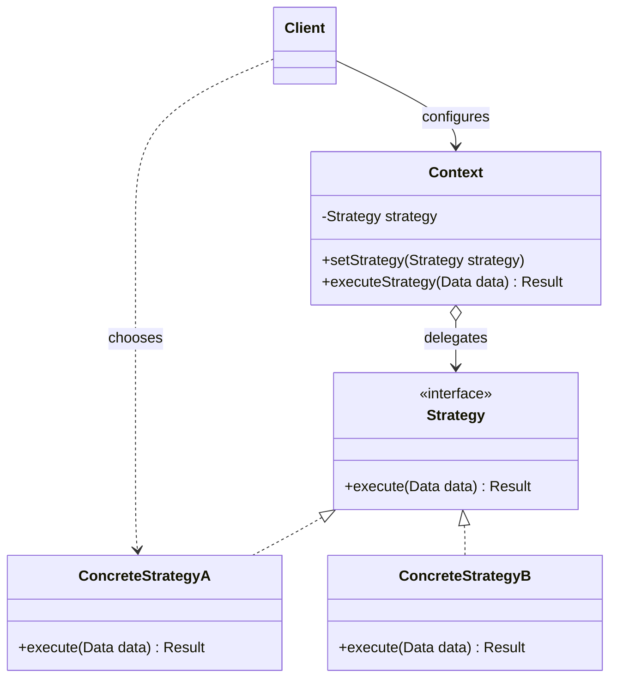

# Strategy

## Description

Strategy (also known as Policy) defines a family of algorithms, encapsulates each one in its own object, and makes them interchangeable. This way, the algorithm can vary independently of the clients that use it.

The object that uses the algorithm, called the context (`Context`), holds a reference to a `Strategy` interface and delegates the work to it, without knowing the concrete implementation. Each `ConcreteStrategy` implements the same interface with a variation of the behavior (for example, different ways to calculate shipping, sort data, or compress files).

The strategy is normally chosen by the client and injected into the context — via constructor or setter — and can be swapped at runtime. This replaces scattered conditionals with composition, keeping each algorithm isolated, testable, and extensible without changing the context.

## Problems it solves

- Classes with long `if/else` or `switch` blocks that select among variations of the same algorithm
- The need to change an object's behavior at runtime (by configuration, user profile, or context)
- A proliferation of subclasses that differ only in how they perform one operation
- Algorithms with implementation details (data structures, dependencies) that shouldn't leak to the client

## When to use

- There are several related classes that differ only in behavior
- You need different variants of an algorithm (for example, with distinct memory and time trade-offs)
- The algorithm must be selected or replaced dynamically, including through dependency injection
- Variable business rules, such as pricing policies, discounts, tax calculation, retry/backoff, or load balancing

### When to avoid

- There are only one or two stable algorithms that rarely change — a simple conditional is more readable
- Clients shouldn't need to know the differences between strategies in order to pick one
- The language offers first-class functions and a lambda solves the problem without the ceremony of classes and interfaces
- The strategies would need very different interfaces, forcing parameters that some implementations ignore

## Trade-offs

| Benefit | Cost / Risk |
| --- | --- |
| Eliminates conditionals and follows the Open/Closed Principle | Increases the number of classes/objects in the system |
| Algorithms are interchangeable at runtime | The client needs to know the available strategies to pick the right one |
| Each algorithm is isolated and individually testable | Communication overhead: the common interface may pass data that some strategies don't use |
| Composition instead of inheritance | Extra indirection can make the flow harder to read in simple cases |

- **Coupling:** the context depends only on the `Strategy` abstraction; the concrete implementations stay isolated.
- **Testability:** the context can be tested with a fake strategy, and each strategy can be tested without the context.
- **Complexity:** strategy selection usually lives in a factory, a registry map, or the DI container configuration.
- **Performance:** stateless strategies can be shared (including as Flyweights) to avoid repeated allocations.

## Diagram



The `Client` chooses a `ConcreteStrategy` and hands it to the `Context`, which keeps a reference to the `Strategy` interface and delegates the execution of the algorithm to it. New strategies can be added by implementing the interface, without changing the `Context`.

## Example

An e-commerce store calculates shipping according to the option the customer chose at checkout: standard, express, or store pickup.

```typescript
interface ShippingStrategy {
  calculate(weightKg: number): number;
}

class StandardShipping implements ShippingStrategy {
  calculate(weightKg: number): number {
    return 10 + weightKg * 2;
  }
}

class ExpressShipping implements ShippingStrategy {
  calculate(weightKg: number): number {
    return 25 + weightKg * 4;
  }
}

class StorePickup implements ShippingStrategy {
  calculate(): number {
    return 0;
  }
}

class Checkout {
  constructor(private shipping: ShippingStrategy) {}

  setShipping(shipping: ShippingStrategy): void {
    this.shipping = shipping;
  }

  total(subtotal: number, weightKg: number): number {
    return subtotal + this.shipping.calculate(weightKg);
  }
}

const checkout = new Checkout(new StandardShipping());
console.log(checkout.total(100, 3)); // 116
checkout.setShipping(new ExpressShipping());
console.log(checkout.total(100, 3)); // 137
```

## Related patterns

- [State](/coding/gof/behavioral/state) — almost identical structure, but in State the states swap themselves according to the lifecycle, while in Strategy the choice usually comes from the client
- [Template Method](/coding/gof/behavioral/template-method) — varies parts of an algorithm through inheritance, while Strategy varies the whole algorithm through composition
- [Decorator](/coding/gof/structural/decorator) — Decorator changes an object's "skin"; Strategy changes its "guts"
- [Bridge](/coding/gof/structural/bridge) — similar structure of delegating to an implementation, but aimed at separating abstraction and implementation into independent hierarchies
- [Command](/coding/gof/behavioral/command) — both encapsulate behavior in objects; Command represents an action to perform, Strategy a way of doing something
- [Flyweight](/coding/gof/structural/flyweight) — stateless strategies can be shared as flyweights
- [Factory Method](/coding/gof/creational/factory-method) — often used to create the appropriate strategy from configuration or user input
- [Null Object](/coding/gof/behavioral/null-object) — can act as a default strategy that does nothing, avoiding null checks in the context

## Reference

- [Design Patterns Cheat Sheet](https://iretha.github.io/design-patterns/cheat-sheet)
- [Strategy on Refactoring.Guru](https://refactoring.guru/design-patterns/strategy)
