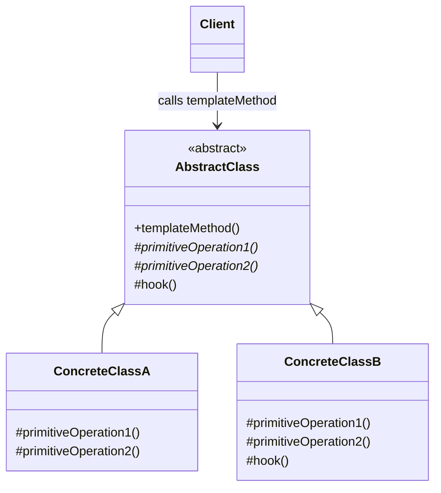

# Template Method

## Description

Template Method defines the skeleton of an algorithm in an operation of a base class, deferring some steps to subclasses. Subclasses can redefine certain steps of the algorithm without changing its overall structure.

The abstract class exposes a "template" method (usually not overridable) that calls a sequence of operations in a fixed order. Some of these operations are abstract (mandatory steps that each subclass must implement), others have a default implementation, and others are *hooks*: optional extension points, normally empty, that the subclass can override if it wants to.

Control of the flow stays in the base class, applying the so-called "Hollywood Principle" (*don't call us, we'll call you*): the superclass calls the subclasses' methods, not the other way around.

## Problems it solves

- Code duplication in classes that run nearly identical algorithms, differing only in a few steps
- The lack of a single point to control the order and invariants of a process (validation, logging, transactions)
- The need to allow controlled extension of a framework without exposing or allowing changes to the entire flow

## When to use

- When several classes share the same algorithm structure and only vary in the details of some steps
- When you want to fix the invariant parts of an algorithm once and leave the variable parts to the subclasses
- In frameworks and libraries that offer well-defined extension points (hooks) to client code
- When refactoring duplicated code in subclasses, promoting the common behavior to the superclass

## When to avoid

- When the variable steps need to be swapped at runtime — prefer Strategy (composition)
- When the algorithm has many customizable steps, producing large hierarchies that are hard to understand
- In languages or contexts where inheritance is discouraged or the hierarchy is already deep
- When subclasses would have to violate the base contract (breaking the Liskov Substitution Principle)

## Trade-offs

| Benefit | Cost / Risk |
| --- | --- |
| Eliminates duplication, centralizing the common flow in the base class | Strong coupling through inheritance between base and subclasses |
| Guarantees the algorithm's order and invariants | The flow is fragmented across classes, making it harder to read |
| Controlled extension through abstract steps and hooks | Variation is fixed at compile time; it can't be swapped at runtime |
| Makes it easier to build reusable frameworks | Changes to the base class can affect all subclasses (fragile base class) |

- **Coupling:** subclasses depend on details of the superclass; document well which methods can be overridden.
- **Testability:** the template can be tested with simple test subclasses, but the individual steps aren't always easy to test.
- **Complexity:** keep the number of abstract steps small; prefer hooks with a default implementation.
- **Contract safety:** mark the template method as `final` (or equivalent) to keep subclasses from changing the structure.

## Diagram



`AbstractClass` defines the `templateMethod`, which invokes the primitive (abstract) operations and the (optional) `hook` in a fixed order. `ConcreteClassA` and `ConcreteClassB` implement the variable steps, and the `Client` interacts only with the template method.

## Example

Processing a bank return file always follows the same flow: read, convert into records, validate and settle the paid boletos. Only reading and conversion change between CNAB 240 and CNAB 400 (Abstract Factory uses the same CNAB files but varies the layout by partner bank; here the focus is the return-processing flow).

<Tabs groupId="lang" queryString>
<TabItem value="java" label="Java">

```java
public abstract class RetornoProcessor {
    // Template method: fixed structure of the flow
    public final void process(String path) throws IOException {
        String raw = read(path);
        List<PaymentRecord> records = parse(raw);
        validate(records);
        beforeSettle(records); // optional hook
        settle(records);
    }

    protected abstract String read(String path) throws IOException;
    protected abstract List<PaymentRecord> parse(String raw);

    protected void validate(List<PaymentRecord> records) {
        records.removeIf(r -> !r.isValid());
    }

    protected void beforeSettle(List<PaymentRecord> records) { } // hook

    private void settle(List<PaymentRecord> records) { /* settles the paid boletos */ }
}

public class Cnab240Processor extends RetornoProcessor {
    protected String read(String path) throws IOException { return Files.readString(Path.of(path)); }
    protected List<PaymentRecord> parse(String raw) { return Cnab240Parser.parse(raw); }
}

public class Cnab400Processor extends RetornoProcessor {
    protected String read(String path) throws IOException {
        return Files.readString(Path.of(path), StandardCharsets.ISO_8859_1);
    }
    protected List<PaymentRecord> parse(String raw) { return Cnab400Parser.parse(raw); }
    @Override
    protected void beforeSettle(List<PaymentRecord> records) { records.forEach(PaymentRecord::normalize); }
}
```

</TabItem>
<TabItem value="python" label="Python">

```python
from abc import ABC, abstractmethod
from pathlib import Path

class RetornoProcessor(ABC):
    def process(self, path: str) -> None:
        """Template method: fixed structure of the flow."""
        raw = self._read(path)
        records = self._parse(raw)
        records = self._validate(records)
        self._before_settle(records)  # optional hook
        self._settle(records)

    @abstractmethod
    def _read(self, path: str) -> str: ...

    @abstractmethod
    def _parse(self, raw: str) -> list[PaymentRecord]: ...

    def _validate(self, records: list[PaymentRecord]) -> list[PaymentRecord]:
        return [r for r in records if r.is_valid()]

    def _before_settle(self, records: list[PaymentRecord]) -> None:  # hook
        pass

    def _settle(self, records: list[PaymentRecord]) -> None:
        ...  # settles the paid boletos

class Cnab240Processor(RetornoProcessor):
    def _read(self, path: str) -> str:
        return Path(path).read_text(encoding="utf-8")

    def _parse(self, raw: str) -> list[PaymentRecord]:
        return Cnab240Parser.parse(raw)

class Cnab400Processor(RetornoProcessor):
    def _read(self, path: str) -> str:
        return Path(path).read_text(encoding="iso-8859-1")

    def _parse(self, raw: str) -> list[PaymentRecord]:
        return Cnab400Parser.parse(raw)

    def _before_settle(self, records: list[PaymentRecord]) -> None:
        for record in records:
            record.normalize()
```

</TabItem>
<TabItem value="go" label="Go">

```go
// Go has no inheritance: the fixed flow is a function, and the steps that vary come from an interface.
type RetornoFormat interface {
	Read(path string) (string, error)
	Parse(raw string) []PaymentRecord
}

// Optional hook: only the formats that need it implement this interface.
type BeforeSettler interface {
	BeforeSettle(records []PaymentRecord)
}

// Template method: fixed structure of the flow
func ProcessRetorno(format RetornoFormat, path string) error {
	raw, err := format.Read(path)
	if err != nil {
		return err
	}
	records := validate(format.Parse(raw))
	if hook, ok := format.(BeforeSettler); ok {
		hook.BeforeSettle(records) // optional hook
	}
	settle(records)
	return nil
}

func validate(records []PaymentRecord) []PaymentRecord {
	return slices.DeleteFunc(records, func(r PaymentRecord) bool { return !r.IsValid() })
}

func settle(records []PaymentRecord) { /* settles the paid boletos */ }

type Cnab240 struct{}

func (Cnab240) Read(path string) (string, error) {
	data, err := os.ReadFile(path)
	return string(data), err
}

func (Cnab240) Parse(raw string) []PaymentRecord { return parseCnab240(raw) }

type Cnab400 struct{}

func (Cnab400) Read(path string) (string, error) {
	data, err := os.ReadFile(path)
	runes := make([]rune, len(data)) // ISO-8859-1: each byte is a code point
	for i, b := range data {
		runes[i] = rune(b)
	}
	return string(runes), err
}

func (Cnab400) Parse(raw string) []PaymentRecord { return parseCnab400(raw) }

func (Cnab400) BeforeSettle(records []PaymentRecord) {
	for i := range records {
		records[i].Normalize()
	}
}
```

</TabItem>
</Tabs>

## Related patterns

- [Strategy](/coding/gof/behavioral/strategy) — a composition-based alternative: it varies the whole algorithm at runtime, while Template Method varies parts of it through inheritance
- [Factory Method](/coding/gof/creational/factory-method) — is often a specialized step called from inside a template method
- [State](/coding/gof/behavioral/state) — also delegates behavior, but through composition and with dynamic state switching
- [Command](/coding/gof/behavioral/command) — commands can use a template method to standardize steps such as validation, execution, and auditing
- [Null Object](/coding/gof/behavioral/null-object) — empty hooks with a default implementation follow the same idea of neutral behavior

## Reference

- [Design Patterns Cheat Sheet](https://iretha.github.io/design-patterns/cheat-sheet)
- [Template Method on Refactoring.Guru](https://refactoring.guru/design-patterns/template-method)
