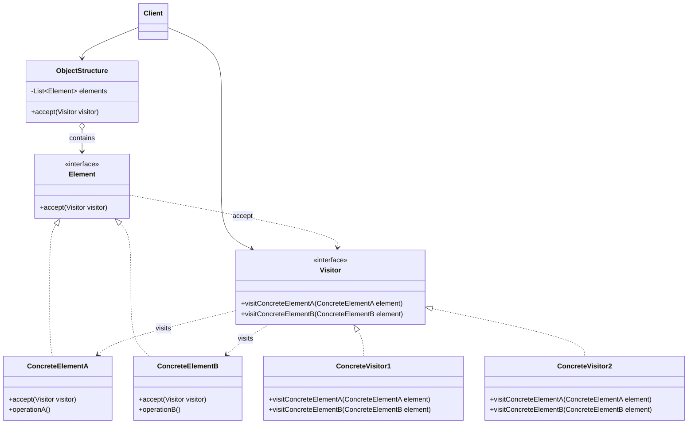

# Visitor

## Description

Visitor represents an operation to be performed on the elements of an object structure. It lets you define new operations without changing the classes of the elements they operate on, by moving each operation into a separate object, the visitor.

Each element in the structure exposes an `accept(visitor)` method, which simply calls back the visitor's method corresponding to its concrete type (for example, `visitor.visitCdb(this)`). This technique, called *double dispatch*, makes the code that runs depend on both the type of the visitor and the type of the element, without `instanceof` or a `switch` on types.

So each new operation becomes a new `ConcreteVisitor` class that gathers, in one place, the behavior for all element types. The pattern is especially useful in stable hierarchies, such as syntax trees (AST), documents, and domain models, on which many different operations are applied.

## Problems it solves

- The need to add new operations (export, validation, calculation, rendering) to a class hierarchy without modifying it for every new feature
- The logic of a single operation spread across several element classes, making it hard to understand and maintain
- `if/else` or `switch` chains with type checks (`instanceof`) to decide what to do with each element
- Domain classes polluted with responsibilities unrelated to their main purpose
- Accumulating state while traversing a heterogeneous structure (for example, summing totals or collecting metrics from a tree)

## When to use

- The object structure contains classes with different interfaces and you need to perform operations that depend on the concrete type of each one
- Many distinct, unrelated operations need to be applied to the structure and you don't want to pollute the classes with them
- The element hierarchy rarely changes, but new operations are added frequently
- Compilers, interpreters, and analysis tools that traverse syntax trees (type checking, optimization, code generation, pretty printing)

## When to avoid

- The element hierarchy changes frequently: each new type requires a new method in every visitor
- There are few operations and they naturally belong to the elements themselves
- The operation needs access to the elements' private internal state, which would force you to break encapsulation
- The language offers exhaustive pattern matching over sealed types (sealed classes, union types), which solves the same problem with less ceremony

## Trade-offs

| Benefit | Cost / Risk |
| --- | --- |
| New operations without changing the element classes (Open/Closed for operations) | Adding a new element type requires changing the `Visitor` interface and all concrete visitors |
| Related behavior concentrated in a single visitor (SRP) | May force elements to expose internal state through public methods |
| A visitor can accumulate state while traversing the structure | Double dispatch and callbacks make the flow less intuitive |
| Eliminates type checks and `switch` on classes | Cyclic coupling between `Visitor` and the element hierarchy |

- **Coupling:** visitors know all the concrete element types; elements only know the `Visitor` interface.
- **Testability:** each operation can be tested in isolation by applying the visitor to small, controlled structures.
- **Complexity:** the responsibility for traversing the structure (in the element, in the visitor, or in an Iterator) must be decided and kept consistent.
- **Extensibility:** the pattern flips the axis of extension: it makes new operations easy and new types hard (the so-called *expression problem*).

## Diagram



The `Client` applies a `ConcreteVisitor` to the `ObjectStructure`, which hands the visitor to each `Element`. Each `ConcreteElement` implements `accept` by calling the `visit` method corresponding to its type, so the operation that runs depends on the visitor/element pair (double dispatch).

## Example

The investment portfolio has stable asset types (`Cdb`, `Stock` and `FundShare`; the same portfolio that Composite organizes into sub-portfolios), and new operations show up often: computing the tax due, generating the income report. Each operation is a visitor, with no changes to the asset classes. The tax rates in the example are illustrative.

<Tabs groupId="lang" queryString>
<TabItem value="java" label="Java">

```java
interface AssetVisitor<R> {
    R visitCdb(Cdb cdb);
    R visitStock(Stock stock);
    R visitFundShare(FundShare share);
}

interface Asset { <R> R accept(AssetVisitor<R> v); }

record Cdb(String issuer, long gainCents) implements Asset {
    public <R> R accept(AssetVisitor<R> v) { return v.visitCdb(this); }
}

record Stock(String symbol, long gainCents) implements Asset {
    public <R> R accept(AssetVisitor<R> v) { return v.visitStock(this); }
}

record FundShare(String fund, long gainCents) implements Asset {
    public <R> R accept(AssetVisitor<R> v) { return v.visitFundShare(this); }
}

// illustrative rates, not an actual tax rule
class TaxCalculator implements AssetVisitor<Long> {
    public Long visitCdb(Cdb cdb) { return Math.round(cdb.gainCents() * 0.15); }
    public Long visitStock(Stock stock) { return Math.round(stock.gainCents() * 0.15); }
    public Long visitFundShare(FundShare share) { return Math.round(share.gainCents() * 0.20); }
}

class IncomeReportExporter implements AssetVisitor<String> {
    public String visitCdb(Cdb cdb) {
        return "{\"type\":\"cdb\",\"issuer\":\"%s\",\"gainCents\":%d}".formatted(cdb.issuer(), cdb.gainCents());
    }
    public String visitStock(Stock stock) {
        return "{\"type\":\"stock\",\"symbol\":\"%s\",\"gainCents\":%d}".formatted(stock.symbol(), stock.gainCents());
    }
    public String visitFundShare(FundShare share) {
        return "{\"type\":\"fund\",\"fund\":\"%s\",\"gainCents\":%d}".formatted(share.fund(), share.gainCents());
    }
}

List<Asset> assets = List.of(
    new Cdb("Banco Alfa", 100_000),
    new Stock("ACME3", 50_000),
    new FundShare("Fundo Beta", 200_000));
long totalTaxCents = assets.stream().mapToLong(a -> a.accept(new TaxCalculator())).sum();
System.out.println(totalTaxCents); // 62500
List<String> report = assets.stream().map(a -> a.accept(new IncomeReportExporter())).toList();
```

</TabItem>
<TabItem value="python" label="Python">

```python
import json
from dataclasses import dataclass

@dataclass(frozen=True)
class Cdb:
    issuer: str
    gain_cents: int

    def accept(self, visitor):
        return visitor.visit_cdb(self)

@dataclass(frozen=True)
class Stock:
    symbol: str
    gain_cents: int

    def accept(self, visitor):
        return visitor.visit_stock(self)

@dataclass(frozen=True)
class FundShare:
    fund: str
    gain_cents: int

    def accept(self, visitor):
        return visitor.visit_fund_share(self)

class TaxCalculator:
    """Illustrative rates, not an actual tax rule."""

    def visit_cdb(self, cdb: Cdb) -> int:
        return round(cdb.gain_cents * 0.15)

    def visit_stock(self, stock: Stock) -> int:
        return round(stock.gain_cents * 0.15)

    def visit_fund_share(self, share: FundShare) -> int:
        return round(share.gain_cents * 0.20)

class IncomeReportExporter:
    def visit_cdb(self, cdb: Cdb) -> str:
        return json.dumps({"type": "cdb", "issuer": cdb.issuer, "gainCents": cdb.gain_cents})

    def visit_stock(self, stock: Stock) -> str:
        return json.dumps({"type": "stock", "symbol": stock.symbol, "gainCents": stock.gain_cents})

    def visit_fund_share(self, share: FundShare) -> str:
        return json.dumps({"type": "fund", "fund": share.fund, "gainCents": share.gain_cents})

assets = [Cdb("Banco Alfa", 100_000), Stock("ACME3", 50_000), FundShare("Fundo Beta", 200_000)]
total_tax_cents = sum(a.accept(TaxCalculator()) for a in assets)
print(total_tax_cents)  # 62500
report = [a.accept(IncomeReportExporter()) for a in assets]
```

</TabItem>
<TabItem value="go" label="Go">

```go
// Go has no generic methods: the visitor accumulates the result instead of returning it.
type AssetVisitor interface {
	VisitCdb(cdb Cdb)
	VisitStock(stock Stock)
	VisitFundShare(share FundShare)
}

type Asset interface{ Accept(v AssetVisitor) }

type Cdb struct {
	Issuer    string
	GainCents int64
}

func (c Cdb) Accept(v AssetVisitor) { v.VisitCdb(c) }

type Stock struct {
	Symbol    string
	GainCents int64
}

func (s Stock) Accept(v AssetVisitor) { v.VisitStock(s) }

type FundShare struct {
	Fund      string
	GainCents int64
}

func (f FundShare) Accept(v AssetVisitor) { v.VisitFundShare(f) }

// illustrative rates, not an actual tax rule
type TaxCalculator struct{ TotalCents int64 }

func (t *TaxCalculator) add(gainCents int64, rate float64) {
	t.TotalCents += int64(math.Round(float64(gainCents) * rate))
}

func (t *TaxCalculator) VisitCdb(cdb Cdb)               { t.add(cdb.GainCents, 0.15) }
func (t *TaxCalculator) VisitStock(stock Stock)         { t.add(stock.GainCents, 0.15) }
func (t *TaxCalculator) VisitFundShare(share FundShare) { t.add(share.GainCents, 0.20) }

type IncomeReportExporter struct{ Lines []string }

func (e *IncomeReportExporter) add(kind, field, value string, gainCents int64) {
	e.Lines = append(e.Lines, fmt.Sprintf(`{"type":%q,%q:%q,"gainCents":%d}`, kind, field, value, gainCents))
}

func (e *IncomeReportExporter) VisitCdb(cdb Cdb) { e.add("cdb", "issuer", cdb.Issuer, cdb.GainCents) }
func (e *IncomeReportExporter) VisitStock(stock Stock) {
	e.add("stock", "symbol", stock.Symbol, stock.GainCents)
}
func (e *IncomeReportExporter) VisitFundShare(share FundShare) {
	e.add("fund", "fund", share.Fund, share.GainCents)
}

func main() {
	assets := []Asset{Cdb{"Banco Alfa", 100_000}, Stock{"ACME3", 50_000}, FundShare{"Fundo Beta", 200_000}}
	tax, report := &TaxCalculator{}, &IncomeReportExporter{}
	for _, asset := range assets {
		asset.Accept(tax)
		asset.Accept(report)
	}
	fmt.Println(tax.TotalCents) // 62500
}
```

</TabItem>
<TabItem value="typescript" label="TypeScript">

```typescript
interface AssetVisitor<R> {
  visitCdb(cdb: Cdb): R;
  visitStock(stock: Stock): R;
  visitFundShare(share: FundShare): R;
}

interface Asset { accept<R>(v: AssetVisitor<R>): R; }

class Cdb implements Asset {
  constructor(public issuer: string, public gainCents: number) {}
  accept<R>(v: AssetVisitor<R>): R { return v.visitCdb(this); }
}

class Stock implements Asset {
  constructor(public symbol: string, public gainCents: number) {}
  accept<R>(v: AssetVisitor<R>): R { return v.visitStock(this); }
}

class FundShare implements Asset {
  constructor(public fund: string, public gainCents: number) {}
  accept<R>(v: AssetVisitor<R>): R { return v.visitFundShare(this); }
}

// illustrative rates, not an actual tax rule
class TaxCalculator implements AssetVisitor<number> {
  visitCdb(cdb: Cdb) { return Math.round(cdb.gainCents * 0.15); }
  visitStock(stock: Stock) { return Math.round(stock.gainCents * 0.15); }
  visitFundShare(share: FundShare) { return Math.round(share.gainCents * 0.20); }
}

class IncomeReportExporter implements AssetVisitor<string> {
  visitCdb(cdb: Cdb) { return JSON.stringify({ type: "cdb", issuer: cdb.issuer, gainCents: cdb.gainCents }); }
  visitStock(stock: Stock) { return JSON.stringify({ type: "stock", symbol: stock.symbol, gainCents: stock.gainCents }); }
  visitFundShare(share: FundShare) { return JSON.stringify({ type: "fund", fund: share.fund, gainCents: share.gainCents }); }
}

const assets: Asset[] = [
  new Cdb("Banco Alfa", 100_000),
  new Stock("ACME3", 50_000),
  new FundShare("Fundo Beta", 200_000),
];
const totalTaxCents = assets.reduce((sum, a) => sum + a.accept(new TaxCalculator()), 0);
console.log(totalTaxCents); // 62500
const report = assets.map((a) => a.accept(new IncomeReportExporter()));
```

</TabItem>
</Tabs>

## Related patterns

- [Composite](/coding/gof/structural/composite) — Visitor is often applied to run operations over all the nodes of a Composite tree, such as the investment portfolio in the example
- [Iterator](/coding/gof/behavioral/iterator) — can be used to traverse the object structure while the Visitor performs the operation on each element
- [Interpreter](/coding/gof/behavioral/interpreter) — operations on Interpreter's abstract syntax tree (evaluation, printing, optimization) are usually implemented as visitors
- [Command](/coding/gof/behavioral/command) — both encapsulate operations in objects; Visitor can be seen as a powerful Command that acts on several element types
- [Strategy](/coding/gof/behavioral/strategy) — also extracts behavior into separate objects, but varies one algorithm for a single context, with no double dispatch

## Reference

- [Design Patterns Cheat Sheet](https://iretha.github.io/design-patterns/cheat-sheet)
- [Visitor on Refactoring.Guru](https://refactoring.guru/design-patterns/visitor)
