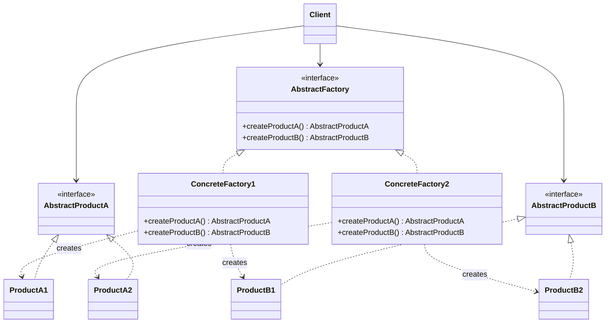

# Abstract Factory

## Description

Abstract Factory provides an interface for creating families of related or dependent objects without specifying their concrete classes. The client talks only to the abstract factory and to the abstract product interfaces, without knowing which implementation is behind them.

Each concrete factory implements the abstract factory interface and produces a coherent variant of every product in the family (for example, the remittance writer and the return parser in the CNAB layout of the same partner bank). Swapping the concrete factory, usually at a single configuration point, swaps the entire family at once.

In practice, the pattern works as a "factory of factories": it groups several related Factory Methods into a single object and ensures consistency among the products it creates.

## Problems it solves

- Client code becomes coupled to concrete classes when it instantiates objects with `new`, making it hard to swap implementations.
- Products from different families get mixed by mistake (for example, generating the remittance file in one bank's layout and reading the return file in another's).
- Supporting a new platform, theme, or vendor requires changing many places scattered across the code.

## When to use

- The system must be independent of how its products are created, composed, and represented.
- The system must be configured with one of several families of products (UI themes, database drivers, cloud providers).
- Related products are designed to be used together and that constraint must be enforced.
- You want to expose a library of products revealing only the interfaces, not the implementations.

## When to avoid

- There's only one product family or a single product; a Factory Method or direct construction is enough.
- New product types are added frequently: each new product requires changing the abstract factory interface and every concrete factory.
- The flexibility gained doesn't justify the extra interfaces and classes.

## Trade-offs

| Benefit | Cost / Risk |
| --- | --- |
| Isolates the client from concrete classes | Increases the number of interfaces and classes |
| Ensures consistency among products of the same family | Adding a new product type requires changing every factory |
| Makes it easy to swap the entire family at a single point | Extra indirection can make the creation flow harder to read |
| Supports the Open/Closed Principle for new families | Can become over-engineering in simple domains |

- **Coupling:** the client depends only on abstractions, which reduces coupling to implementations.
- **Testability:** it's simple to inject a fake factory that produces mocks or stubs.
- **Complexity:** the parallel hierarchy of factories and products grows quickly with the number of variants.
- **Performance:** negligible impact; creation goes through one additional polymorphic call.

## Diagram



The `Client` uses only `AbstractFactory` and the product interfaces. Each concrete factory (`ConcreteFactory1`, `ConcreteFactory2`) creates a coherent family of products (`ProductA1`/`ProductB1` or `ProductA2`/`ProductB2`).

## Example

The fintech exchanges billing files with several partner banks, and each bank has its own CNAB layout. The bank's factory is chosen once and hands out a remittance writer and a return parser that match each other; the rest of the code does not know the concrete classes.

```typescript
interface Boleto { ourNumber: string; amountCents: number; }
interface Settlement { ourNumber: string; paidCents: number; }

interface RemessaWriter { write(boletos: Boleto[]): string; }
interface RetornoParser { parse(file: string): Settlement[]; }

interface CnabFactory {
  createWriter(): RemessaWriter;
  createParser(): RetornoParser;
}

// Bank A: fields separated by ";" (simplified layout)
class BankARemessaWriter implements RemessaWriter {
  write(boletos: Boleto[]) {
    return boletos.map((b) => `A;${b.ourNumber};${b.amountCents}`).join("\n");
  }
}
class BankARetornoParser implements RetornoParser {
  parse(file: string) {
    return file.split("\n").map((line) => {
      const [, ourNumber, paid] = line.split(";");
      return { ourNumber, paidCents: Number(paid) };
    });
  }
}

// Bank B: fixed-width columns (simplified layout)
class BankBRemessaWriter implements RemessaWriter {
  write(boletos: Boleto[]) {
    return boletos
      .map((b) => `B${b.ourNumber.padStart(10, "0")}${String(b.amountCents).padStart(13, "0")}`)
      .join("\n");
  }
}
class BankBRetornoParser implements RetornoParser {
  parse(file: string) {
    return file.split("\n").map((line) => ({
      ourNumber: line.slice(1, 11),
      paidCents: Number(line.slice(11, 24)),
    }));
  }
}

class BankACnabFactory implements CnabFactory {
  createWriter() { return new BankARemessaWriter(); }
  createParser() { return new BankARetornoParser(); }
}

class BankBCnabFactory implements CnabFactory {
  createWriter() { return new BankBRemessaWriter(); }
  createParser() { return new BankBRetornoParser(); }
}

class BillingBatchService {
  private writer: RemessaWriter;
  private parser: RetornoParser;

  constructor(factory: CnabFactory) {
    this.writer = factory.createWriter();
    this.parser = factory.createParser();
  }

  generateRemessa(boletos: Boleto[]): string { return this.writer.write(boletos); }
  readRetorno(file: string): Settlement[] { return this.parser.parse(file); }
}

// The partner bank is chosen once; remittance and return always use the same layout
const service = new BillingBatchService(new BankBCnabFactory());
const remessa = service.generateRemessa([{ ourNumber: "42", amountCents: 15000 }]);
console.log(remessa); // B00000000420000000015000
console.log(service.readRetorno(remessa)); // [ { ourNumber: '0000000042', paidCents: 15000 } ]
```

## Related patterns

- [Factory Method](/coding/gof/creational/factory-method) — concrete factories are often implemented with Factory Methods.
- [Prototype](/coding/gof/creational/prototype) — an alternative for implementing concrete factories by cloning prototypes instead of instantiating subclasses.
- [Singleton](/coding/gof/creational/singleton) — usually one instance of each concrete factory is enough in the application.
- [Builder](/coding/gof/creational/builder) — focuses on building a complex object step by step, whereas Abstract Factory creates families of objects immediately.
- [Facade](/coding/gof/structural/facade) — an Abstract Factory can be used as an alternative to Facade to hide the creation of a subsystem's specific objects.
- [Bridge](/coding/gof/structural/bridge) — an Abstract Factory can create and configure a specific implementation of a Bridge.

## Reference

- [Design Patterns Cheat Sheet](https://iretha.github.io/design-patterns/cheat-sheet)
- [Abstract Factory on Refactoring.Guru](https://refactoring.guru/design-patterns/abstract-factory)
