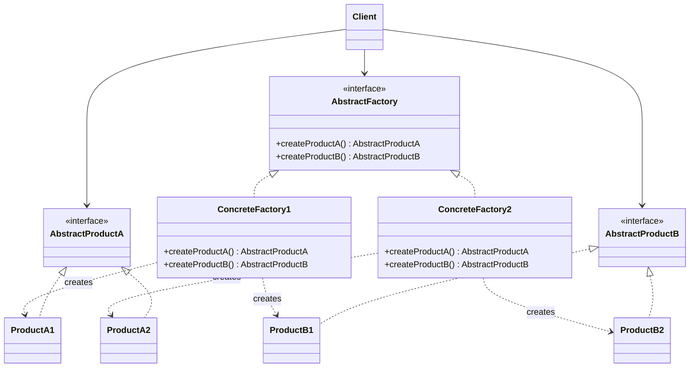

# Abstract Factory

## Description

Abstract Factory provides an interface for creating families of related or dependent objects without specifying their concrete classes. The client talks only to the abstract factory and to the abstract product interfaces, without knowing which implementation is behind them.

Each concrete factory implements the abstract factory interface and produces a coherent variant of every product in the family (for example, the remittance writer and the return parser in the CNAB layout of the same partner bank). Swapping the concrete factory, usually at a single configuration point, swaps the entire family at once.

In practice, the pattern works as a "factory of factories": it groups several related Factory Methods into a single object and ensures consistency among the products it creates.

## Problems it solves

- Client code becomes coupled to concrete classes when it instantiates objects with `new`, making it hard to swap implementations.
- Products from different families get mixed by mistake (for example, generating the remittance file in one bank's layout and reading the return file in another's).
- Supporting a new platform, theme, or vendor requires changing many places scattered across the code.

## When to use

- The system must be independent of how its products are created, composed, and represented.
- The system must be configured with one of several families of products (UI themes, database drivers, cloud providers).
- Related products are designed to be used together and that constraint must be enforced.
- You want to expose a library of products revealing only the interfaces, not the implementations.

## When to avoid

- There's only one product family or a single product; a Factory Method or direct construction is enough.
- New product types are added frequently: each new product requires changing the abstract factory interface and every concrete factory.
- The flexibility gained doesn't justify the extra interfaces and classes.

## Trade-offs

| Benefit | Cost / Risk |
| --- | --- |
| Isolates the client from concrete classes | Increases the number of interfaces and classes |
| Ensures consistency among products of the same family | Adding a new product type requires changing every factory |
| Makes it easy to swap the entire family at a single point | Extra indirection can make the creation flow harder to read |
| Supports the Open/Closed Principle for new families | Can become over-engineering in simple domains |

- **Coupling:** the client depends only on abstractions, which reduces coupling to implementations.
- **Testability:** it's simple to inject a fake factory that produces mocks or stubs.
- **Complexity:** the parallel hierarchy of factories and products grows quickly with the number of variants.
- **Performance:** negligible impact; creation goes through one additional polymorphic call.

## Diagram



The `Client` uses only `AbstractFactory` and the product interfaces. Each concrete factory (`ConcreteFactory1`, `ConcreteFactory2`) creates a coherent family of products (`ProductA1`/`ProductB1` or `ProductA2`/`ProductB2`).

## Example

The fintech exchanges billing files with several partner banks, and each bank has its own CNAB layout. The bank's factory is chosen once and hands out a remittance writer and a return parser that match each other; the rest of the code does not know the concrete classes.

<Tabs groupId="lang" queryString>
<TabItem value="java" label="Java">

```java
record Boleto(String ourNumber, long amountCents) {}
record Settlement(String ourNumber, long paidCents) {}

interface RemessaWriter { String write(List<Boleto> boletos); }
interface RetornoParser { List<Settlement> parse(String file); }

interface CnabFactory {
    RemessaWriter createWriter();
    RetornoParser createParser();
}

// Bank A: fields separated by ";" (simplified layout)
class BankARemessaWriter implements RemessaWriter {
    public String write(List<Boleto> boletos) {
        return boletos.stream()
                .map(b -> "A;" + b.ourNumber() + ";" + b.amountCents())
                .collect(Collectors.joining("\n"));
    }
}

class BankARetornoParser implements RetornoParser {
    public List<Settlement> parse(String file) {
        return file.lines().map(line -> {
            String[] fields = line.split(";");
            return new Settlement(fields[1], Long.parseLong(fields[2]));
        }).toList();
    }
}

// Bank B: fixed-width columns (simplified layout)
class BankBRemessaWriter implements RemessaWriter {
    public String write(List<Boleto> boletos) {
        return boletos.stream()
                .map(b -> String.format("B%10s%013d", b.ourNumber(), b.amountCents()).replace(' ', '0'))
                .collect(Collectors.joining("\n"));
    }
}

class BankBRetornoParser implements RetornoParser {
    public List<Settlement> parse(String file) {
        return file.lines()
                .map(line -> new Settlement(line.substring(1, 11), Long.parseLong(line.substring(11, 24))))
                .toList();
    }
}

class BankACnabFactory implements CnabFactory {
    public RemessaWriter createWriter() { return new BankARemessaWriter(); }
    public RetornoParser createParser() { return new BankARetornoParser(); }
}

class BankBCnabFactory implements CnabFactory {
    public RemessaWriter createWriter() { return new BankBRemessaWriter(); }
    public RetornoParser createParser() { return new BankBRetornoParser(); }
}

class BillingBatchService {
    private final RemessaWriter writer;
    private final RetornoParser parser;

    BillingBatchService(CnabFactory factory) {
        writer = factory.createWriter();
        parser = factory.createParser();
    }

    String generateRemessa(List<Boleto> boletos) { return writer.write(boletos); }
    List<Settlement> readRetorno(String file) { return parser.parse(file); }
}

// The partner bank is chosen once; remittance and return always use the same layout
BillingBatchService service = new BillingBatchService(new BankBCnabFactory());
String remessa = service.generateRemessa(List.of(new Boleto("42", 15000)));
System.out.println(remessa); // B00000000420000000015000
System.out.println(service.readRetorno(remessa)); // [Settlement[ourNumber=0000000042, paidCents=15000]]
```

</TabItem>
<TabItem value="python" label="Python">

```python
from dataclasses import dataclass
from typing import Protocol

@dataclass(frozen=True)
class Boleto:
    our_number: str
    amount_cents: int

@dataclass(frozen=True)
class Settlement:
    our_number: str
    paid_cents: int

class RemessaWriter(Protocol):
    def write(self, boletos: list[Boleto]) -> str: ...

class RetornoParser(Protocol):
    def parse(self, file: str) -> list[Settlement]: ...

class CnabFactory(Protocol):
    def create_writer(self) -> RemessaWriter: ...
    def create_parser(self) -> RetornoParser: ...

# Bank A: fields separated by ";" (simplified layout)
class BankARemessaWriter:
    def write(self, boletos: list[Boleto]) -> str:
        return "\n".join(f"A;{b.our_number};{b.amount_cents}" for b in boletos)

class BankARetornoParser:
    def parse(self, file: str) -> list[Settlement]:
        rows = (line.split(";") for line in file.splitlines())
        return [Settlement(our_number, int(paid)) for _, our_number, paid in rows]

# Bank B: fixed-width columns (simplified layout)
class BankBRemessaWriter:
    def write(self, boletos: list[Boleto]) -> str:
        return "\n".join(f"B{b.our_number:0>10}{b.amount_cents:013d}" for b in boletos)

class BankBRetornoParser:
    def parse(self, file: str) -> list[Settlement]:
        return [Settlement(line[1:11], int(line[11:24])) for line in file.splitlines()]

class BankACnabFactory:
    def create_writer(self) -> RemessaWriter:
        return BankARemessaWriter()

    def create_parser(self) -> RetornoParser:
        return BankARetornoParser()

class BankBCnabFactory:
    def create_writer(self) -> RemessaWriter:
        return BankBRemessaWriter()

    def create_parser(self) -> RetornoParser:
        return BankBRetornoParser()

class BillingBatchService:
    def __init__(self, factory: CnabFactory) -> None:
        self._writer = factory.create_writer()
        self._parser = factory.create_parser()

    def generate_remessa(self, boletos: list[Boleto]) -> str:
        return self._writer.write(boletos)

    def read_retorno(self, file: str) -> list[Settlement]:
        return self._parser.parse(file)

# The partner bank is chosen once; remittance and return always use the same layout
service = BillingBatchService(BankBCnabFactory())
remessa = service.generate_remessa([Boleto("42", 15000)])
print(remessa)  # B00000000420000000015000
print(service.read_retorno(remessa))  # [Settlement(our_number='0000000042', paid_cents=15000)]
```

</TabItem>
<TabItem value="go" label="Go">

```go
type Boleto struct {
	OurNumber   string
	AmountCents int64
}

type Settlement struct {
	OurNumber string
	PaidCents int64
}

type RemessaWriter interface {
	Write(boletos []Boleto) string
}

type RetornoParser interface {
	Parse(file string) []Settlement
}

type CnabFactory interface {
	CreateWriter() RemessaWriter
	CreateParser() RetornoParser
}

// Bank A: fields separated by ";" (simplified layout)
type BankARemessaWriter struct{}

func (BankARemessaWriter) Write(boletos []Boleto) string {
	lines := make([]string, len(boletos))
	for i, b := range boletos {
		lines[i] = fmt.Sprintf("A;%s;%d", b.OurNumber, b.AmountCents)
	}
	return strings.Join(lines, "\n")
}

type BankARetornoParser struct{}

func (BankARetornoParser) Parse(file string) []Settlement {
	var settlements []Settlement
	for _, line := range strings.Split(file, "\n") {
		fields := strings.Split(line, ";")
		paid, _ := strconv.ParseInt(fields[2], 10, 64)
		settlements = append(settlements, Settlement{fields[1], paid})
	}
	return settlements
}

// Bank B: fixed-width columns (simplified layout)
type BankBRemessaWriter struct{}

func (BankBRemessaWriter) Write(boletos []Boleto) string {
	lines := make([]string, len(boletos))
	for i, b := range boletos {
		lines[i] = fmt.Sprintf("B%010s%013d", b.OurNumber, b.AmountCents)
	}
	return strings.Join(lines, "\n")
}

type BankBRetornoParser struct{}

func (BankBRetornoParser) Parse(file string) []Settlement {
	var settlements []Settlement
	for _, line := range strings.Split(file, "\n") {
		paid, _ := strconv.ParseInt(line[11:24], 10, 64)
		settlements = append(settlements, Settlement{line[1:11], paid})
	}
	return settlements
}

type BankACnabFactory struct{}

func (BankACnabFactory) CreateWriter() RemessaWriter { return BankARemessaWriter{} }
func (BankACnabFactory) CreateParser() RetornoParser { return BankARetornoParser{} }

type BankBCnabFactory struct{}

func (BankBCnabFactory) CreateWriter() RemessaWriter { return BankBRemessaWriter{} }
func (BankBCnabFactory) CreateParser() RetornoParser { return BankBRetornoParser{} }

type BillingBatchService struct {
	writer RemessaWriter
	parser RetornoParser
}

func NewBillingBatchService(factory CnabFactory) *BillingBatchService {
	return &BillingBatchService{factory.CreateWriter(), factory.CreateParser()}
}

func (s *BillingBatchService) GenerateRemessa(boletos []Boleto) string {
	return s.writer.Write(boletos)
}
func (s *BillingBatchService) ReadRetorno(file string) []Settlement { return s.parser.Parse(file) }

func main() {
	// The partner bank is chosen once; remittance and return always use the same layout
	service := NewBillingBatchService(BankBCnabFactory{})
	remessa := service.GenerateRemessa([]Boleto{{"42", 15000}})
	fmt.Println(remessa)                      // B00000000420000000015000
	fmt.Println(service.ReadRetorno(remessa)) // [{0000000042 15000}]
}
```

</TabItem>
<TabItem value="typescript" label="TypeScript">

```typescript
interface Boleto { ourNumber: string; amountCents: number; }
interface Settlement { ourNumber: string; paidCents: number; }

interface RemessaWriter { write(boletos: Boleto[]): string; }
interface RetornoParser { parse(file: string): Settlement[]; }

interface CnabFactory {
  createWriter(): RemessaWriter;
  createParser(): RetornoParser;
}

// Bank A: fields separated by ";" (simplified layout)
class BankARemessaWriter implements RemessaWriter {
  write(boletos: Boleto[]) {
    return boletos.map((b) => `A;${b.ourNumber};${b.amountCents}`).join("\n");
  }
}
class BankARetornoParser implements RetornoParser {
  parse(file: string) {
    return file.split("\n").map((line) => {
      const [, ourNumber, paid] = line.split(";");
      return { ourNumber, paidCents: Number(paid) };
    });
  }
}

// Bank B: fixed-width columns (simplified layout)
class BankBRemessaWriter implements RemessaWriter {
  write(boletos: Boleto[]) {
    return boletos
      .map((b) => `B${b.ourNumber.padStart(10, "0")}${String(b.amountCents).padStart(13, "0")}`)
      .join("\n");
  }
}
class BankBRetornoParser implements RetornoParser {
  parse(file: string) {
    return file.split("\n").map((line) => ({
      ourNumber: line.slice(1, 11),
      paidCents: Number(line.slice(11, 24)),
    }));
  }
}

class BankACnabFactory implements CnabFactory {
  createWriter() { return new BankARemessaWriter(); }
  createParser() { return new BankARetornoParser(); }
}

class BankBCnabFactory implements CnabFactory {
  createWriter() { return new BankBRemessaWriter(); }
  createParser() { return new BankBRetornoParser(); }
}

class BillingBatchService {
  private writer: RemessaWriter;
  private parser: RetornoParser;

  constructor(factory: CnabFactory) {
    this.writer = factory.createWriter();
    this.parser = factory.createParser();
  }

  generateRemessa(boletos: Boleto[]): string { return this.writer.write(boletos); }
  readRetorno(file: string): Settlement[] { return this.parser.parse(file); }
}

// The partner bank is chosen once; remittance and return always use the same layout
const service = new BillingBatchService(new BankBCnabFactory());
const remessa = service.generateRemessa([{ ourNumber: "42", amountCents: 15000 }]);
console.log(remessa); // B00000000420000000015000
console.log(service.readRetorno(remessa)); // [ { ourNumber: '0000000042', paidCents: 15000 } ]
```

</TabItem>
</Tabs>

## Related patterns

- [Factory Method](/coding/gof/creational/factory-method) — concrete factories are often implemented with Factory Methods.
- [Prototype](/coding/gof/creational/prototype) — an alternative for implementing concrete factories by cloning prototypes instead of instantiating subclasses.
- [Singleton](/coding/gof/creational/singleton) — usually one instance of each concrete factory is enough in the application.
- [Builder](/coding/gof/creational/builder) — focuses on building a complex object step by step, whereas Abstract Factory creates families of objects immediately.
- [Facade](/coding/gof/structural/facade) — an Abstract Factory can be used as an alternative to Facade to hide the creation of a subsystem's specific objects.
- [Bridge](/coding/gof/structural/bridge) — an Abstract Factory can create and configure a specific implementation of a Bridge.

## Reference

- [Design Patterns Cheat Sheet](https://iretha.github.io/design-patterns/cheat-sheet)
- [Abstract Factory on Refactoring.Guru](https://refactoring.guru/design-patterns/abstract-factory)
