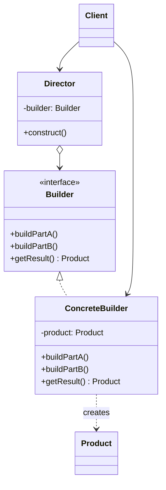

# Builder

## Description

Builder separates the construction of a complex object from its representation, allowing the same construction process to produce different representations. Instead of assembling the object all at once through a constructor with many parameters, creation is split into named, explicit steps.

A `Builder` defines the operations for creating each part of the product; concrete implementations (`ConcreteBuilder`) know how to assemble and store those parts and expose a method to get the final result. Optionally, a `Director` encapsulates the order of the steps for recurring construction recipes, so the client only chooses which builder to use.

In modern practice, the most common variant is the fluent builder (chained methods that return the builder itself), used to create immutable objects with many optional attributes and to validate the object's consistency before handing it over.

## Problems it solves

- Constructors with long parameter lists, many of them optional, that are hard to read and prone to ordering mistakes (the "telescoping constructor")
- The need to assemble an object step by step, sometimes with conditional or repeated steps
- The same construction process having to generate different representations (e.g., a document in HTML, Markdown, or PDF)
- Creating immutable objects whose state must be complete and valid by the time they're handed over

## When to use

- The object has many attributes, especially optional ones or ones with default values
- Construction involves several steps, meaningful ordering, or validation rules across fields
- You want to reuse the same assembly algorithm to produce different products
- You need immutable objects, but without giant constructors
- Assembling composite structures (trees, SQL queries, HTTP requests, messages)

### When to avoid

- The object is simple, with few required fields; a constructor or factory is enough
- The language already offers named parameters and default values that eliminate the problem
- The products don't share a common construction process, making the abstraction artificial
- The cost of keeping a builder in sync with every change to the product class isn't worth it

## Trade-offs

| Benefit | Cost / Risk |
| --- | --- |
| Readable, self-documenting client code (named steps) | More classes and code to maintain (one builder per product) |
| Enables immutable products and validation centralized in `build()` | Field duplication between builder and product |
| Isolates construction code from the product's business logic | The builder can fall out of date with respect to the product |
| The same process generates different representations | Forgotten required fields only show up at run time (unless builders are typed per step) |

- **Coupling:** the client depends on the builder, not on the product's internal representation.
- **Testability:** builders make it easy to create test data ("test data builders") with sensible default values.
- **Complexity:** the `Director` is optional; it often adds layers with no real benefit.
- **Concurrency:** builders are mutable and usually shouldn't be shared between threads.

## Diagram



The `Client` creates a `ConcreteBuilder` and hands it to the `Director`, which calls the construction steps in the correct order; at the end, the client gets the assembled `Product` from the builder itself via `getResult()`.

## Example

An application builds HTTP requests with a required URL and several optional headers, a timeout, and a body. A fluent builder keeps creation readable and ensures the final request is immutable and valid.

```java
public final class HttpRequest {
    private final String url, method, body;
    private final Map<String, String> headers;
    private final int timeoutMs;

    private HttpRequest(Builder b) {
        url = b.url; method = b.method; body = b.body;
        headers = Map.copyOf(b.headers); timeoutMs = b.timeoutMs;
    }

    public static Builder builder(String url) { return new Builder(url); }

    public static final class Builder {
        private final String url;
        private String method = "GET", body;
        private final Map<String, String> headers = new HashMap<>();
        private int timeoutMs = 5000;

        private Builder(String url) { this.url = url; }
        public Builder method(String m) { this.method = m; return this; }
        public Builder header(String k, String v) { headers.put(k, v); return this; }
        public Builder body(String b) { this.body = b; return this; }
        public Builder timeout(int ms) { this.timeoutMs = ms; return this; }

        public HttpRequest build() {
            if (body != null && method.equals("GET"))
                throw new IllegalStateException("GET does not accept a body");
            return new HttpRequest(this);
        }
    }
}

// Usage
HttpRequest req = HttpRequest.builder("https://api.example.com/orders")
    .method("POST").header("Content-Type", "design/json")
    .body("{\"id\": 42}").timeout(2000).build();
```

## Related patterns

- [Abstract Factory](/coding/gof/creational/abstract-factory) — also creates complex objects, but returns families of products at once; Builder focuses on assembling a single product step by step
- [Telescoping Constructor](/coding/gof/creational/telescoping-constructor) — an anti-pattern that Builder normally replaces
- [Factory Method](/coding/gof/creational/factory-method) — a simpler alternative when creation fits in a single call
- [Prototype](/coding/gof/creational/prototype) — another way to avoid complex construction, by cloning an already-configured object
- [Composite](/coding/gof/structural/composite) — Builder is often used to assemble Composite trees
- [Singleton](/coding/gof/creational/singleton) — a shared Director or builder is sometimes exposed as a single instance

## Reference

- [Design Patterns Cheat Sheet](https://iretha.github.io/design-patterns/cheat-sheet)
- [Builder on Refactoring.Guru](https://refactoring.guru/design-patterns/builder)
