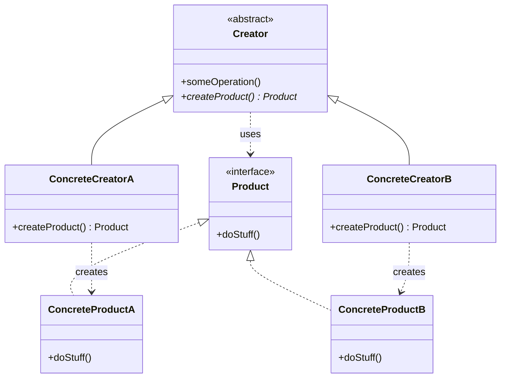

# Factory Method

## Description

Factory Method defines an interface for creating an object, but lets subclasses decide which concrete class to instantiate. Instead of calling the constructor directly, the base class (the *Creator*) declares a factory method — usually abstract or with a default implementation — that returns an abstract *Product*.

The key point is that the Creator normally contains business logic that **uses** the product, without knowing which concrete implementation is in use. Each subclass (*ConcreteCreator*) overrides the factory method to return the appropriate *ConcreteProduct*. This way, creation is deferred to the subclasses and client code depends only on abstractions.

Unlike **Factory (Simple Factory)**, which is a single method/class with conditionals (`if`/`switch`) deciding what to create, Factory Method uses **inheritance and polymorphism**: each creation variant lives in a subclass. **Abstract Factory**, in turn, creates **families** of related products through several creation methods on a factory object (composition), whereas Factory Method deals with **one** product per method.

## Problems it solves

- Code that instantiates concrete classes directly (`new`) is coupled to implementations and has to change with every new type.
- A framework or library needs to let users extend the objects it creates internally.
- Common logic (flow, validation, lifecycle) is repeated across variants that differ only in the object created.
- Creation conditionals scattered across the code violate the Open/Closed principle.

## When to use

- When the class can't know in advance which exact types of objects it needs to create.
- When you want subclasses to specify the objects created, as in frameworks and extension points.
- When there's a common algorithm in the base class and only the product varies (combines well with Template Method).
- When you want to reuse existing objects (cache, pool) behind a creation method, instead of always building new ones.

## When to avoid

- When there's only one product type and no real prospect of variation — a simple constructor is enough.
- When creating subclasses just to swap the product causes a class explosion; a Simple Factory, dependency injection, or a creation function/lambda may be simpler.
- When you need to create families of objects that must be compatible with each other — prefer Abstract Factory.

## Trade-offs

| Benefit | Cost / Risk |
| --- | --- |
| Decouples the Creator from concrete products | Requires a parallel hierarchy of Creators and Products |
| New products without changing existing code (Open/Closed) | More classes and indirection to understand the flow |
| Centralizes creation at a single point (Single Responsibility) | Inheritance-based: less flexible than composition at run time |
| Makes testing easier by replacing the product with a *fake* via subclass | Can be *overengineering* in simple scenarios |

- **Coupling:** the client depends only on the abstract `Creator` and `Product`.
- **Testability:** a test subclass that overrides the factory method is all you need.
- **Complexity:** grows with the number of variants; evaluate whether a Simple Factory solves it.
- **Evolution:** it's common to start with Factory Method and evolve to Abstract Factory, Prototype, or Builder as the need for flexibility grows.

## Diagram



The `Creator` declares the abstract method `createProduct()` and uses the `Product` in `someOperation()`. Each `ConcreteCreator` overrides the factory method to instantiate its corresponding `ConcreteProduct`, without the Creator knowing the concrete class.

## Example

A notification service has a common flow (build the message, send it, log it), but the channel varies: email or SMS. Each subclass decides which `Notifier` to create.

```typescript
interface Notifier {
  send(to: string, message: string): void;
}

class EmailNotifier implements Notifier {
  send(to: string, message: string) { console.log(`Email to ${to}: ${message}`); }
}

class SmsNotifier implements Notifier {
  send(to: string, message: string) { console.log(`SMS to ${to}: ${message}`); }
}

abstract class NotificationService {
  protected abstract createNotifier(): Notifier; // Factory Method

  notify(to: string, message: string): void {
    const notifier = this.createNotifier();
    notifier.send(to, message);
    console.log(`log: notification sent to ${to}`);
  }
}

class EmailNotificationService extends NotificationService {
  protected createNotifier(): Notifier { return new EmailNotifier(); }
}

class SmsNotificationService extends NotificationService {
  protected createNotifier(): Notifier { return new SmsNotifier(); }
}

const service: NotificationService = new SmsNotificationService();
service.notify("+5511999999999", "Your order has been shipped");
```

## Related patterns

- [Factory](/coding/gof/creational/factory) — the Simple Factory concentrates the decision in a single method with conditionals; Factory Method distributes that decision among subclasses via polymorphism, avoiding modifying the factory for every new type.
- [Abstract Factory](/coding/gof/creational/abstract-factory) — creates families of related products through composition; its concrete factories are usually implemented with one Factory Method per product.
- [Template Method](/coding/gof/behavioral/template-method) — Factory Method is often a step of a Template Method, where the base class defines the algorithm and the subclass supplies the object.
- [Prototype](/coding/gof/creational/prototype) — an alternative that creates objects by cloning instances, without requiring a hierarchy of Creators.
- [Builder](/coding/gof/creational/builder) — focuses on building complex objects step by step, whereas Factory Method decides which class to instantiate.
- [Iterator](/coding/gof/behavioral/iterator) — collections use a Factory Method (`createIterator()`) to return the iterator compatible with their structure.

## Reference

- [Design Patterns Cheat Sheet](https://iretha.github.io/design-patterns/cheat-sheet)
- [Factory Method on Refactoring.Guru](https://refactoring.guru/design-patterns/factory-method)
