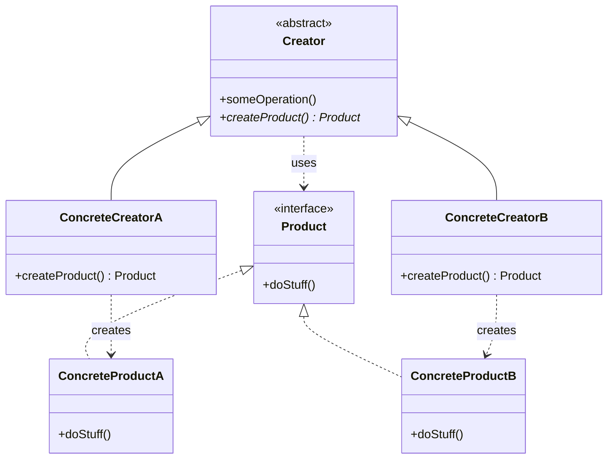

# Factory Method

## Description

Factory Method defines an interface for creating an object, but lets subclasses decide which concrete class to instantiate. Instead of calling the constructor directly, the base class (the *Creator*) declares a factory method — usually abstract or with a default implementation — that returns an abstract *Product*.

The key point is that the Creator normally contains business logic that **uses** the product, without knowing which concrete implementation is in use. Each subclass (*ConcreteCreator*) overrides the factory method to return the appropriate *ConcreteProduct*. This way, creation is deferred to the subclasses and client code depends only on abstractions.

Unlike **Factory (Simple Factory)**, which is a single method/class with conditionals (`if`/`switch`) deciding what to create, Factory Method uses **inheritance and polymorphism**: each creation variant lives in a subclass. **Abstract Factory**, in turn, creates **families** of related products through several creation methods on a factory object (composition), whereas Factory Method deals with **one** product per method.

## Problems it solves

- Code that instantiates concrete classes directly (`new`) is coupled to implementations and has to change with every new type.
- A framework or library needs to let users extend the objects it creates internally.
- Common logic (flow, validation, lifecycle) is repeated across variants that differ only in the object created.
- Creation conditionals scattered across the code violate the Open/Closed principle.

## When to use

- When the class can't know in advance which exact types of objects it needs to create.
- When you want subclasses to specify the objects created, as in frameworks and extension points.
- When there's a common algorithm in the base class and only the product varies (combines well with Template Method).
- When you want to reuse existing objects (cache, pool) behind a creation method, instead of always building new ones.

## When to avoid

- When there's only one product type and no real prospect of variation — a simple constructor is enough.
- When creating subclasses just to swap the product causes a class explosion; a Simple Factory, dependency injection, or a creation function/lambda may be simpler.
- When you need to create families of objects that must be compatible with each other — prefer Abstract Factory.

## Trade-offs

| Benefit | Cost / Risk |
| --- | --- |
| Decouples the Creator from concrete products | Requires a parallel hierarchy of Creators and Products |
| New products without changing existing code (Open/Closed) | More classes and indirection to understand the flow |
| Centralizes creation at a single point (Single Responsibility) | Inheritance-based: less flexible than composition at run time |
| Makes testing easier by replacing the product with a *fake* via subclass | Can be *overengineering* in simple scenarios |

- **Coupling:** the client depends only on the abstract `Creator` and `Product`.
- **Testability:** a test subclass that overrides the factory method is all you need.
- **Complexity:** grows with the number of variants; evaluate whether a Simple Factory solves it.
- **Evolution:** it's common to start with Factory Method and evolve to Abstract Factory, Prototype, or Builder as the need for flexibility grows.

## Diagram



The `Creator` declares the abstract method `createProduct()` and uses the `Product` in `someOperation()`. Each `ConcreteCreator` overrides the factory method to instantiate its corresponding `ConcreteProduct`, without the Creator knowing the concrete class.

## Example

Every transfer follows the same flow (check the balance, create the instruction, record it in the ledger), but the instruction varies by rail: Pix or TED. Each subclass decides which `PaymentInstruction` to create.

<Tabs groupId="lang" queryString>
<TabItem value="java" label="Java">

```java
record TransferRequest(String fromAccountId, String destination, long amountCents) {}

interface PaymentInstruction {
    String send();
}

record PixInstruction(TransferRequest request) implements PaymentInstruction {
    public String send() {
        return "Pix transfer of " + request.amountCents() + " cents to key " + request.destination() + " (SPI)";
    }
}

record TedInstruction(TransferRequest request) implements PaymentInstruction {
    public String send() {
        return "TED of " + request.amountCents() + " cents to " + request.destination() + " (next window)";
    }
}

abstract class TransferProcessor {
    protected abstract PaymentInstruction createInstruction(TransferRequest request); // Factory Method

    void process(TransferRequest request, long balanceCents) {
        if (balanceCents < request.amountCents()) throw new IllegalStateException("insufficient balance");
        PaymentInstruction instruction = createInstruction(request);
        System.out.println(instruction.send());
        System.out.println("ledger: debit of " + request.amountCents() + " cents on " + request.fromAccountId());
    }
}

class PixTransferProcessor extends TransferProcessor {
    protected PaymentInstruction createInstruction(TransferRequest request) { return new PixInstruction(request); }
}

class TedTransferProcessor extends TransferProcessor {
    protected PaymentInstruction createInstruction(TransferRequest request) { return new TedInstruction(request); }
}

TransferProcessor processor = new PixTransferProcessor();
processor.process(new TransferRequest("0001-1", "maria@example.com", 12_500), 50_000);
```

</TabItem>
<TabItem value="python" label="Python">

```python
from abc import ABC, abstractmethod
from dataclasses import dataclass
from typing import Protocol

@dataclass(frozen=True)
class TransferRequest:
    from_account_id: str
    destination: str
    amount_cents: int

class PaymentInstruction(Protocol):
    def send(self) -> str: ...

@dataclass(frozen=True)
class PixInstruction:
    request: TransferRequest

    def send(self) -> str:
        return f"Pix transfer of {self.request.amount_cents} cents to key {self.request.destination} (SPI)"

@dataclass(frozen=True)
class TedInstruction:
    request: TransferRequest

    def send(self) -> str:
        return f"TED of {self.request.amount_cents} cents to {self.request.destination} (next window)"

class TransferProcessor(ABC):
    @abstractmethod
    def _create_instruction(self, request: TransferRequest) -> PaymentInstruction:  # Factory Method
        ...

    def process(self, request: TransferRequest, balance_cents: int) -> None:
        if balance_cents < request.amount_cents:
            raise ValueError("insufficient balance")
        instruction = self._create_instruction(request)
        print(instruction.send())
        print(f"ledger: debit of {request.amount_cents} cents on {request.from_account_id}")

class PixTransferProcessor(TransferProcessor):
    def _create_instruction(self, request: TransferRequest) -> PaymentInstruction:
        return PixInstruction(request)

class TedTransferProcessor(TransferProcessor):
    def _create_instruction(self, request: TransferRequest) -> PaymentInstruction:
        return TedInstruction(request)

processor: TransferProcessor = PixTransferProcessor()
processor.process(TransferRequest("0001-1", "maria@example.com", 12_500), 50_000)
```

</TabItem>
<TabItem value="go" label="Go">

```go
type TransferRequest struct {
	FromAccountID string
	Destination   string
	AmountCents   int64
}

type PaymentInstruction interface {
	Send() string
}

type PixInstruction struct{ request TransferRequest }

func (i PixInstruction) Send() string {
	return fmt.Sprintf("Pix transfer of %d cents to key %s (SPI)", i.request.AmountCents, i.request.Destination)
}

type TedInstruction struct{ request TransferRequest }

func (i TedInstruction) Send() string {
	return fmt.Sprintf("TED of %d cents to %s (next window)", i.request.AmountCents, i.request.Destination)
}

// Go has no abstract classes: the factory method is a function stored in the processor.
type TransferProcessor struct {
	createInstruction func(TransferRequest) PaymentInstruction // Factory Method
}

func (p TransferProcessor) Process(request TransferRequest, balanceCents int64) error {
	if balanceCents < request.AmountCents {
		return errors.New("insufficient balance")
	}
	instruction := p.createInstruction(request)
	fmt.Println(instruction.Send())
	fmt.Printf("ledger: debit of %d cents on %s\n", request.AmountCents, request.FromAccountID)
	return nil
}

func NewPixTransferProcessor() TransferProcessor {
	return TransferProcessor{func(r TransferRequest) PaymentInstruction { return PixInstruction{r} }}
}

func NewTedTransferProcessor() TransferProcessor {
	return TransferProcessor{func(r TransferRequest) PaymentInstruction { return TedInstruction{r} }}
}

func main() {
	processor := NewPixTransferProcessor()
	err := processor.Process(TransferRequest{"0001-1", "maria@example.com", 12_500}, 50_000)
	if err != nil {
		fmt.Println(err)
	}
}
```

</TabItem>
<TabItem value="typescript" label="TypeScript">

```typescript
interface TransferRequest {
  fromAccountId: string;
  destination: string;
  amountCents: number;
}

interface PaymentInstruction {
  send(): string;
}

class PixInstruction implements PaymentInstruction {
  constructor(private request: TransferRequest) {}
  send() { return `Pix transfer of ${this.request.amountCents} cents to key ${this.request.destination} (SPI)`; }
}

class TedInstruction implements PaymentInstruction {
  constructor(private request: TransferRequest) {}
  send() { return `TED of ${this.request.amountCents} cents to ${this.request.destination} (next window)`; }
}

abstract class TransferProcessor {
  protected abstract createInstruction(request: TransferRequest): PaymentInstruction; // Factory Method

  process(request: TransferRequest, balanceCents: number): void {
    if (balanceCents < request.amountCents) throw new Error("insufficient balance");
    const instruction = this.createInstruction(request);
    console.log(instruction.send());
    console.log(`ledger: debit of ${request.amountCents} cents on ${request.fromAccountId}`);
  }
}

class PixTransferProcessor extends TransferProcessor {
  protected createInstruction(request: TransferRequest): PaymentInstruction { return new PixInstruction(request); }
}

class TedTransferProcessor extends TransferProcessor {
  protected createInstruction(request: TransferRequest): PaymentInstruction { return new TedInstruction(request); }
}

const processor: TransferProcessor = new PixTransferProcessor();
processor.process({ fromAccountId: "0001-1", destination: "maria@example.com", amountCents: 12_500 }, 50_000);
```

</TabItem>
</Tabs>

## Related patterns

- [Factory](/coding/gof/creational/factory) — the Simple Factory concentrates the decision in a single method with conditionals; Factory Method distributes that decision among subclasses via polymorphism, avoiding modifying the factory for every new type.
- [Abstract Factory](/coding/gof/creational/abstract-factory) — creates families of related products through composition; its concrete factories are usually implemented with one Factory Method per product.
- [Template Method](/coding/gof/behavioral/template-method) — Factory Method is often a step of a Template Method, where the base class defines the algorithm and the subclass supplies the object.
- [Prototype](/coding/gof/creational/prototype) — an alternative that creates objects by cloning instances, without requiring a hierarchy of Creators.
- [Builder](/coding/gof/creational/builder) — focuses on building complex objects step by step, whereas Factory Method decides which class to instantiate.
- [Iterator](/coding/gof/behavioral/iterator) — collections use a Factory Method (`createIterator()`) to return the iterator compatible with their structure.

## Reference

- [Design Patterns Cheat Sheet](https://iretha.github.io/design-patterns/cheat-sheet)
- [Factory Method on Refactoring.Guru](https://refactoring.guru/design-patterns/factory-method)
