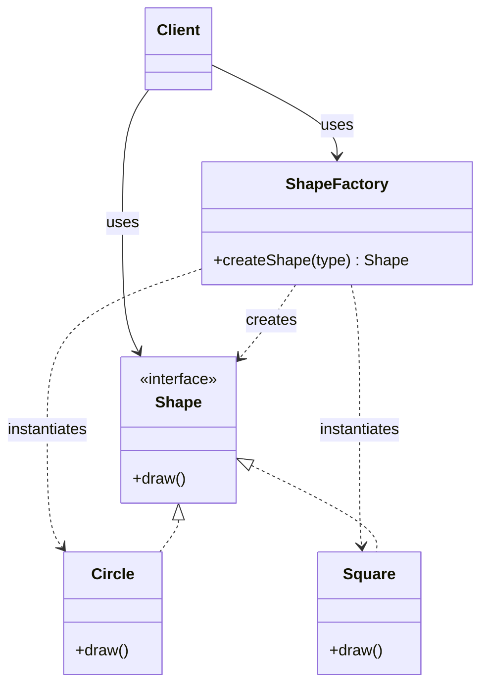

# Factory

## Description

Factory (also called Simple Factory) centralizes object creation at a single point: a class or method that receives a parameter (a type, a configuration, a string) and decides which concrete implementation to instantiate, returning it through a common interface or base class. The client asks for "a product of type X" without knowing the constructor or the concrete class.

Unlike the patterns in the book "Design Patterns" (Gang of Four), Simple Factory isn't among the 23 cataloged patterns, and its status as a formal pattern is debated: many authors consider it merely a programming idiom or a good encapsulation practice. Even so, it's probably the most common form of "factory" found in real code and is usually the first step before evolving to Factory Method or Abstract Factory.

The decision logic is usually a `switch`/`if` or a registry map (type → constructor). There's no hierarchy of factories or subclasses deciding creation: there's a single concrete factory, often with a static method.

## Problems it solves

- Logic for selecting concrete classes (`if type == ...`) scattered and duplicated across many places in client code
- Client coupled to concrete classes and to construction details (parameters, dependencies, configuration)
- Difficulty adding or swapping implementations without changing every place that instantiates them
- The need to create objects from run-time data (configuration, user input, messages)

## When to use

- There's a family of classes with a common interface and the choice of implementation depends on a simple parameter
- Object creation involves logic that shouldn't live in the client
- You want a single point to change how objects are created (for example, for caching, logging, or dependency injection)
- The number of variants is small and relatively stable

## When to avoid

- There's only one implementation and no prospect of variation — a direct constructor is simpler
- New variants appear frequently and changing the central `switch` violates the open/closed principle; consider Factory Method or an extensible registry
- You need to create families of related objects that must be consistent with each other — use Abstract Factory
- Construction is complex and done in steps — use Builder

## Trade-offs

| Benefit | Cost / Risk |
| --- | --- |
| Client decoupled from concrete classes | The factory comes to know every concrete class |
| Centralized creation logic with no duplication | Adding a type requires modifying the factory (violates open/closed) |
| Easy to understand and implement | Can grow into a giant `switch` that's hard to maintain |
| Single point for swapping implementations | Static methods make substitution in tests harder |

- **Coupling:** reduces the client's coupling, but concentrates dependencies in the factory.
- **Testability:** prefer an injectable factory (an instance with an interface) over a static method to make mocking easier.
- **Extensibility:** a registry map (type → constructor) mitigates the growing `switch` problem.
- **Complexity:** low; it's the lightest way to encapsulate object creation.

## Diagram



The `Client` requests an object from the `ShapeFactory`, specifying the desired type; the factory decides which concrete class (`Circle` or `Square`) to instantiate and returns it as a `Shape`. The client works only with the interface.

## Example

A notification service needs to send messages by email, SMS, or push, depending on each user's saved preference. The factory translates that preference into the right implementation.

```typescript
interface Notifier {
  send(to: string, message: string): void;
}

class EmailNotifier implements Notifier {
  send(to: string, message: string) { /* sends email */ }
}

class SmsNotifier implements Notifier {
  send(to: string, message: string) { /* sends SMS */ }
}

class PushNotifier implements Notifier {
  send(to: string, message: string) { /* sends push */ }
}

class NotifierFactory {
  static create(channel: "email" | "sms" | "push"): Notifier {
    switch (channel) {
      case "email": return new EmailNotifier();
      case "sms":   return new SmsNotifier();
      case "push":  return new PushNotifier();
      default: throw new Error(`Unknown channel: ${channel}`);
    }
  }
}

// Client
const notifier = NotifierFactory.create(user.preferredChannel);
notifier.send(user.contact, "Your order has been shipped!");
```

## Related patterns

- [Factory Method](/coding/gof/creational/factory-method) — instead of a single factory with a conditional, it defines a creation method that subclasses override; the decision about the concrete class is made through inheritance/polymorphism, not by parameter. It's the natural evolution when the Simple Factory needs to be extended without modification.
- [Abstract Factory](/coding/gof/creational/abstract-factory) — provides an interface for creating *families* of related objects, with several interchangeable concrete factories; the Simple Factory creates a single product type and has only one concrete factory.
- [Builder](/coding/gof/creational/builder) — focuses on building a complex object step by step, whereas Factory returns the finished object in a single call.
- [Singleton](/coding/gof/creational/singleton) — the factory is often exposed as a single instance or through static methods.
- [Prototype](/coding/gof/creational/prototype) — a factory can create objects by cloning registered prototypes instead of calling constructors.
- [Object Pool](/coding/gof/creational/object-pool) — the factory can reuse instances from a pool instead of creating new ones on every call.
- [Strategy](/coding/gof/behavioral/strategy) — factories are frequently used to select the concrete strategy based on configuration.

## Reference

- [Design Patterns Cheat Sheet](https://iretha.github.io/design-patterns/cheat-sheet)
