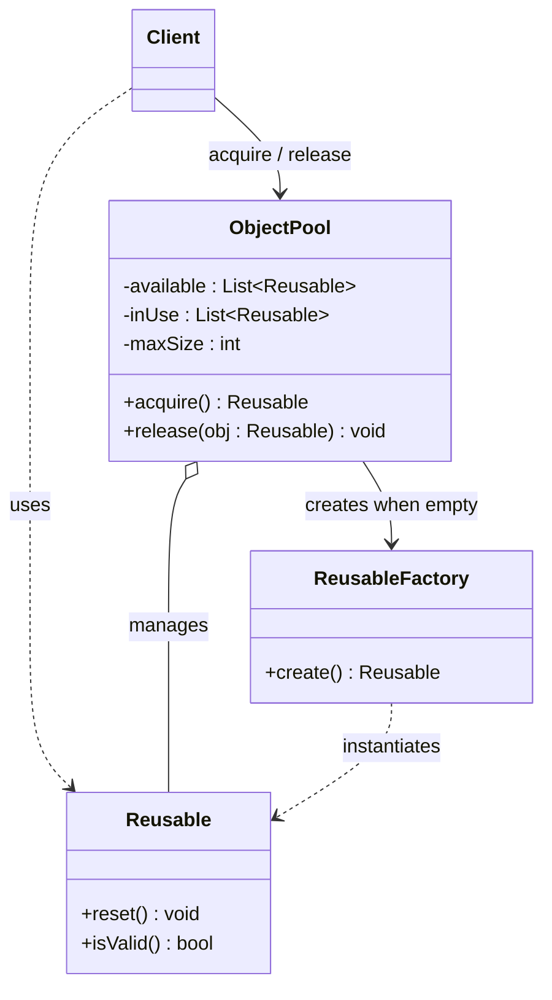

# Object Pool

## Description

Object Pool keeps a set of objects that are already initialized and ready to use, instead of creating and destroying them on demand. When a client needs an object, it "borrows" one from the pool (*acquire*); when it's done, it returns it (*release*) so another client can reuse it.

The pool controls the lifecycle of the instances: it creates new ones when none is available (respecting a maximum limit), resets the state of returned objects, and can block, fail, or wait when the limit is reached. The pattern is especially useful when creating an object is expensive (network connections, threads, large buffers) and the usage rate is high, but the number of objects in simultaneous use is limited.

It isn't one of the 23 patterns in the Gang of Four book, but it's widely used in infrastructure: database connection pools, thread pools, and buffer pools.

## Problems it solves

- High, repeated cost of creating/destroying objects (connection handshake, memory allocation, heavy initialization)
- Pressure on the garbage collector caused by many short-lived objects
- The need to limit the number of scarce resources used at the same time (connections, licenses, sockets)
- Unpredictable latency when obtaining a resource at the moment of use

## When to use

- Objects that are expensive to create and frequently needed for short periods
- External resources with a concurrency limit (database connections, worker threads)
- Latency-sensitive systems that benefit from pre-warming (*warm-up*) the objects
- When an object's state can be reliably reset before it's reused

### When to avoid

- Lightweight objects that are cheap to create; in modern runtimes, the allocator and GC are usually more efficient than a pool
- Objects with state that's hard to clean, which risks leaking data between uses
- When the discipline of returning objects can't be guaranteed ("lost" objects exhaust the pool)
- When a mature library already provides pooling (e.g., HikariCP, the platform's thread pools)

## Trade-offs

| Benefit | Cost / Risk |
| --- | --- |
| Reduces the cost of creating and destroying objects | More complexity: lifecycle management, limits, and wait times |
| Limits and controls the use of scarce resources | Objects that aren't returned cause *pool exhaustion* |
| More predictable latency after *warm-up* | Residual state from one use can leak into the next if *reset* fails |
| Less pressure on the garbage collector | Memory held by idle objects, even without demand |

- **Concurrency:** the pool is usually shared between threads and needs synchronization, which can become a contention point.
- **Validation:** objects can become invalid while idle (e.g., a connection closed by the server); the pool must validate them before handing them out.
- **Testability:** exposing the pool through an interface makes it easy to swap in a simple implementation in tests.
- **Sizing:** minimum/maximum sizes and *timeouts* need tuning to the real load.

## Diagram



The `Client` gets a `Reusable` from the `ObjectPool` and returns it when done. The pool keeps lists of available and in-use objects, falls back to the `ReusableFactory` when it needs to create new instances (up to `maxSize`), and calls `reset()` when it receives an object back.

## Example

An HTTP service needs database connections; opening a connection on every request is expensive, so the connections are kept in a bounded pool.

```python
import threading

class ConnectionPool:
    def __init__(self, factory, max_size=10):
        self._factory = factory
        self._available = []
        self._in_use = set()
        self._max_size = max_size
        self._cond = threading.Condition()

    def acquire(self, timeout=5.0):
        with self._cond:
            while not self._available and len(self._in_use) >= self._max_size:
                if not self._cond.wait(timeout):
                    raise TimeoutError("pool exhausted")
            conn = self._available.pop() if self._available else self._factory()
            if not conn.is_valid():
                conn = self._factory()
            self._in_use.add(conn)
            return conn

    def release(self, conn):
        with self._cond:
            self._in_use.discard(conn)
            conn.reset()
            self._available.append(conn)
            self._cond.notify()

# usage
conn = pool.acquire()
try:
    conn.execute("SELECT 1")
finally:
    pool.release(conn)
```

## Related patterns

- [Singleton](/coding/gof/creational/singleton) — the pool is usually a single, global instance in the application
- [Factory Method](/coding/gof/creational/factory-method) — used by the pool to create new instances when no objects are available
- [Prototype](/coding/gof/creational/prototype) — the pool can clone a pre-configured prototype to generate new objects
- [Flyweight](/coding/gof/structural/flyweight) — both reuse objects, but Flyweight shares immutable state simultaneously, whereas the pool lends objects for exclusive use
- [Proxy](/coding/gof/structural/proxy) — a proxy can wrap the borrowed object and automatically return it to the pool when it's closed

## Reference

- [Design Patterns Cheat Sheet](https://iretha.github.io/design-patterns/cheat-sheet)
- [Object Pool on SourceMaking](https://sourcemaking.com/design_patterns/object_pool)
