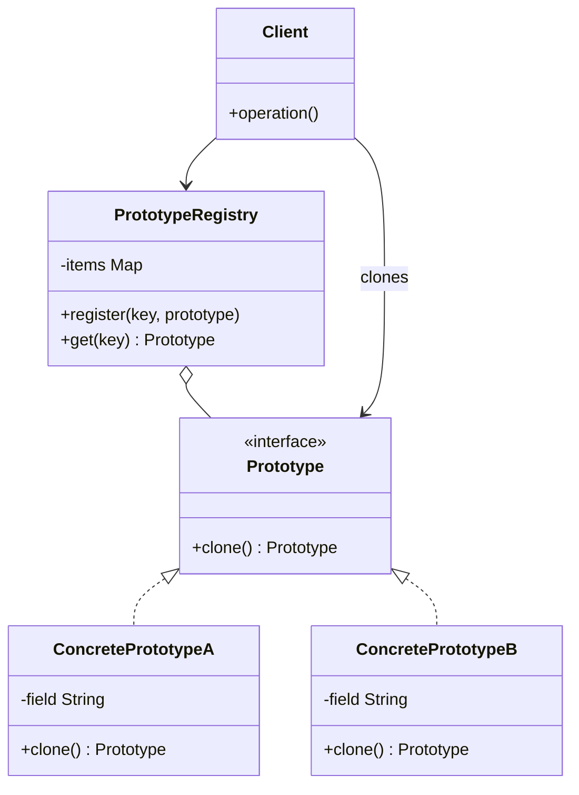

# Prototype

## Description

Prototype specifies the kinds of objects to create using a prototypical instance, and creates new objects by copying (cloning) that prototype. Instead of instantiating a concrete class with `new` and configuring the object from scratch, the client asks an existing object to produce a copy of itself.

Each prototype implements a `clone()` operation declared in a common interface. This way, the client can create objects without knowing their concrete classes, working only with the abstraction. It's common to keep a registry (Prototype Registry) of pre-configured prototypes, identified by a key, from which new instances are cloned.

The central implementation decision is between a shallow copy, which shares internal references with the original, and a deep copy, which also duplicates the referenced objects.

## Problems it solves

- Repeatedly creating objects whose initialization is expensive (database queries, file reads, heavy computations)
- Instantiating objects when client code only knows an interface, not the concrete class
- Avoiding a parallel hierarchy of factories for each product variation
- Generating many variations of an object that differ only in a few configuration attributes
- Copying objects whose internal state is private and can't be replicated externally

## When to use

- When the classes to instantiate are defined at run time (for example, loaded dynamically)
- When creating an object from scratch is more costly than copying one that's already built
- When instances of a class can take on only a few combinations of state, which can be kept as prototypes
- When you want to reduce the number of subclasses created only to vary the initial configuration

## When to avoid

- When objects have many circular references or non-cloneable resources (connections, file handles, threads)
- When direct creation is cheap and simple, making cloning an unnecessary indirection
- When the copy semantics (shallow vs. deep) are ambiguous and can cause shared-state bugs

## Trade-offs

| Benefit | Cost / Risk |
| --- | --- |
| Creates objects without coupling the client to concrete classes | Each class must implement `clone()` correctly |
| Avoids repeated, costly initialization | Deep copy of complex or circular graphs is hard |
| Lets you add and remove "types" at run time via a registry | Shallow copy can unexpectedly share mutable state |
| Reduces subclasses created only to vary configuration | Native cloning mechanisms (e.g., `Cloneable` in Java) have pitfalls |

- **Coupling:** low between client and concrete products; the client depends only on the `Prototype` interface.
- **Testability:** good; test prototypes can be registered in place of the real ones.
- **Complexity:** the copy logic has to evolve along with the class's fields, which is a frequent source of bugs.
- **Performance:** advantageous when cloning is cheaper than construction; otherwise neutral or negative.

## Diagram



`Prototype` declares the `clone()` operation, implemented by `ConcretePrototypeA` and `ConcretePrototypeB`, which copy their own state. The `Client` creates new objects by asking the prototypes for copies, optionally obtained from a `PrototypeRegistry` that keeps them indexed by key.

## Example

The customer saves favorite payments, such as the rent and an allowance. To schedule a new one, the app clones the favorite and changes only the date and the amount, without rebuilding the receiver data or the description and without knowing whether the favorite is a Pix or a TED.

<Tabs groupId="lang" queryString>
<TabItem value="java" label="Java">

```java
interface PaymentOrder {
    PaymentOrder copy();
    void reschedule(String scheduledFor, long amountCents);
}

class PixPaymentOrder implements PaymentOrder {
    String receiverKey, description, scheduledFor;
    long amountCents;

    PixPaymentOrder(String receiverKey, String description, long amountCents, String scheduledFor) {
        this.receiverKey = receiverKey; this.description = description;
        this.amountCents = amountCents; this.scheduledFor = scheduledFor;
    }

    public PaymentOrder copy() {
        return new PixPaymentOrder(receiverKey, description, amountCents, scheduledFor);
    }

    public void reschedule(String scheduledFor, long amountCents) {
        this.scheduledFor = scheduledFor; this.amountCents = amountCents;
    }
}

class TedPaymentOrder implements PaymentOrder {
    String bankCode, branch, accountNumber, description, scheduledFor;
    long amountCents;

    TedPaymentOrder(String bankCode, String branch, String accountNumber,
                    String description, long amountCents, String scheduledFor) {
        this.bankCode = bankCode; this.branch = branch; this.accountNumber = accountNumber;
        this.description = description; this.amountCents = amountCents; this.scheduledFor = scheduledFor;
    }

    public PaymentOrder copy() {
        return new TedPaymentOrder(bankCode, branch, accountNumber, description, amountCents, scheduledFor);
    }

    public void reschedule(String scheduledFor, long amountCents) {
        this.scheduledFor = scheduledFor; this.amountCents = amountCents;
    }
}

class FavoritePayments {
    private final Map<String, PaymentOrder> items = new HashMap<>();

    void register(String key, PaymentOrder order) {
        items.put(key, order);
    }

    PaymentOrder create(String key) {
        PaymentOrder proto = items.get(key);
        if (proto == null) throw new IllegalArgumentException("Unknown favorite: " + key);
        return proto.copy();
    }
}

FavoritePayments favorites = new FavoritePayments();
favorites.register("rent", new PixPaymentOrder("locador@example.com", "Rent", 250_000, "2026-12-05"));
favorites.register("allowance", new TedPaymentOrder("001", "1234", "56789-0", "Allowance", 30_000, "2026-12-10"));

// The client clones without knowing whether the favorite is Pix or TED
PaymentOrder order = favorites.create("rent");
order.reschedule("2027-01-05", 262_500); // the original favorite stays untouched
```

</TabItem>
<TabItem value="python" label="Python">

```python
from __future__ import annotations

import copy
from dataclasses import dataclass
from typing import Protocol

class PaymentOrder(Protocol):
    def clone(self) -> PaymentOrder: ...
    def reschedule(self, scheduled_for: str, amount_cents: int) -> None: ...

@dataclass
class PixPaymentOrder:
    receiver_key: str
    description: str
    amount_cents: int
    scheduled_for: str

    def clone(self) -> PaymentOrder:
        return copy.copy(self)

    def reschedule(self, scheduled_for: str, amount_cents: int) -> None:
        self.scheduled_for, self.amount_cents = scheduled_for, amount_cents

@dataclass
class TedPaymentOrder:
    bank_code: str
    branch: str
    account_number: str
    description: str
    amount_cents: int
    scheduled_for: str

    def clone(self) -> PaymentOrder:
        return copy.copy(self)

    def reschedule(self, scheduled_for: str, amount_cents: int) -> None:
        self.scheduled_for, self.amount_cents = scheduled_for, amount_cents

class FavoritePayments:
    def __init__(self) -> None:
        self._items: dict[str, PaymentOrder] = {}

    def register(self, key: str, order: PaymentOrder) -> None:
        self._items[key] = order

    def create(self, key: str) -> PaymentOrder:
        if key not in self._items:
            raise KeyError(f"Unknown favorite: {key}")
        return self._items[key].clone()

favorites = FavoritePayments()
favorites.register("rent", PixPaymentOrder("locador@example.com", "Rent", 250_000, "2026-12-05"))
favorites.register("allowance", TedPaymentOrder("001", "1234", "56789-0", "Allowance", 30_000, "2026-12-10"))

# The client clones without knowing whether the favorite is Pix or TED
order = favorites.create("rent")
order.reschedule("2027-01-05", 262_500)  # the original favorite stays untouched
```

</TabItem>
<TabItem value="go" label="Go">

```go
type PaymentOrder interface {
	Clone() PaymentOrder
	Reschedule(scheduledFor string, amountCents int64)
}

type PixPaymentOrder struct {
	ReceiverKey, Description string
	AmountCents              int64
	ScheduledFor             string
}

func (o *PixPaymentOrder) Clone() PaymentOrder {
	clone := *o // the assignment copies every field
	return &clone
}

func (o *PixPaymentOrder) Reschedule(scheduledFor string, amountCents int64) {
	o.ScheduledFor, o.AmountCents = scheduledFor, amountCents
}

type TedPaymentOrder struct {
	BankCode, Branch, AccountNumber, Description string
	AmountCents                                  int64
	ScheduledFor                                 string
}

func (o *TedPaymentOrder) Clone() PaymentOrder {
	clone := *o
	return &clone
}

func (o *TedPaymentOrder) Reschedule(scheduledFor string, amountCents int64) {
	o.ScheduledFor, o.AmountCents = scheduledFor, amountCents
}

type FavoritePayments struct {
	items map[string]PaymentOrder
}

func (f *FavoritePayments) Register(key string, order PaymentOrder) {
	f.items[key] = order
}

func (f *FavoritePayments) Create(key string) (PaymentOrder, error) {
	proto, ok := f.items[key]
	if !ok {
		return nil, fmt.Errorf("unknown favorite: %s", key)
	}
	return proto.Clone(), nil
}

func main() {
	favorites := &FavoritePayments{items: map[string]PaymentOrder{}}
	favorites.Register("rent", &PixPaymentOrder{"locador@example.com", "Rent", 250_000, "2026-12-05"})
	favorites.Register("allowance", &TedPaymentOrder{"001", "1234", "56789-0", "Allowance", 30_000, "2026-12-10"})

	// The client clones without knowing whether the favorite is Pix or TED
	order, err := favorites.Create("rent")
	if err != nil {
		return
	}
	order.Reschedule("2027-01-05", 262_500) // the original favorite stays untouched
}
```

</TabItem>
<TabItem value="typescript" label="TypeScript">

```typescript
interface PaymentOrder {
  clone(): PaymentOrder;
  reschedule(scheduledFor: string, amountCents: number): void;
}

class PixPaymentOrder implements PaymentOrder {
  constructor(public receiverKey: string, public description: string,
              public amountCents: number, public scheduledFor: string) {}

  clone(): PaymentOrder {
    return new PixPaymentOrder(this.receiverKey, this.description,
                               this.amountCents, this.scheduledFor);
  }

  reschedule(scheduledFor: string, amountCents: number): void {
    this.scheduledFor = scheduledFor; this.amountCents = amountCents;
  }
}

class TedPaymentOrder implements PaymentOrder {
  constructor(public bankCode: string, public branch: string, public accountNumber: string,
              public description: string, public amountCents: number, public scheduledFor: string) {}

  clone(): PaymentOrder {
    return new TedPaymentOrder(this.bankCode, this.branch, this.accountNumber,
                               this.description, this.amountCents, this.scheduledFor);
  }

  reschedule(scheduledFor: string, amountCents: number): void {
    this.scheduledFor = scheduledFor; this.amountCents = amountCents;
  }
}

class FavoritePayments {
  private items = new Map<string, PaymentOrder>();

  register(key: string, order: PaymentOrder): void {
    this.items.set(key, order);
  }

  create(key: string): PaymentOrder {
    const proto = this.items.get(key);
    if (!proto) throw new Error(`Unknown favorite: ${key}`);
    return proto.clone();
  }
}

const favorites = new FavoritePayments();
favorites.register("rent", new PixPaymentOrder("locador@example.com", "Rent", 250_000, "2026-12-05"));
favorites.register("allowance", new TedPaymentOrder("001", "1234", "56789-0", "Allowance", 30_000, "2026-12-10"));

// The client clones without knowing whether the favorite is Pix or TED
const order = favorites.create("rent");
order.reschedule("2027-01-05", 262_500); // the original favorite stays untouched
```

</TabItem>
</Tabs>

## Related patterns

- [Abstract Factory](/coding/gof/creational/abstract-factory) — can store a set of prototypes and clone from them instead of instantiating subclasses
- [Factory Method](/coding/gof/creational/factory-method) — an inheritance-based alternative; Prototype doesn't need creator subclasses
- [Composite](/coding/gof/structural/composite) — composite structures often benefit from cloning to duplicate entire trees
- [Decorator](/coding/gof/structural/decorator) — designs with many decorated objects can use cloning to replicate complex configurations
- [Memento](/coding/gof/behavioral/memento) — in simple cases, a clone of the object can serve as a state snapshot
- [Singleton](/coding/gof/creational/singleton) — the prototype registry is often implemented as a Singleton

## Reference

- [Design Patterns Cheat Sheet](https://iretha.github.io/design-patterns/cheat-sheet)
- [Prototype on Refactoring.Guru](https://refactoring.guru/design-patterns/prototype)
