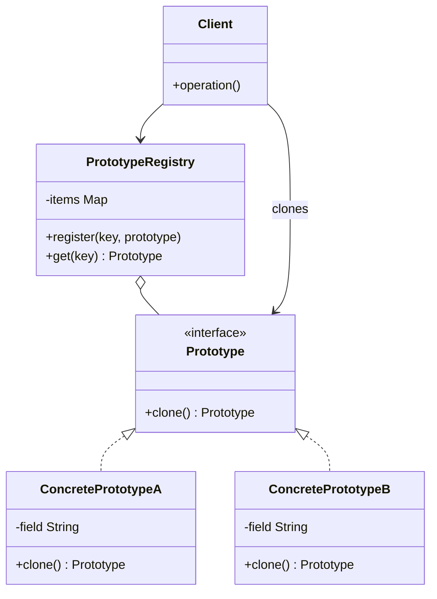

# Prototype

## Description

Prototype specifies the kinds of objects to create using a prototypical instance, and creates new objects by copying (cloning) that prototype. Instead of instantiating a concrete class with `new` and configuring the object from scratch, the client asks an existing object to produce a copy of itself.

Each prototype implements a `clone()` operation declared in a common interface. This way, the client can create objects without knowing their concrete classes, working only with the abstraction. It's common to keep a registry (Prototype Registry) of pre-configured prototypes, identified by a key, from which new instances are cloned.

The central implementation decision is between a shallow copy, which shares internal references with the original, and a deep copy, which also duplicates the referenced objects.

## Problems it solves

- Repeatedly creating objects whose initialization is expensive (database queries, file reads, heavy computations)
- Instantiating objects when client code only knows an interface, not the concrete class
- Avoiding a parallel hierarchy of factories for each product variation
- Generating many variations of an object that differ only in a few configuration attributes
- Copying objects whose internal state is private and can't be replicated externally

## When to use

- When the classes to instantiate are defined at run time (for example, loaded dynamically)
- When creating an object from scratch is more costly than copying one that's already built
- When instances of a class can take on only a few combinations of state, which can be kept as prototypes
- When you want to reduce the number of subclasses created only to vary the initial configuration

## When to avoid

- When objects have many circular references or non-cloneable resources (connections, file handles, threads)
- When direct creation is cheap and simple, making cloning an unnecessary indirection
- When the copy semantics (shallow vs. deep) are ambiguous and can cause shared-state bugs

## Trade-offs

| Benefit | Cost / Risk |
| --- | --- |
| Creates objects without coupling the client to concrete classes | Each class must implement `clone()` correctly |
| Avoids repeated, costly initialization | Deep copy of complex or circular graphs is hard |
| Lets you add and remove "types" at run time via a registry | Shallow copy can unexpectedly share mutable state |
| Reduces subclasses created only to vary configuration | Native cloning mechanisms (e.g., `Cloneable` in Java) have pitfalls |

- **Coupling:** low between client and concrete products; the client depends only on the `Prototype` interface.
- **Testability:** good; test prototypes can be registered in place of the real ones.
- **Complexity:** the copy logic has to evolve along with the class's fields, which is a frequent source of bugs.
- **Performance:** advantageous when cloning is cheaper than construction; otherwise neutral or negative.

## Diagram



`Prototype` declares the `clone()` operation, implemented by `ConcretePrototypeA` and `ConcretePrototypeB`, which copy their own state. The `Client` creates new objects by asking the prototypes for copies, optionally obtained from a `PrototypeRegistry` that keeps them indexed by key.

## Example

The customer saves favorite payments, such as the rent and an allowance. To schedule a new one, the app clones the favorite and changes only the date and the amount, without rebuilding the receiver data or the description.

```typescript
interface PaymentOrder {
  clone(): PaymentOrder;
}

class PixPaymentOrder implements PaymentOrder {
  constructor(public receiverKey: string, public description: string,
              public amountCents: number, public scheduledFor: string) {}

  clone(): PaymentOrder {
    return new PixPaymentOrder(this.receiverKey, this.description,
                               this.amountCents, this.scheduledFor);
  }
}

class FavoritePayments {
  private items = new Map<string, PaymentOrder>();

  register(key: string, order: PaymentOrder): void {
    this.items.set(key, order);
  }

  create(key: string): PaymentOrder {
    const proto = this.items.get(key);
    if (!proto) throw new Error(`Unknown favorite: ${key}`);
    return proto.clone();
  }
}

const favorites = new FavoritePayments();
favorites.register("rent", new PixPaymentOrder("locador@example.com", "Rent", 250_000, "2026-12-05"));

const order = favorites.create("rent") as PixPaymentOrder;
order.scheduledFor = "2027-01-05"; order.amountCents = 262_500; // the original favorite stays untouched
```

## Related patterns

- [Abstract Factory](/coding/gof/creational/abstract-factory) — can store a set of prototypes and clone from them instead of instantiating subclasses
- [Factory Method](/coding/gof/creational/factory-method) — an inheritance-based alternative; Prototype doesn't need creator subclasses
- [Composite](/coding/gof/structural/composite) — composite structures often benefit from cloning to duplicate entire trees
- [Decorator](/coding/gof/structural/decorator) — designs with many decorated objects can use cloning to replicate complex configurations
- [Memento](/coding/gof/behavioral/memento) — in simple cases, a clone of the object can serve as a state snapshot
- [Singleton](/coding/gof/creational/singleton) — the prototype registry is often implemented as a Singleton

## Reference

- [Design Patterns Cheat Sheet](https://iretha.github.io/design-patterns/cheat-sheet)
- [Prototype on Refactoring.Guru](https://refactoring.guru/design-patterns/prototype)
