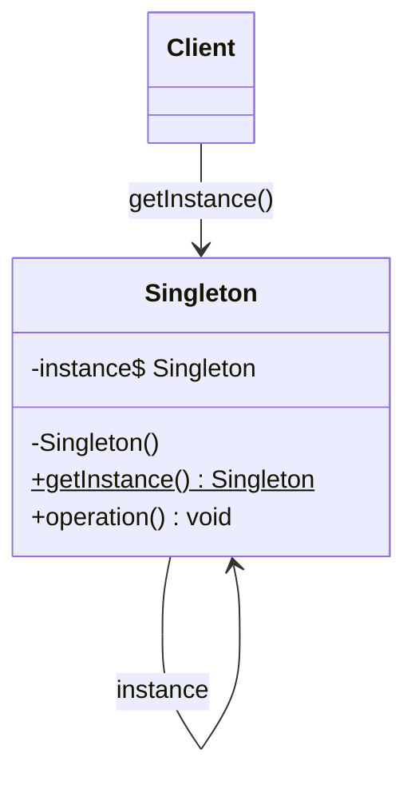

# Singleton

## Description

Singleton ensures that a class has **a single instance** for the life of the application and provides a **global access point** to it. The class itself becomes responsible for controlling its creation, instead of leaving that decision to clients.

To do this, the constructor is made private (or protected), preventing outside instantiation, and the class exposes a static method (for example, `getInstance()`) that creates the instance on the first call (lazy initialization) or creates it up front (eager initialization) and always returns the same object on subsequent calls.

In concurrent environments, instance creation must be protected (synchronization, double-checked locking, a static holder, or language features such as `enum` in Java or `Lazy<T>` in C#) to prevent two threads from creating distinct instances.

## Problems it solves

- Resources that must exist only once in the process, such as a connection pool, an in-memory cache, a configuration manager, or a centralized logger.
- The need for controlled, consistent access to shared state, without scattering the object's creation throughout the code.
- Avoiding the cost of repeatedly creating objects that are expensive to initialize.
- Replacing global variables with an encapsulated access point, which can defer creation until first use.

## When to use

- When there must be exactly one instance of a class and it must be accessible to several clients from a well-known point.
- When the single instance should be extensible by subclassing and clients should be able to use the extended version without changing their code.
- When initialization is expensive and should happen only on demand.

## When to avoid

- When the "single" instance is just a convenience: prefer dependency injection with a singleton scope managed by a container.
- When the class holds shared mutable state, since that creates hidden coupling and makes the system harder to reason about.
- In code that needs to be easily testable with mocks or run in parallel in tests.
- In distributed or multi-process systems, where "single instance" per process doesn't mean a single instance in the system.

## Trade-offs

| Benefit | Cost / Risk |
| --- | --- |
| Guarantees a single instance | Hides dependencies and creates global coupling |
| Centralized access point | Makes unit testing harder (state persists between tests, hard to mock) |
| Lazy initialization is possible | Requires care with concurrency during creation |
| Saves resources for expensive objects | Violates the single responsibility principle (manages its own lifecycle) |

- **Coupling:** clients get tied to the concrete class when they call `getInstance()` directly; accessing it through an interface or injection reduces this problem.
- **Testability:** global state can leak between tests; a reset method or the use of DI is usually needed.
- **Concurrency:** excessive synchronization in `getInstance()` can become a bottleneck; prefer a static holder or eager initialization when possible.
- **Lifecycle:** serialization, reflection, and multiple class loaders can break the single-instance guarantee.

## Diagram



The `Singleton` class keeps a static reference to its own instance and a private constructor; the `Client` doesn't instantiate it directly, it just obtains the object through the static `getInstance()` method.

## Example

The modules that compute boleto due dates, TED settlement and clearing deadlines need the same calendar of business days and bank holidays, loaded from disk once and shared by all of them. The calendar does not change after loading, which avoids the risk of shared mutable state.

<Tabs groupId="lang" queryString>
<TabItem value="java" label="Java">

```java
public final class BusinessCalendar {
    private final Set<LocalDate> holidays = new HashSet<>();

    private BusinessCalendar() {
        try (InputStream in = getClass().getResourceAsStream("/bank-holidays.txt");
             BufferedReader reader = new BufferedReader(new InputStreamReader(in))) {
            reader.lines().map(String::trim).filter(l -> !l.isEmpty())
                  .map(LocalDate::parse).forEach(holidays::add);
        } catch (IOException e) {
            throw new IllegalStateException("Failed to load calendar", e);
        }
    }

    // Holder: lazy, thread-safe initialization guaranteed by the JVM
    private static class Holder {
        private static final BusinessCalendar INSTANCE = new BusinessCalendar();
    }

    public static BusinessCalendar getInstance() {
        return Holder.INSTANCE;
    }

    public boolean isBusinessDay(LocalDate date) {
        DayOfWeek day = date.getDayOfWeek();
        return day != DayOfWeek.SATURDAY && day != DayOfWeek.SUNDAY
            && !holidays.contains(date);
    }

    public LocalDate nextBusinessDay(LocalDate date) {
        LocalDate next = date.plusDays(1);
        while (!isBusinessDay(next)) next = next.plusDays(1);
        return next;
    }
}

// Usage: boleto due dates, TED settlement and clearing all query the same calendar
LocalDate settlement = BusinessCalendar.getInstance().nextBusinessDay(LocalDate.of(2026, 12, 24));
```

</TabItem>
<TabItem value="python" label="Python">

```python
from datetime import date, timedelta
from functools import lru_cache

class BusinessCalendar:
    def __init__(self, holidays: set[date]) -> None:
        self._holidays = holidays

    def is_business_day(self, day: date) -> bool:
        return day.weekday() < 5 and day not in self._holidays  # 5 and 6: Saturday and Sunday

    def next_business_day(self, day: date) -> date:
        following = day + timedelta(days=1)
        while not self.is_business_day(following):
            following += timedelta(days=1)
        return following

# lru_cache: the calendar is loaded only on the first call and reused on the following ones
@lru_cache(maxsize=None)
def business_calendar() -> BusinessCalendar:
    try:
        with open("bank-holidays.txt") as file:
            return BusinessCalendar({date.fromisoformat(line.strip()) for line in file if line.strip()})
    except OSError as e:
        raise RuntimeError("Failed to load calendar") from e

# Usage: boleto due dates, TED settlement and clearing all query the same calendar
settlement = business_calendar().next_business_day(date(2026, 12, 24))
```

</TabItem>
<TabItem value="go" label="Go">

```go
type BusinessCalendar struct {
	holidays map[string]bool // dates in the 2006-01-02 format
}

// sync.OnceValue: lazy, thread-safe initialization, executed only once
var Calendar = sync.OnceValue(func() *BusinessCalendar {
	file, err := os.Open("bank-holidays.txt")
	if err != nil {
		panic(fmt.Errorf("failed to load calendar: %w", err))
	}
	defer file.Close()

	calendar := &BusinessCalendar{holidays: map[string]bool{}}
	scanner := bufio.NewScanner(file)
	for scanner.Scan() {
		if line := strings.TrimSpace(scanner.Text()); line != "" {
			calendar.holidays[line] = true
		}
	}
	return calendar
})

func (c *BusinessCalendar) IsBusinessDay(date time.Time) bool {
	day := date.Weekday()
	return day != time.Saturday && day != time.Sunday && !c.holidays[date.Format(time.DateOnly)]
}

func (c *BusinessCalendar) NextBusinessDay(date time.Time) time.Time {
	next := date.AddDate(0, 0, 1)
	for !c.IsBusinessDay(next) {
		next = next.AddDate(0, 0, 1)
	}
	return next
}

func main() {
	// Usage: boleto due dates, TED settlement and clearing all query the same calendar
	settlement := Calendar().NextBusinessDay(time.Date(2026, 12, 24, 0, 0, 0, 0, time.UTC))
}
```

</TabItem>
</Tabs>

## Related patterns

- [Abstract Factory](/coding/gof/creational/abstract-factory) — concrete factories are often implemented as Singletons.
- [Builder](/coding/gof/creational/builder) — a shared builder or its director can be exposed as a Singleton.
- [Prototype](/coding/gof/creational/prototype) — a prototype registry can be a Singleton.
- [Object Pool](/coding/gof/creational/object-pool) — the pool is usually unique in the application and implemented as a Singleton.
- [Facade](/coding/gof/structural/facade) — a single facade is often enough, and it can be a Singleton.
- [Flyweight](/coding/gof/structural/flyweight) — the flyweight factory is normally a Singleton; they differ because Flyweight allows several shared instances.
- [State](/coding/gof/behavioral/state) — state objects with no data of their own can be Singletons.
- [Null Object](/coding/gof/behavioral/null-object) — the null object is usually exposed as a single instance.

## Reference

- [Design Patterns Cheat Sheet](https://iretha.github.io/design-patterns/cheat-sheet)
- [Singleton on Refactoring.Guru](https://refactoring.guru/design-patterns/singleton)
