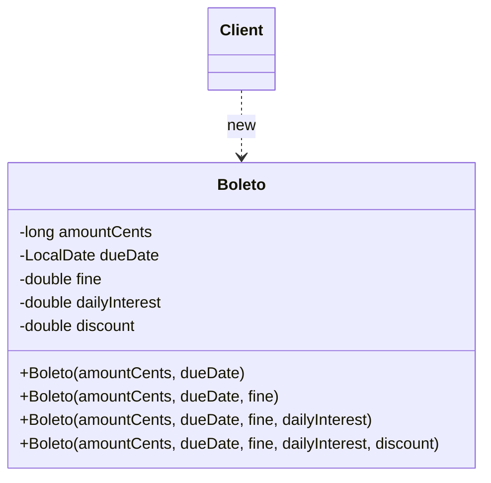

# Telescoping Constructor

## Description

Telescoping Constructor is an object-creation technique in which a class offers a sequence of overloaded constructors, each accepting one more parameter than the previous one. The smaller constructors delegate to the larger ones, filling in the missing parameters with default values, until reaching a "full" constructor that actually initializes the object. The name comes from the image of a telescope extending segment by segment.

It isn't one of the 23 patterns in the GoF catalog. In the literature (notably *Effective Java*, by Joshua Bloch) it's usually presented as an **anti-pattern**: it works well with few parameters, but scales poorly as the number of optional fields grows — calls become hard to read, argument order becomes a trap, and the number of constructors explodes. [Builder](/coding/gof/creational/builder) is the solution usually recommended in that scenario.

Still, the technique has real merits: it produces immutable, fully initialized objects in a single call, requires no helper classes, and is idiomatic in languages without named parameters. For objects with two or three optional parameters, it's often the simplest and most direct option. In languages with named parameters and default values (Kotlin, C#, Python), the problem practically disappears, since a single constructor replaces the whole chain.

## Problems it solves

- Allowing an object to be created by providing only the required parameters, using default values for the optional ones
- Centralizing initialization and validation logic in a single "full" constructor, avoiding duplication
- Ensuring the object is born in a valid state and can be immutable (`final`/`readonly` fields), without setters
- Offering default values in languages that don't support optional or named parameters

## When to use

- The class has few optional parameters (typically up to three or four)
- The optional parameters have a natural order of "importance", so it makes sense to add them progressively
- Immutability and atomic initialization are desirable and you don't want the cost of a Builder class
- The language offers neither named parameters nor default values

## When to avoid

- There are many optional parameters, or they grow frequently — prefer [Builder](/coding/gof/creational/builder)
- Several consecutive parameters have the same type (e.g., several `int` or `boolean`), which makes it easy to swap arguments without a compile error
- The client needs to combine optionals arbitrarily (skip the second and supply the third), which the linear chain doesn't allow
- The language already offers named parameters and default values, making the chain of overloads unnecessary

## Trade-offs

| Benefit | Cost / Risk |
| --- | --- |
| Simple, with no helper classes | The number of constructors grows linearly (and combinations not covered are unreachable) |
| Immutable, valid object after a single call | Calls with many positional arguments are hard to read (`new Pizza(30, true, false, true)`) |
| Default values and validation centralized in the full constructor | Arguments of the same type can be silently swapped |
| Safe for concurrent use (no intermediate state) | Adding a new optional field requires a new constructor and changes the public API |

- **Readability:** the most criticized point; IDEs with parameter hints soften it but don't solve the problem in code review.
- **Maintenance:** each new optional extends the chain; inserting a parameter "in the middle" breaks the order and existing clients.
- **Alternatives:** Builder (readability and arbitrary combinations), JavaBeans/setters (readable, but loses immutability and allows inconsistent states), static factory methods with descriptive names, or named parameters when the language allows.

## Diagram



The `Client` instantiates `Boleto` by choosing the constructor with the number of arguments it needs. Each smaller constructor delegates (via `this(...)`) to the next one, passing a default value, until reaching the full constructor, which assigns all the fields.

## Example

A `Boleto` requires an amount and a due date, while the fine, daily interest and early-payment discount are optional, defaulting to zero.

```java
public final class Boleto {
    private final long amountCents;   // required
    private final LocalDate dueDate;  // required
    private final double fine;        // optional (rate)
    private final double dailyInterest; // optional (daily rate)
    private final double discount;    // optional (rate)

    public Boleto(long amountCents, LocalDate dueDate) {
        this(amountCents, dueDate, 0);
    }
    public Boleto(long amountCents, LocalDate dueDate, double fine) {
        this(amountCents, dueDate, fine, 0);
    }
    public Boleto(long amountCents, LocalDate dueDate, double fine, double dailyInterest) {
        this(amountCents, dueDate, fine, dailyInterest, 0);
    }
    public Boleto(long amountCents, LocalDate dueDate, double fine,
                  double dailyInterest, double discount) {
        if (amountCents <= 0 || dueDate == null) throw new IllegalArgumentException();
        this.amountCents = amountCents;
        this.dueDate = dueDate;
        this.fine = fine;
        this.dailyInterest = dailyInterest;
        this.discount = discount;
    }
}

// Usage: what does each number mean? Swapping fine and discount compiles fine.
Boleto boleto = new Boleto(150_000, LocalDate.of(2026, 12, 10), 0.02, 0.00033, 0.05);
```

## Related patterns

- [Builder](/coding/gof/creational/builder) — the recommended alternative when there are many optional parameters; the `PixCharge` in the Builder example solves the same problem with readable calls and arbitrary combinations, while keeping immutability
- [Factory Method](/coding/gof/creational/factory-method) — creation methods with descriptive names can replace ambiguous constructor overloads
- [Factory](/coding/gof/creational/factory) — encapsulates the choice of default values and the creation, hiding the constructor chain from the client
- [Prototype](/coding/gof/creational/prototype) — another way to avoid long parameter lists: clone a pre-configured object and adjust only what's needed

## Reference

- [Design Patterns Cheat Sheet](https://iretha.github.io/design-patterns/cheat-sheet)
