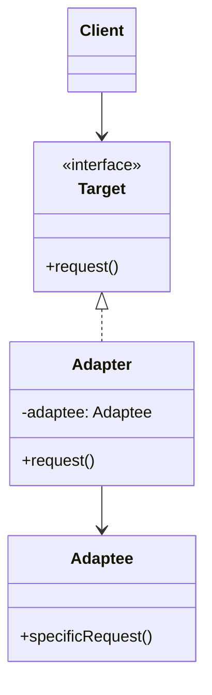

# Adapter

## Description

The Adapter (also known as Wrapper) converts the interface of a class into another interface the client expects. It lets classes with incompatible interfaces work together without either of them having to change.

The client talks only to the target interface (`Target`). The adapter implements that interface and, internally, translates each call into the API of the adapted object (`Adaptee`), converting parameters, data formats, and return values when necessary.

There are two variants: the *object adapter*, which uses composition and holds a reference to the adapted object (the most common and flexible form), and the *class adapter*, which uses multiple inheritance (or inheritance + interface) to inherit from the adaptee and implement the target at the same time.

## Problems it solves

- Integrating a third-party library or a legacy system whose interface doesn't match the one the current code expects.
- Reusing existing classes without modifying their source code (which may not even be available).
- Isolating the domain from the details of external APIs, keeping vendor types and conventions from spreading across the codebase.
- Making it possible to swap one vendor (payment gateway, email provider, storage) for another while keeping the same internal interface.

## When to use

- You want to use an existing class, but its interface doesn't match the one the client needs.
- You need to create an anti-corruption layer between your model and an external or legacy service.
- Several heterogeneous implementations must be exposed to the client through a single interface.
- In tests, to wrap external dependencies behind an interface that's easy to replace with test doubles.

## When to avoid

- When it's possible (and cheap) to simply change the original interface or the client.
- When the difference between the interfaces is so large that the "adapter" turns into a full reimplementation; in that case, it may be a Facade or a new service.
- When the adapter only forwards identical calls, adding a layer of indirection with no real gain.

## Trade-offs

| Benefit | Cost / Risk |
| --- | --- |
| Reuses existing code without modifying it | More classes and an extra layer of indirection |
| Respects the open/closed principle: new adapters without touching the client | Data conversions can cost performance on very frequent calls |
| Separates conversion logic from business logic (single responsibility) | Semantic differences (errors, transactions, timing) can't always be adapted transparently |
| Makes it easier to swap vendors and use mocks in tests | Many chained adapters make tracing and debugging harder |

- **Coupling:** the client depends only on the `Target`; the coupling to the `Adaptee` is concentrated in the adapter.
- **Testability:** the adapter can be tested in isolation, and the client can use fake implementations of the `Target`.
- **Object vs. class adapter:** composition lets you adapt subclasses of the adaptee and swap the instance at runtime; inheritance lets you override the adaptee's behavior, but couples more tightly.

## Diagram



The `Client` depends only on the `Target` interface. The `Adapter` implements `Target` and delegates each `request()` call to the `Adaptee`'s `specificRequest()`, making the necessary conversions (*object adapter* variant).

## Example

A store uses the internal `PaymentGateway` interface, which works with amounts in dollars (decimal). The new provider `AcmePayClient` exposes an SDK that takes cents and returns a status code; an adapter bridges the two.

```typescript
interface PaymentGateway {
  pay(orderId: string, amount: number): boolean;
}

// Third-party SDK (we can't change it)
class AcmePayClient {
  charge(reference: string, amountInCents: number): { status: string } {
    return { status: "APPROVED" };
  }
}

class AcmePayAdapter implements PaymentGateway {
  constructor(private readonly client: AcmePayClient) {}

  pay(orderId: string, amount: number): boolean {
    const cents = Math.round(amount * 100);
    const result = this.client.charge(orderId, cents);
    return result.status === "APPROVED";
  }
}

// The client only knows PaymentGateway
const gateway: PaymentGateway = new AcmePayAdapter(new AcmePayClient());
gateway.pay("order-42", 199.9);
```

## Related patterns

- [Bridge](/coding/gof/structural/bridge) — has a similar structure, but is designed up front to separate abstraction and implementation; the Adapter is applied afterward, to make existing interfaces work together.
- [Decorator](/coding/gof/structural/decorator) — also wraps an object, but keeps the same interface and adds behavior, whereas the Adapter changes the interface.
- [Proxy](/coding/gof/structural/proxy) — wraps an object offering the same interface to control access; the Adapter offers a different interface.
- [Facade](/coding/gof/structural/facade) — defines a new, simplified interface for an entire subsystem; the Adapter reuses an existing interface for a single object.

## Reference

- [Design Patterns Cheat Sheet](https://iretha.github.io/design-patterns/cheat-sheet)
- [Adapter on Refactoring.Guru](https://refactoring.guru/design-patterns/adapter)
