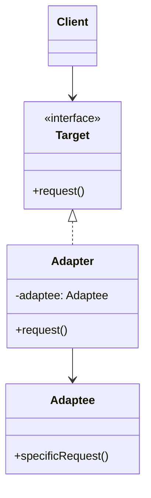

# Adapter

## Description

The Adapter (also known as Wrapper) converts the interface of a class into another interface the client expects. It lets classes with incompatible interfaces work together without either of them having to change.

The client talks only to the target interface (`Target`). The adapter implements that interface and, internally, translates each call into the API of the adapted object (`Adaptee`), converting parameters, data formats, and return values when necessary.

There are two variants: the *object adapter*, which uses composition and holds a reference to the adapted object (the most common and flexible form), and the *class adapter*, which uses multiple inheritance (or inheritance + interface) to inherit from the adaptee and implement the target at the same time.

## Problems it solves

- Integrating a third-party library or a legacy system whose interface doesn't match the one the current code expects.
- Reusing existing classes without modifying their source code (which may not even be available).
- Isolating the domain from the details of external APIs, keeping vendor types and conventions from spreading across the codebase.
- Making it possible to swap one vendor (payment gateway, email provider, storage) for another while keeping the same internal interface.

## When to use

- You want to use an existing class, but its interface doesn't match the one the client needs.
- You need to create an anti-corruption layer between your model and an external or legacy service.
- Several heterogeneous implementations must be exposed to the client through a single interface.
- In tests, to wrap external dependencies behind an interface that's easy to replace with test doubles.

## When to avoid

- When it's possible (and cheap) to simply change the original interface or the client.
- When the difference between the interfaces is so large that the "adapter" turns into a full reimplementation; in that case, it may be a Facade or a new service.
- When the adapter only forwards identical calls, adding a layer of indirection with no real gain.

## Trade-offs

| Benefit | Cost / Risk |
| --- | --- |
| Reuses existing code without modifying it | More classes and an extra layer of indirection |
| Respects the open/closed principle: new adapters without touching the client | Data conversions can cost performance on very frequent calls |
| Separates conversion logic from business logic (single responsibility) | Semantic differences (errors, transactions, timing) can't always be adapted transparently |
| Makes it easier to swap vendors and use mocks in tests | Many chained adapters make tracing and debugging harder |

- **Coupling:** the client depends only on the `Target`; the coupling to the `Adaptee` is concentrated in the adapter.
- **Testability:** the adapter can be tested in isolation, and the client can use fake implementations of the `Target`.
- **Object vs. class adapter:** composition lets you adapt subclasses of the adaptee and swap the instance at runtime; inheritance lets you override the adaptee's behavior, but couples more tightly.

## Diagram



The `Client` depends only on the `Target` interface. The `Adapter` implements `Target` and delegates each `request()` call to the `Adaptee`'s `specificRequest()`, making the necessary conversions (*object adapter* variant).

## Example

The fintech uses the internal `PixGateway` interface, which works with `Money` and a Pix key. The settlement partner's SDK, `PartnerPixClient`, takes the key as plain text and the amount in cents, and returns a status code; an adapter bridges the two.

<Tabs groupId="lang" queryString>
<TabItem value="java" label="Java">

```java
record Money(long cents) {}

enum PixKeyType { CPF, EMAIL, PHONE, EVP }

record PixKey(PixKeyType type, String value) {}

interface PixGateway {
    boolean send(PixKey key, Money amount);
}

// Partner SDK (we cannot change it)
class PartnerPixClient {
    record Result(String status) {}

    Result transfer(String destinationKey, long amountInCents) {
        return new Result("SETTLED");
    }
}

class PartnerPixAdapter implements PixGateway {
    private final PartnerPixClient client;

    PartnerPixAdapter(PartnerPixClient client) { this.client = client; }

    public boolean send(PixKey key, Money amount) {
        PartnerPixClient.Result result = client.transfer(key.value(), amount.cents());
        return result.status().equals("SETTLED");
    }
}

// The client only knows PixGateway
PixGateway gateway = new PartnerPixAdapter(new PartnerPixClient());
gateway.send(new PixKey(PixKeyType.EMAIL, "ana@example.com"), new Money(19_990));
```

</TabItem>
<TabItem value="python" label="Python">

```python
from dataclasses import dataclass
from typing import Protocol

@dataclass(frozen=True)
class Money:
    cents: int

@dataclass(frozen=True)
class PixKey:
    type: str  # "CPF", "EMAIL", "PHONE" or "EVP"
    value: str

class PixGateway(Protocol):
    def send(self, key: PixKey, amount: Money) -> bool: ...

# Partner SDK (we cannot change it)
class PartnerPixClient:
    def transfer(self, destination_key: str, amount_in_cents: int) -> dict:
        return {"status": "SETTLED"}

class PartnerPixAdapter:
    def __init__(self, client: PartnerPixClient) -> None:
        self._client = client

    def send(self, key: PixKey, amount: Money) -> bool:
        result = self._client.transfer(key.value, amount.cents)
        return result["status"] == "SETTLED"

# The client only knows PixGateway
gateway: PixGateway = PartnerPixAdapter(PartnerPixClient())
gateway.send(PixKey("EMAIL", "ana@example.com"), Money(19_990))
```

</TabItem>
<TabItem value="go" label="Go">

```go
type Money struct{ Cents int64 }

type PixKey struct {
	Type  string // "CPF", "EMAIL", "PHONE" or "EVP"
	Value string
}

type PixGateway interface {
	Send(key PixKey, amount Money) bool
}

// Partner SDK (we cannot change it)
type PartnerPixClient struct{}

type PartnerResult struct{ Status string }

func (PartnerPixClient) Transfer(destinationKey string, amountInCents int64) PartnerResult {
	return PartnerResult{Status: "SETTLED"}
}

type PartnerPixAdapter struct {
	client PartnerPixClient
}

func (a PartnerPixAdapter) Send(key PixKey, amount Money) bool {
	result := a.client.Transfer(key.Value, amount.Cents)
	return result.Status == "SETTLED"
}

func main() {
	// The client only knows PixGateway
	var gateway PixGateway = PartnerPixAdapter{client: PartnerPixClient{}}
	gateway.Send(PixKey{"EMAIL", "ana@example.com"}, Money{19_990})
}
```

</TabItem>
<TabItem value="typescript" label="TypeScript">

```typescript
interface Money {
  cents: number;
}

interface PixKey {
  type: "CPF" | "EMAIL" | "PHONE" | "EVP";
  value: string;
}

interface PixGateway {
  send(key: PixKey, amount: Money): boolean;
}

// Partner SDK (we cannot change it)
class PartnerPixClient {
  transfer(destinationKey: string, amountInCents: number): { status: string } {
    return { status: "SETTLED" };
  }
}

class PartnerPixAdapter implements PixGateway {
  constructor(private readonly client: PartnerPixClient) {}

  send(key: PixKey, amount: Money): boolean {
    const result = this.client.transfer(key.value, amount.cents);
    return result.status === "SETTLED";
  }
}

// The client only knows PixGateway
const gateway: PixGateway = new PartnerPixAdapter(new PartnerPixClient());
gateway.send({ type: "EMAIL", value: "ana@example.com" }, { cents: 19_990 });
```

</TabItem>
</Tabs>

## Related patterns

- [Bridge](/coding/gof/structural/bridge) — has a similar structure, but is designed up front to separate abstraction and implementation; the Adapter is applied afterward, to make existing interfaces work together.
- [Decorator](/coding/gof/structural/decorator) — also wraps an object, but keeps the same interface and adds behavior, whereas the Adapter changes the interface.
- [Proxy](/coding/gof/structural/proxy) — wraps an object offering the same interface to control access; the Adapter offers a different interface.
- [Facade](/coding/gof/structural/facade) — defines a new, simplified interface for an entire subsystem; the Adapter reuses an existing interface for a single object.

## Reference

- [Design Patterns Cheat Sheet](https://iretha.github.io/design-patterns/cheat-sheet)
- [Adapter on Refactoring.Guru](https://refactoring.guru/design-patterns/adapter)
