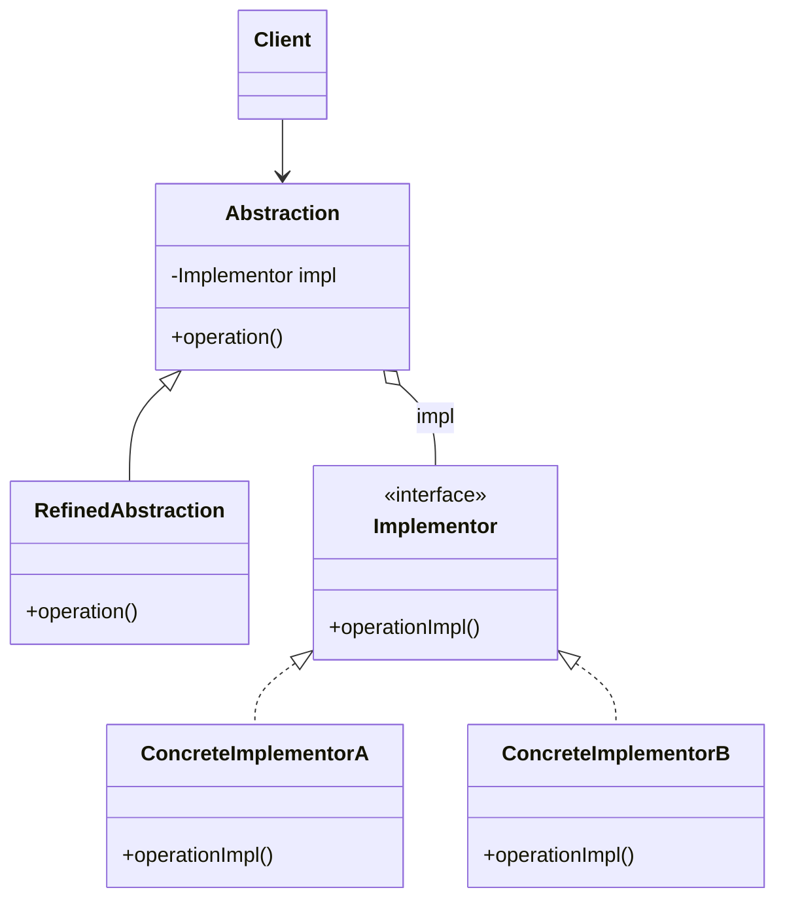

# Bridge

## Description

The Bridge decouples an abstraction from its implementation so that the two can vary independently. Instead of creating a single hierarchy that combines every variation (for example, `OneTimePixCharge`, `RecurringPixCharge`, `OneTimeBoletoCharge`...), the pattern splits the problem into two hierarchies: the **abstraction** (what the client uses) and the **implementor** (how the low-level work is done).

The abstraction holds a reference to an implementor object and delegates the primitive operations to it. New refined abstractions and new concrete implementations can be added without one affecting the other, and the implementation can even be swapped at runtime.

In practice, the Bridge trades inheritance for composition: the "bridge" is precisely the abstraction's reference to the implementor interface.

## Problems it solves

- Combinatorial explosion of subclasses when two dimensions of variation (e.g., charge type and settlement rail) are modeled in a single hierarchy.
- Permanent coupling between the abstraction and a specific implementation, fixed at compile time.
- Implementation changes that force recompilation or changes to client code.
- Difficulty sharing the same implementation among several abstractions.

## When to use

- When a class varies along two (or more) orthogonal dimensions that should evolve independently.
- When you need to choose or swap the implementation at runtime (e.g., driver, storage backend, delivery channel).
- When you want to hide platform-dependent implementation details from client code.
- When designing cross-platform libraries or drivers (JDBC, graphics renderers, cloud providers).

## When to avoid

- When there's only one implementation and no real prospect of others; the indirection becomes needless complexity.
- When the two dimensions aren't actually independent and the abstraction needs to know details of each implementation.
- In small, stable code, where a simple hierarchy or a one-off Strategy does the job.

## Trade-offs

| Benefit | Cost / Risk |
| --- | --- |
| Abstraction and implementation evolve independently | More classes and interfaces to understand |
| Avoids subclass explosion (N + M instead of N x M) | Extra indirection on every delegated call |
| Implementation can be swapped at runtime | Requires identifying the right dimensions right at design time |
| Respects Open/Closed and Single Responsibility | The implementor interface can become too generic (lowest common denominator) |

- **Coupling:** the client depends only on the abstraction; implementations stay isolated.
- **Testability:** the implementor can easily be replaced with a test double.
- **Complexity:** it's usually decided early in the project; applying it later requires significant refactoring.
- **Performance:** the cost of an indirect call, normally negligible.

## Diagram



`Abstraction` defines the interface used by the `Client` and holds a reference to an `Implementor`; `RefinedAbstraction` extends that interface. `Implementor` declares the primitive operations, carried out by `ConcreteImplementorA` and `ConcreteImplementorB`.

## Example

A billing system has charge types (one-time, recurring) and settlement rails (Pix, boleto, card). With Bridge, each charge delegates settlement to a rail, avoiding classes such as `RecurringPixCharge` and `OneTimeBoletoCharge`.

<Tabs groupId="lang" queryString>
<TabItem value="java" label="Java">

```java
interface SettlementRail {
    void settle(String reference, long amountCents);
}

class PixRail implements SettlementRail {
    public void settle(String reference, long amountCents) {
        System.out.println("Pix settled " + reference + ": " + amountCents);
    }
}

class BoletoRail implements SettlementRail {
    public void settle(String reference, long amountCents) {
        System.out.println("Boleto settled " + reference + ": " + amountCents);
    }
}

class CardRail implements SettlementRail {
    public void settle(String reference, long amountCents) {
        System.out.println("Card settled " + reference + ": " + amountCents);
    }
}

abstract class Charge {
    protected final SettlementRail rail;

    Charge(SettlementRail rail) { this.rail = rail; }

    abstract void collect(String reference, long amountCents);
}

class OneTimeCharge extends Charge {
    OneTimeCharge(SettlementRail rail) { super(rail); }

    void collect(String reference, long amountCents) { rail.settle(reference, amountCents); }
}

class RecurringCharge extends Charge {
    private final int cycles;

    RecurringCharge(SettlementRail rail, int cycles) { super(rail); this.cycles = cycles; }

    void collect(String reference, long amountCents) {
        for (int n = 1; n <= cycles; n++) {
            rail.settle(reference + "-" + n, amountCents);
        }
    }
}

new OneTimeCharge(new PixRail()).collect("inv-12", 15_000);
new RecurringCharge(new CardRail(), 3).collect("sub-77", 4_990);
```

</TabItem>
<TabItem value="python" label="Python">

```python
from abc import ABC, abstractmethod
from typing import Protocol

class SettlementRail(Protocol):
    def settle(self, reference: str, amount_cents: int) -> None: ...

class PixRail:
    def settle(self, reference: str, amount_cents: int) -> None:
        print(f"Pix settled {reference}: {amount_cents}")

class BoletoRail:
    def settle(self, reference: str, amount_cents: int) -> None:
        print(f"Boleto settled {reference}: {amount_cents}")

class CardRail:
    def settle(self, reference: str, amount_cents: int) -> None:
        print(f"Card settled {reference}: {amount_cents}")

class Charge(ABC):
    def __init__(self, rail: SettlementRail) -> None:
        self._rail = rail

    @abstractmethod
    def collect(self, reference: str, amount_cents: int) -> None: ...

class OneTimeCharge(Charge):
    def collect(self, reference: str, amount_cents: int) -> None:
        self._rail.settle(reference, amount_cents)

class RecurringCharge(Charge):
    def __init__(self, rail: SettlementRail, cycles: int) -> None:
        super().__init__(rail)
        self._cycles = cycles

    def collect(self, reference: str, amount_cents: int) -> None:
        for n in range(1, self._cycles + 1):
            self._rail.settle(f"{reference}-{n}", amount_cents)

OneTimeCharge(PixRail()).collect("inv-12", 15_000)
RecurringCharge(CardRail(), 3).collect("sub-77", 4_990)
```

</TabItem>
<TabItem value="go" label="Go">

```go
type SettlementRail interface {
	Settle(reference string, amountCents int64)
}

type PixRail struct{}

func (PixRail) Settle(reference string, amountCents int64) {
	fmt.Printf("Pix settled %s: %d\n", reference, amountCents)
}

type BoletoRail struct{}

func (BoletoRail) Settle(reference string, amountCents int64) {
	fmt.Printf("Boleto settled %s: %d\n", reference, amountCents)
}

type CardRail struct{}

func (CardRail) Settle(reference string, amountCents int64) {
	fmt.Printf("Card settled %s: %d\n", reference, amountCents)
}

// The abstraction holds the implementation in a field: the two hierarchies vary independently.
type OneTimeCharge struct {
	Rail SettlementRail
}

func (c OneTimeCharge) Collect(reference string, amountCents int64) {
	c.Rail.Settle(reference, amountCents)
}

type RecurringCharge struct {
	Rail   SettlementRail
	Cycles int
}

func (c RecurringCharge) Collect(reference string, amountCents int64) {
	for n := 1; n <= c.Cycles; n++ {
		c.Rail.Settle(fmt.Sprintf("%s-%d", reference, n), amountCents)
	}
}

func main() {
	OneTimeCharge{Rail: PixRail{}}.Collect("inv-12", 15_000)
	RecurringCharge{Rail: CardRail{}, Cycles: 3}.Collect("sub-77", 4_990)
}
```

</TabItem>
<TabItem value="typescript" label="TypeScript">

```typescript
interface SettlementRail {
  settle(reference: string, amountCents: number): void;
}

class PixRail implements SettlementRail {
  settle(reference: string, amountCents: number) { console.log(`Pix settled ${reference}: ${amountCents}`); }
}

class BoletoRail implements SettlementRail {
  settle(reference: string, amountCents: number) { console.log(`Boleto settled ${reference}: ${amountCents}`); }
}

class CardRail implements SettlementRail {
  settle(reference: string, amountCents: number) { console.log(`Card settled ${reference}: ${amountCents}`); }
}

abstract class Charge {
  constructor(protected rail: SettlementRail) {}
  abstract collect(reference: string, amountCents: number): void;
}

class OneTimeCharge extends Charge {
  collect(reference: string, amountCents: number) { this.rail.settle(reference, amountCents); }
}

class RecurringCharge extends Charge {
  constructor(rail: SettlementRail, private readonly cycles: number) { super(rail); }

  collect(reference: string, amountCents: number) {
    for (let n = 1; n <= this.cycles; n++) {
      this.rail.settle(`${reference}-${n}`, amountCents);
    }
  }
}

new OneTimeCharge(new PixRail()).collect("inv-12", 15_000);
new RecurringCharge(new CardRail(), 3).collect("sub-77", 4_990);
```

</TabItem>
</Tabs>

## Related patterns

- [Adapter](/coding/gof/structural/adapter) — also involves indirection between interfaces, but the Adapter is applied afterward to make existing classes compatible; the Bridge is planned up front.
- [Abstract Factory](/coding/gof/creational/abstract-factory) — can create and configure the right abstraction/implementor pair, hiding the choice of concrete implementation.
- [Strategy](/coding/gof/behavioral/strategy) — similar structure (composition + delegation), but Strategy focuses on swapping algorithms, while Bridge separates two structural hierarchies.
- [State](/coding/gof/behavioral/state) — also delegates behavior to a composed object, but the switch is driven by internal state.
- [Builder](/coding/gof/creational/builder) — can be combined with Bridge: the director acts as the abstraction and the builders as the implementations.

## Reference

- [Design Patterns Cheat Sheet](https://iretha.github.io/design-patterns/cheat-sheet)
- [Bridge on Refactoring.Guru](https://refactoring.guru/design-patterns/bridge)
