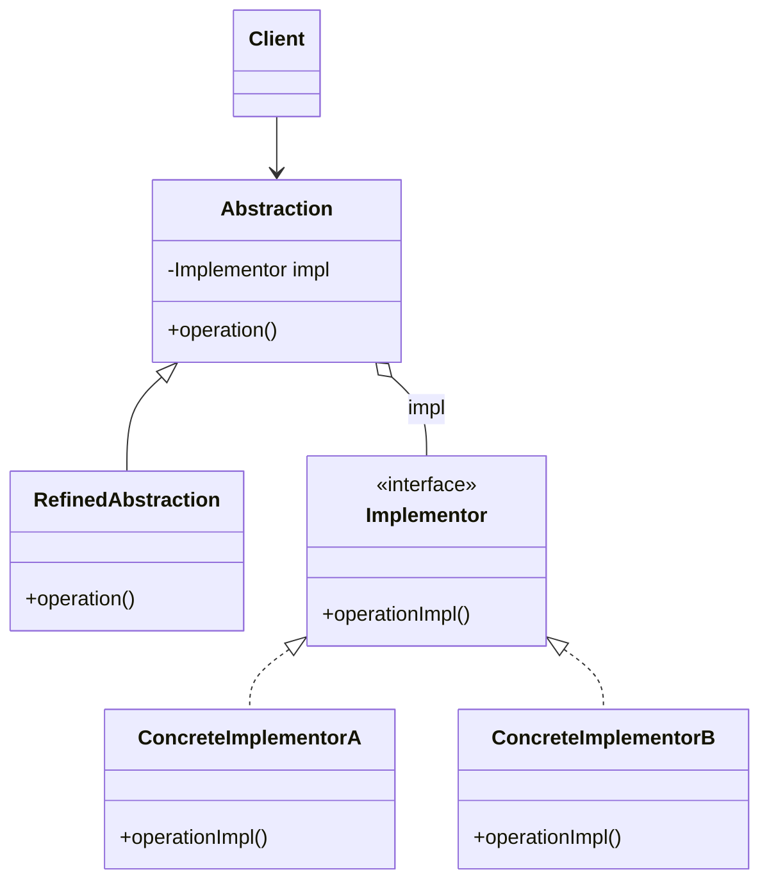

# Bridge

## Description

The Bridge decouples an abstraction from its implementation so that the two can vary independently. Instead of creating a single hierarchy that combines every variation (for example, `WindowsCircle`, `LinuxCircle`, `WindowsSquare`...), the pattern splits the problem into two hierarchies: the **abstraction** (what the client uses) and the **implementor** (how the low-level work is done).

The abstraction holds a reference to an implementor object and delegates the primitive operations to it. New refined abstractions and new concrete implementations can be added without one affecting the other, and the implementation can even be swapped at runtime.

In practice, the Bridge trades inheritance for composition: the "bridge" is precisely the abstraction's reference to the implementor interface.

## Problems it solves

- Combinatorial explosion of subclasses when two dimensions of variation (e.g., shape and rendering platform) are modeled in a single hierarchy.
- Permanent coupling between the abstraction and a specific implementation, fixed at compile time.
- Implementation changes that force recompilation or changes to client code.
- Difficulty sharing the same implementation among several abstractions.

## When to use

- When a class varies along two (or more) orthogonal dimensions that should evolve independently.
- When you need to choose or swap the implementation at runtime (e.g., driver, storage backend, delivery channel).
- When you want to hide platform-dependent implementation details from client code.
- When designing cross-platform libraries or drivers (JDBC, graphics renderers, cloud providers).

### When to avoid

- When there's only one implementation and no real prospect of others; the indirection becomes needless complexity.
- When the two dimensions aren't actually independent and the abstraction needs to know details of each implementation.
- In small, stable code, where a simple hierarchy or a one-off Strategy does the job.

## Trade-offs

| Benefit | Cost / Risk |
| --- | --- |
| Abstraction and implementation evolve independently | More classes and interfaces to understand |
| Avoids subclass explosion (N + M instead of N x M) | Extra indirection on every delegated call |
| Implementation can be swapped at runtime | Requires identifying the right dimensions right at design time |
| Respects Open/Closed and Single Responsibility | The implementor interface can become too generic (lowest common denominator) |

- **Coupling:** the client depends only on the abstraction; implementations stay isolated.
- **Testability:** the implementor can easily be replaced with a test double.
- **Complexity:** it's usually decided early in the project; applying it later requires significant refactoring.
- **Performance:** the cost of an indirect call, normally negligible.

## Diagram



`Abstraction` defines the interface used by the `Client` and holds a reference to an `Implementor`; `RefinedAbstraction` extends that interface. `Implementor` declares the primitive operations, carried out by `ConcreteImplementorA` and `ConcreteImplementorB`.

## Example

A notification system has message types (alert, reminder) and delivery channels (email, SMS). With Bridge, each message type delegates delivery to a channel, avoiding classes like `EmailAlert` and `SmsReminder`.

```typescript
interface MessageSender {
  send(to: string, body: string): void;
}

class EmailSender implements MessageSender {
  send(to: string, body: string) { console.log(`Email to ${to}: ${body}`); }
}

class SmsSender implements MessageSender {
  send(to: string, body: string) { console.log(`SMS to ${to}: ${body}`); }
}

abstract class Notification {
  constructor(protected sender: MessageSender) {}
  abstract notify(to: string, text: string): void;
}

class AlertNotification extends Notification {
  notify(to: string, text: string) { this.sender.send(to, `[ALERT] ${text}`); }
}

class ReminderNotification extends Notification {
  notify(to: string, text: string) { this.sender.send(to, `Reminder: ${text}`); }
}

new AlertNotification(new SmsSender()).notify("+5511999999999", "CPU at 95%");
new ReminderNotification(new EmailSender()).notify("ana@example.com", "Meeting at 3pm");
```

## Related patterns

- [Adapter](/coding/gof/structural/adapter) — also involves indirection between interfaces, but the Adapter is applied afterward to make existing classes compatible; the Bridge is planned up front.
- [Abstract Factory](/coding/gof/creational/abstract-factory) — can create and configure the right abstraction/implementor pair, hiding the choice of concrete implementation.
- [Strategy](/coding/gof/behavioral/strategy) — similar structure (composition + delegation), but Strategy focuses on swapping algorithms, while Bridge separates two structural hierarchies.
- [State](/coding/gof/behavioral/state) — also delegates behavior to a composed object, but the switch is driven by internal state.
- [Builder](/coding/gof/creational/builder) — can be combined with Bridge: the director acts as the abstraction and the builders as the implementations.

## Reference

- [Design Patterns Cheat Sheet](https://iretha.github.io/design-patterns/cheat-sheet)
- [Bridge on Refactoring.Guru](https://refactoring.guru/design-patterns/bridge)
