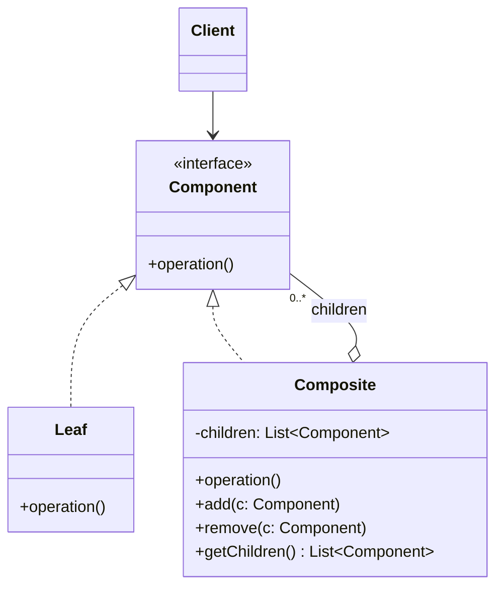

# Composite

## Description

The Composite composes objects into tree structures to represent part-whole hierarchies. It lets the client treat individual objects (leaves) and compositions of objects (nodes with children) uniformly, through a common interface.

The `Component` interface declares the shared operations. Leaves (`Leaf`) implement the behavior directly, while composites (`Composite`) hold a collection of children of type `Component` and delegate the operation to each of them, usually aggregating the results. Because the composite is also a `Component`, the structure can be nested recursively to any depth.

As a result, client code doesn't need to distinguish whether it's dealing with a simple element or a group: it just calls the operation on the root and the recursion walks the entire tree.

## Problems it solves

- Client code full of type checks (`if` / `instanceof`) to tell simple elements apart from groupings
- Need to represent recursive hierarchies (file systems, menus, org charts, UI trees, expressions)
- Difficulty applying an operation (computing a total, rendering, validating) recursively across an entire structure
- Client coupling to the internal structure of object groupings

## When to use

- When the domain has a naturally tree-shaped structure, with a part-whole relationship
- When the client should ignore the difference between individual objects and compositions
- When new kinds of leaves or composites may appear without changing client code

## When to avoid

- When the structure is flat or has a single level; a simple list is enough
- When leaves and composites behave very differently, making the common interface artificial or full of operations that make no sense for one side
- When you need to strictly restrict which types of children a composite accepts (the type system no longer helps)

## Trade-offs

| Benefit | Cost / Risk |
| --- | --- |
| Client treats leaves and composites uniformly | The common interface can become too generic |
| Makes it easy to add new component types (Open/Closed) | Hard to restrict the types of a composite's children |
| Simple, elegant recursive operations | Child-management operations (`add`/`remove`) on the leaf either violate type safety or require checks |
| Nested structures of arbitrary depth | Large trees can have a performance cost on repeated traversals |

- **Transparency vs. safety:** declaring `add`/`remove` in `Component` gives the client transparency, but forces the leaf to throw an error or ignore the call; declaring them only in `Composite` is safer, but requires the client to know the concrete type.
- **Parent reference:** keeping a pointer to the parent makes navigation and removal easier, but adds consistency complexity.
- **Caching:** composites can store aggregated results to avoid recomputation, as long as they invalidate the cache when children change.
- **Testability:** each leaf can be tested in isolation; composites can be tested with fake leaves.

## Diagram



The `Client` depends only on `Component`. `Leaf` implements the operation directly, and `Composite` aggregates several child `Component`s, delegating the operation to each of them recursively.

## Example

An investment portfolio contains assets and sub-portfolios, such as "Emergency Fund" and "Retirement". The current value of a portfolio is the sum of the values of its items, and the client asks for the value of any node without knowing whether it is an asset or a portfolio. Illustrative values.

<Tabs groupId="lang" queryString>
<TabItem value="java" label="Java">

```java
record Money(long cents) {
    Money plus(Money other) { return new Money(cents + other.cents); }
}

interface Holding {
    String getName();
    Money currentValue();
}

record Asset(String name, Money value) implements Holding {
    public String getName() { return name; }
    public Money currentValue() { return value; }
}

class Portfolio implements Holding {
    private final String name;
    private final List<Holding> children = new ArrayList<>();

    Portfolio(String name) { this.name = name; }

    Portfolio add(Holding holding) { children.add(holding); return this; }
    void remove(Holding holding) { children.remove(holding); }

    public String getName() { return name; }
    public Money currentValue() {
        return children.stream().map(Holding::currentValue).reduce(new Money(0), Money::plus);
    }
}

Portfolio reserve = new Portfolio("Emergency Fund").add(new Asset("CDB Daily Liquidity", new Money(2_000_000)));
Portfolio retirement = new Portfolio("Retirement")
    .add(new Asset("CDB 2029", new Money(1_500_000)))
    .add(new Asset("Multimarket Fund", new Money(800_000)));
Portfolio portfolio = new Portfolio("Portfolio").add(reserve).add(retirement);

System.out.println(portfolio.currentValue().cents()); // 4300000 (R$ 43,000.00)
```

</TabItem>
<TabItem value="python" label="Python">

```python
from __future__ import annotations

from dataclasses import dataclass
from typing import Protocol

@dataclass(frozen=True)
class Money:
    cents: int

    def __add__(self, other: Money) -> Money:
        return Money(self.cents + other.cents)

class Holding(Protocol):
    name: str

    def current_value(self) -> Money: ...

@dataclass(frozen=True)
class Asset:
    name: str
    value: Money

    def current_value(self) -> Money:
        return self.value

class Portfolio:
    def __init__(self, name: str) -> None:
        self.name = name
        self._children: list[Holding] = []

    def add(self, holding: Holding) -> Portfolio:
        self._children.append(holding)
        return self

    def remove(self, holding: Holding) -> None:
        self._children.remove(holding)

    def current_value(self) -> Money:
        return sum((child.current_value() for child in self._children), Money(0))

reserve = Portfolio("Emergency Fund").add(Asset("CDB Daily Liquidity", Money(2_000_000)))
retirement = (
    Portfolio("Retirement")
    .add(Asset("CDB 2029", Money(1_500_000)))
    .add(Asset("Multimarket Fund", Money(800_000)))
)
portfolio = Portfolio("Portfolio").add(reserve).add(retirement)

print(portfolio.current_value().cents)  # 4300000 (R$ 43,000.00)
```

</TabItem>
<TabItem value="go" label="Go">

```go
type Money struct{ Cents int64 }

func (m Money) Plus(other Money) Money { return Money{m.Cents + other.Cents} }

type Holding interface {
	Name() string
	CurrentValue() Money
}

type Asset struct {
	name  string
	value Money
}

func (a Asset) Name() string        { return a.name }
func (a Asset) CurrentValue() Money { return a.value }

type Portfolio struct {
	name     string
	children []Holding
}

func NewPortfolio(name string) *Portfolio { return &Portfolio{name: name} }

func (p *Portfolio) Add(holding Holding) *Portfolio {
	p.children = append(p.children, holding)
	return p
}

func (p *Portfolio) Remove(holding Holding) {
	p.children = slices.DeleteFunc(p.children, func(c Holding) bool { return c == holding })
}

func (p *Portfolio) Name() string { return p.name }

func (p *Portfolio) CurrentValue() Money {
	total := Money{}
	for _, child := range p.children {
		total = total.Plus(child.CurrentValue())
	}
	return total
}

func main() {
	reserve := NewPortfolio("Emergency Fund").Add(Asset{"CDB Daily Liquidity", Money{2_000_000}})
	retirement := NewPortfolio("Retirement").
		Add(Asset{"CDB 2029", Money{1_500_000}}).
		Add(Asset{"Multimarket Fund", Money{800_000}})
	portfolio := NewPortfolio("Portfolio").Add(reserve).Add(retirement)

	fmt.Println(portfolio.CurrentValue().Cents) // 4300000 (R$ 43,000.00)
}
```

</TabItem>
<TabItem value="typescript" label="TypeScript">

```typescript
class Money {
  constructor(readonly cents: number) {}
  plus(other: Money): Money { return new Money(this.cents + other.cents); }
}

interface Holding {
  getName(): string;
  currentValue(): Money;
}

class Asset implements Holding {
  constructor(private name: string, private value: Money) {}
  getName() { return this.name; }
  currentValue() { return this.value; }
}

class Portfolio implements Holding {
  private children: Holding[] = [];
  constructor(private name: string) {}
  add(holding: Holding) { this.children.push(holding); return this; }
  remove(holding: Holding) { this.children = this.children.filter(c => c !== holding); }
  getName() { return this.name; }
  currentValue() {
    return this.children.reduce((total, c) => total.plus(c.currentValue()), new Money(0));
  }
}

const reserve = new Portfolio("Emergency Fund").add(new Asset("CDB Daily Liquidity", new Money(2_000_000)));
const retirement = new Portfolio("Retirement")
  .add(new Asset("CDB 2029", new Money(1_500_000)))
  .add(new Asset("Multimarket Fund", new Money(800_000)));
const portfolio = new Portfolio("Portfolio").add(reserve).add(retirement);

console.log(portfolio.currentValue().cents); // 4300000 (R$ 43,000.00)
```

</TabItem>
</Tabs>

## Related patterns

- [Decorator](/coding/gof/structural/decorator) — has a similar recursive structure, but a decorator has a single child and adds responsibilities, while the Composite aggregates several children
- [Iterator](/coding/gof/behavioral/iterator) — used to traverse the component tree without exposing its internal structure
- [Visitor](/coding/gof/behavioral/visitor) — lets you apply new operations across the whole tree without changing the `Leaf` and `Composite` classes (the same investment portfolio is the example there, with operations such as tax and income reports)
- [Chain of Responsibility](/coding/gof/behavioral/chain-of-responsibility) — often uses the component's parent reference as the successor in the chain
- [Flyweight](/coding/gof/structural/flyweight) — leaves can be shared as flyweights to save memory in large trees
- [Interpreter](/coding/gof/behavioral/interpreter) — the Interpreter's abstract syntax tree is an application of the Composite
- [Builder](/coding/gof/creational/builder) — can be used to build complex Composite trees step by step
- [Command](/coding/gof/behavioral/command) — macro commands are composed of other commands

## Reference

- [Design Patterns Cheat Sheet](https://iretha.github.io/design-patterns/cheat-sheet)
- [Composite on Refactoring.Guru](https://refactoring.guru/design-patterns/composite)
