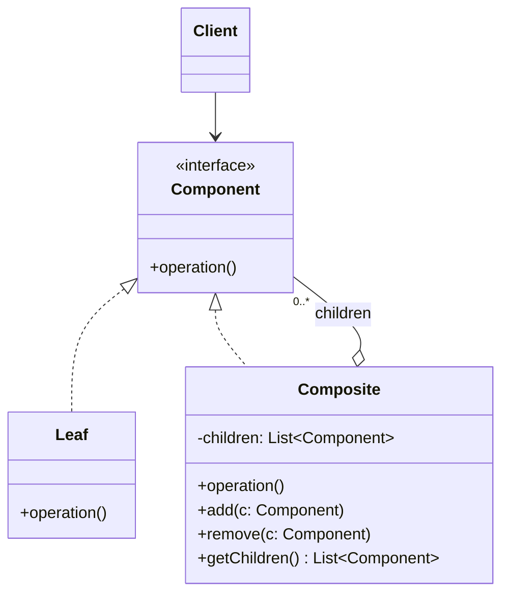

# Composite

## Description

The Composite composes objects into tree structures to represent part-whole hierarchies. It lets the client treat individual objects (leaves) and compositions of objects (nodes with children) uniformly, through a common interface.

The `Component` interface declares the shared operations. Leaves (`Leaf`) implement the behavior directly, while composites (`Composite`) hold a collection of children of type `Component` and delegate the operation to each of them, usually aggregating the results. Because the composite is also a `Component`, the structure can be nested recursively to any depth.

As a result, client code doesn't need to distinguish whether it's dealing with a simple element or a group: it just calls the operation on the root and the recursion walks the entire tree.

## Problems it solves

- Client code full of type checks (`if` / `instanceof`) to tell simple elements apart from groupings
- Need to represent recursive hierarchies (file systems, menus, org charts, UI trees, expressions)
- Difficulty applying an operation (computing a total, rendering, validating) recursively across an entire structure
- Client coupling to the internal structure of object groupings

## When to use

- When the domain has a naturally tree-shaped structure, with a part-whole relationship
- When the client should ignore the difference between individual objects and compositions
- When new kinds of leaves or composites may appear without changing client code

## When to avoid

- When the structure is flat or has a single level; a simple list is enough
- When leaves and composites behave very differently, making the common interface artificial or full of operations that make no sense for one side
- When you need to strictly restrict which types of children a composite accepts (the type system no longer helps)

## Trade-offs

| Benefit | Cost / Risk |
| --- | --- |
| Client treats leaves and composites uniformly | The common interface can become too generic |
| Makes it easy to add new component types (Open/Closed) | Hard to restrict the types of a composite's children |
| Simple, elegant recursive operations | Child-management operations (`add`/`remove`) on the leaf either violate type safety or require checks |
| Nested structures of arbitrary depth | Large trees can have a performance cost on repeated traversals |

- **Transparency vs. safety:** declaring `add`/`remove` in `Component` gives the client transparency, but forces the leaf to throw an error or ignore the call; declaring them only in `Composite` is safer, but requires the client to know the concrete type.
- **Parent reference:** keeping a pointer to the parent makes navigation and removal easier, but adds consistency complexity.
- **Caching:** composites can store aggregated results to avoid recomputation, as long as they invalidate the cache when children change.
- **Testability:** each leaf can be tested in isolation; composites can be tested with fake leaves.

## Diagram



The `Client` depends only on `Component`. `Leaf` implements the operation directly, and `Composite` aggregates several child `Component`s, delegating the operation to each of them recursively.

## Example

In a file system, a folder's size is the sum of the sizes of its files and subfolders. The client computes the size of any node without knowing whether it's a file or a folder.

```typescript
interface FileSystemNode {
  getName(): string;
  getSize(): number;
}

class File implements FileSystemNode {
  constructor(private name: string, private size: number) {}
  getName() { return this.name; }
  getSize() { return this.size; }
}

class Folder implements FileSystemNode {
  private children: FileSystemNode[] = [];
  constructor(private name: string) {}
  add(node: FileSystemNode) { this.children.push(node); return this; }
  remove(node: FileSystemNode) { this.children = this.children.filter(c => c !== node); }
  getName() { return this.name; }
  getSize() { return this.children.reduce((total, c) => total + c.getSize(), 0); }
}

const src = new Folder("src").add(new File("app.ts", 120)).add(new File("util.ts", 40));
const root = new Folder("project").add(src).add(new File("README.md", 10));

console.log(root.getSize()); // 170
```

## Related patterns

- [Decorator](/coding/gof/structural/decorator) — has a similar recursive structure, but a decorator has a single child and adds responsibilities, while the Composite aggregates several children
- [Iterator](/coding/gof/behavioral/iterator) — used to traverse the component tree without exposing its internal structure
- [Visitor](/coding/gof/behavioral/visitor) — lets you apply new operations across the whole tree without changing the `Leaf` and `Composite` classes
- [Chain of Responsibility](/coding/gof/behavioral/chain-of-responsibility) — often uses the component's parent reference as the successor in the chain
- [Flyweight](/coding/gof/structural/flyweight) — leaves can be shared as flyweights to save memory in large trees
- [Interpreter](/coding/gof/behavioral/interpreter) — the Interpreter's abstract syntax tree is an application of the Composite
- [Builder](/coding/gof/creational/builder) — can be used to build complex Composite trees step by step
- [Command](/coding/gof/behavioral/command) — macro commands are composed of other commands

## Reference

- [Design Patterns Cheat Sheet](https://iretha.github.io/design-patterns/cheat-sheet)
- [Composite on Refactoring.Guru](https://refactoring.guru/design-patterns/composite)
