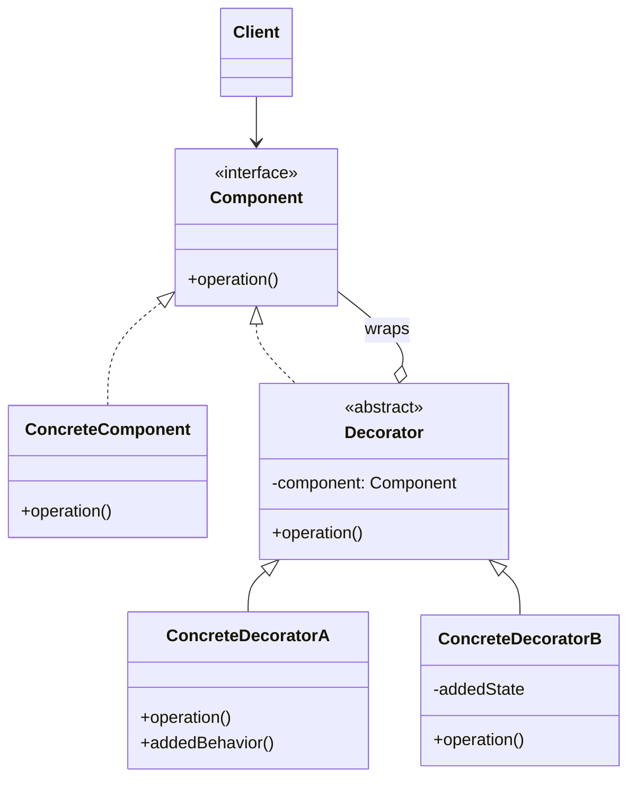

# Decorator

## Description

The Decorator lets you add responsibilities to an object dynamically, at runtime, without changing its class and without resorting to inheritance. It offers a flexible alternative to subclassing for extending functionality.

The idea is to "wrap" the original object in another object (the decorator) that implements the same interface. The decorator holds a reference to the wrapped component, delegates calls to it, and adds behavior before or after that delegation. Because the decorator has the same interface as the component, the client can't tell the difference.

Decorators can be stacked: each layer adds a behavior, and the order of composition determines the final result. This lets you combine features freely, instead of creating a subclass for every possible combination.

## Problems it solves

- Subclass explosion from representing every combination of optional features (e.g., `CompressedEncryptedBufferedStream`).
- Needing to add or remove behavior on individual objects at runtime, without affecting other instances of the same class.
- Extending classes that can't be modified or inherited from (e.g., `final`/`sealed` classes or third-party library classes).
- Separating cross-cutting concerns (logging, caching, metrics, retry) from the core logic.

## When to use

- When you need to add responsibilities to objects transparently and dynamically.
- When the extensions are optional and can be combined with one another.
- When inheritance is impractical, either because it would generate too many subclasses or because the class doesn't allow extension.
- To apply cross-cutting behaviors (logging, caching, authorization, compression) while keeping the Single Responsibility Principle.

## When to avoid

- When the client depends on the identity or concrete type of the object (the decorator is a different object from the wrapped component).
- When the component's interface is very large, forcing each decorator to delegate dozens of methods.
- When there's only one fixed, stable extension, where a simple subclass or a direct change is clearer.
- When the order of the decorators matters a lot and is hard to control, producing unexpected behavior.

## Trade-offs

| Benefit | Cost / Risk |
| --- | --- |
| Extends behavior without modifying the original class (Open/Closed) | Many small, similar objects, making the code harder to read |
| Combines features at runtime | The stacking order affects the result and can cause subtle bugs |
| Avoids subclass explosion | Identity comparisons and type checks stop working |
| Each decorator has a single responsibility | Harder debugging because of the many layers of delegation |

- **Coupling:** low; decorators depend only on the component's interface.
- **Testability:** high; each decorator can be tested in isolation with a fake component.
- **Complexity:** assembling the chain is usually delegated to a factory or a dependency injection container.
- **Performance:** each layer adds an indirect call, usually at negligible cost.

## Diagram



`Component` defines the common interface; `ConcreteComponent` is the base object. `Decorator` implements the same interface and holds a reference to a `Component`, delegating calls to it; `ConcreteDecoratorA` and `ConcreteDecoratorB` add behavior before or after that delegation. The `Client` works only with `Component`.

## Example

The basic transfer service only moves the money. Fraud check, night limit and audit trail are layers stacked according to the account type, instead of one subclass for each combination. The limits are illustrative.

```typescript
interface TransferRequest {
  fromAccountId: string;
  toKey: string;
  amountCents: number;
  at: Date;
}

interface TransferService {
  transfer(request: TransferRequest): void;
}

class BasicTransferService implements TransferService {
  transfer(request: TransferRequest): void {
    console.log(`Transferring ${request.amountCents} -> ${request.toKey}`);
  }
}

abstract class TransferDecorator implements TransferService {
  constructor(protected wrapped: TransferService) {}
  transfer(request: TransferRequest): void {
    this.wrapped.transfer(request);
  }
}

class FraudCheckDecorator extends TransferDecorator {
  transfer(request: TransferRequest): void {
    if (request.amountCents > 5_000_000) throw new Error("Blocked by fraud check");
    super.transfer(request);
  }
}

class NightLimitDecorator extends TransferDecorator {
  transfer(request: TransferRequest): void {
    const hour = request.at.getHours();
    const isNight = hour >= 20 || hour < 6;
    if (isNight && request.amountCents > 100_000) throw new Error("Night limit exceeded");
    super.transfer(request);
  }
}

class AuditDecorator extends TransferDecorator {
  transfer(request: TransferRequest): void {
    console.log(`Audit: ${request.fromAccountId} transfers ${request.amountCents}`);
    super.transfer(request);
  }
}

const service: TransferService = new AuditDecorator(
  new NightLimitDecorator(new FraudCheckDecorator(new BasicTransferService())),
);
service.transfer({
  fromAccountId: "acc-1",
  toKey: "ana@example.com",
  amountCents: 50_000,
  at: new Date("2026-03-10T23:30:00"),
}); // audit, night limit and fraud check pass; R$ 500.00 transferred
```

## Related patterns

- [Adapter](/coding/gof/structural/adapter) — the Adapter changes an object's interface; the Decorator keeps the interface and adds responsibilities.
- [Composite](/coding/gof/structural/composite) — similar structure (recursive composition), but the Decorator has a single child and focuses on adding behavior, not aggregating results.
- [Proxy](/coding/gof/structural/proxy) — same wrapping structure, but the Proxy controls access to the object and usually manages its lifecycle, whereas the Decorator is composed by the client to extend behavior.
- [Strategy](/coding/gof/behavioral/strategy) — the Decorator changes the object's "skin"; the Strategy changes its "guts", swapping the internal algorithm.
- [Chain of Responsibility](/coding/gof/behavioral/chain-of-responsibility) — also chains objects, but a link can stop the flow, whereas decorators normally always delegate.

## Reference

- [Design Patterns Cheat Sheet](https://iretha.github.io/design-patterns/cheat-sheet)
- [Decorator on Refactoring.Guru](https://refactoring.guru/design-patterns/decorator)
