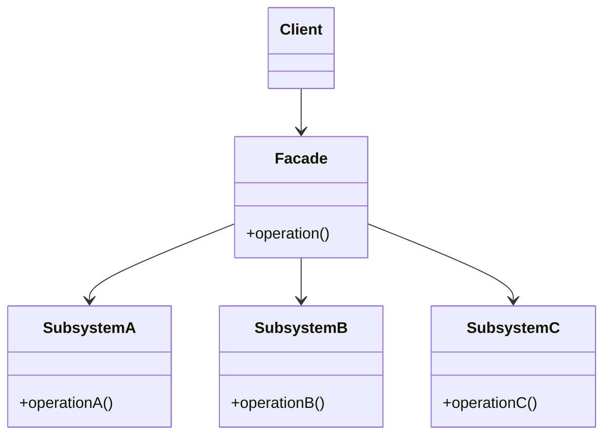

# Facade

## Description

The Facade provides a single, simplified interface to a set of interfaces in a subsystem. Instead of the client knowing about and coordinating several internal classes, it talks to a single facade object that exposes high-level operations.

The facade knows which subsystem classes are responsible for each request and delegates the work to them, in the correct order. The subsystem classes keep working independently and don't know about the facade; advanced clients can still access them directly when they need more control.

The result is a layer that reduces the coupling between clients and implementation details, making the subsystem easier to use, maintain, and evolve.

## Problems it solves

- Clients need to orchestrate many low-level classes (libraries, frameworks, legacy APIs) to perform a simple task.
- Internal changes in a subsystem propagate to all the code that uses it.
- Complex dependencies between layers make it hard to understand a module's entry point.
- Integration code repeated in several places to perform the same sequence of calls.

## When to use

- When you want to provide a simple interface to a complex subsystem.
- To structure a system into layers, defining an entry point for each one.
- To isolate client code from third-party libraries or legacy systems, making them easier to replace.
- When there are many dependencies between clients and implementation classes and you want to decouple them.

## When to avoid

- When the subsystem is already simple; the facade would only add an unnecessary layer.
- When clients need the full power and flexibility of the subsystem and the facade would end up replicating its entire API.
- When the facade tends to become a "god object", accumulating unrelated responsibilities.

## Trade-offs

| Benefit | Cost / Risk |
| --- | --- |
| Simple, easy-to-use interface | May hide useful functionality or limit advanced use cases |
| Less coupling between clients and the subsystem | One more layer of indirection to maintain |
| Internal changes are isolated behind the facade | Risk of the facade growing too large and becoming a "god object" |
| Clear entry point for layers and modules | May mask design problems in the subsystem instead of solving them |

- **Coupling:** the client depends only on the facade, but the facade is coupled to several subsystem classes.
- **Testability:** clients are easy to test with a facade double; the facade itself requires integration tests or mocks of the components.
- **Complexity:** low; the pattern requires neither inheritance nor special interfaces.
- **Performance:** negligible impact, just one extra delegation call.

## Diagram



The `Client` interacts only with the `Facade`, which delegates calls to `SubsystemA`, `SubsystemB`, and `SubsystemC` in the proper order. The subsystem classes don't know about the facade.

## Example

Sending a Pix requires resolving the key in DICT, passing the fraud check, debiting the ledger and sending the message to SPI. Instead of each controller coordinating these four services, a `PixTransferFacade` exposes a single `send` operation.

```typescript
interface PixDestination { ispb: string; account: string; }

class DictClient {
  resolve(pixKey: string): PixDestination { return { ispb: "00000000", account: "12345-6" }; }
}

class FraudService {
  approve(accountId: string, amountCents: number): boolean { return true; }
}

class LedgerService {
  debit(accountId: string, amountCents: number): string { return "entry-123"; }
}

class SpiClient {
  submit(destination: PixDestination, amountCents: number, entryId: string): string {
    return "E00000000202603101030abc123"; // endToEndId
  }
}

class PixTransferFacade {
  constructor(
    private dict = new DictClient(),
    private fraud = new FraudService(),
    private ledger = new LedgerService(),
    private spi = new SpiClient(),
  ) {}

  send(accountId: string, pixKey: string, amountCents: number): string {
    const destination = this.dict.resolve(pixKey);
    if (!this.fraud.approve(accountId, amountCents)) {
      throw new Error("Transfer rejected by fraud check");
    }
    const entryId = this.ledger.debit(accountId, amountCents);
    return this.spi.submit(destination, amountCents, entryId);
  }
}

// Client
const endToEndId = new PixTransferFacade().send("acc-1", "ana@example.com", 19_990);
```

## Related patterns

- [Adapter](/coding/gof/structural/adapter) — the Adapter converts an existing interface into another one that's expected; the Facade creates a new, simpler interface for a set of classes.
- [Mediator](/coding/gof/behavioral/mediator) — both centralize communication, but the Mediator coordinates colleagues that know about it, while the Facade is transparent to the subsystem.
- [Abstract Factory](/coding/gof/creational/abstract-factory) — can be used together with the Facade to create the subsystem's objects in a platform-independent way.
- [Singleton](/coding/gof/creational/singleton) — often a single instance of the facade is enough.
- [Proxy](/coding/gof/structural/proxy) — also sits between the client and the real object, but keeps the same interface instead of simplifying it.

## Reference

- [Design Patterns Cheat Sheet](https://iretha.github.io/design-patterns/cheat-sheet)
- [Facade on Refactoring.Guru](https://refactoring.guru/design-patterns/facade)
