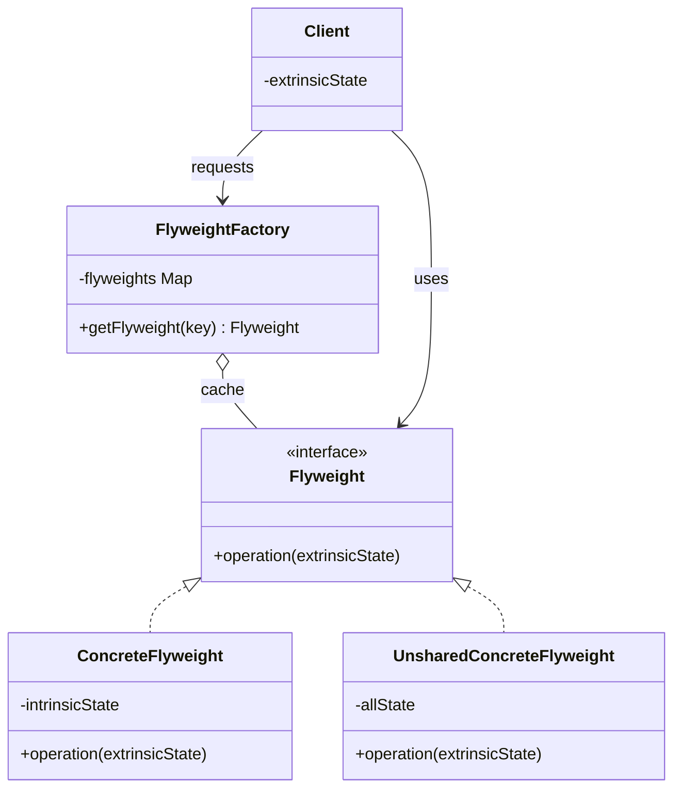

# Flyweight

## Description

The Flyweight reduces memory consumption when an application needs to hold a very large number of similar objects. The idea is to share, across many contexts, the parts of the state that repeat, instead of duplicating them in every instance.

To do this, the object's state is split into two parts: the **intrinsic state**, which is immutable and context-independent, is stored in the flyweight and can be shared; and the **extrinsic state**, which varies with usage and is kept by the client (or by a context object) and passed as a parameter to the flyweight's operations.

A `FlyweightFactory` controls the creation and reuse of instances: given a key, it returns the flyweight that already exists in the cache or creates a new one. This way, thousands of logical objects can be represented by a few physical instances.

## Problems it solves

- Excessive memory consumption caused by thousands or millions of objects carrying identical data (fonts, textures, icons, metadata)
- Cost of repeatedly creating heavy objects whose content is always the same
- Difficulty scaling fine-grained structures (characters in an editor, particles, trees on a map, spreadsheet cells)

## When to use

- The application creates a very large number of similar objects and memory is a real bottleneck
- A large part of the objects' state can be extracted and made extrinsic
- Many groups of objects can be replaced by a few shared objects once the extrinsic state is removed
- The application doesn't depend on object identity (reference comparisons aren't relevant)

## When to avoid

- The number of objects is small or memory isn't a constraint; the gain doesn't justify the complexity
- The objects' state is mostly unique, leaving little to share
- The intrinsic state needs to be mutable, which would make sharing dangerous
- Computing or carrying the extrinsic state costs more (CPU, readability) than the memory saved

## Trade-offs

| Benefit | Cost / Risk |
| --- | --- |
| Drastic reduction in memory usage | More complex code, with state split between the flyweight and the context |
| Fewer allocations and less pressure on the garbage collector | CPU cost to look up the cache and recompute/pass the extrinsic state |
| Central point for creation and reuse via the factory | The factory and its cache must be thread-safe in concurrent environments |
| Shared immutable objects are safe across threads | Loss of identity: the same object represents several logical elements |

- **Coupling:** clients come to depend on the factory and need to know the extrinsic state.
- **Testability:** immutable flyweights are easy to test; the shared cache may require isolation between tests.
- **Performance:** it's an optimization; measure before applying it and watch out for unbounded cache growth.

## Diagram



The `Client` obtains flyweights through the `FlyweightFactory`, which maintains a cache of shared `ConcreteFlyweight`s (holding intrinsic state). The client keeps the extrinsic state and passes it on each call to `operation`; `UnsharedConcreteFlyweight` represents implementations that don't need to be shared.

## Example

Card reconciliation keeps millions of entries in memory. The merchant's name, MCC and logo (heavy) are shared among the entries of the same merchant; only the amount, date and cardholder are stored in each entry.

<Tabs groupId="lang" queryString>
<TabItem value="java" label="Java">

```java
record MerchantInfo(String name, String mcc, byte[] logo) { // flyweight (intrinsic)
    String label() {
        return name + " (MCC " + mcc + ")";
    }
}

class MerchantInfoFactory {
    private static final Map<String, MerchantInfo> cache = new ConcurrentHashMap<>();

    static MerchantInfo get(String name, String mcc, byte[] logo) {
        return cache.computeIfAbsent(name + ":" + mcc,
                k -> new MerchantInfo(name, mcc, logo));
    }
}

record CardEntry(long amountCents, LocalDate date, String holder, MerchantInfo merchant) { // context, extrinsic
    String describe() { return holder + " - " + merchant.label() + ": " + amountCents; }
}

class ReconciliationBatch {
    private final List<CardEntry> entries = new ArrayList<>();

    void add(long amountCents, LocalDate date, String holder,
             String merchantName, String mcc, byte[] logo) {
        entries.add(new CardEntry(amountCents, date, holder,
                MerchantInfoFactory.get(merchantName, mcc, logo)));
    }

    long totalCents() { return entries.stream().mapToLong(CardEntry::amountCents).sum(); }
}
```

</TabItem>
<TabItem value="python" label="Python">

```python
from dataclasses import dataclass
from datetime import date

@dataclass(frozen=True)
class MerchantInfo:  # flyweight (intrinsic)
    name: str
    mcc: str
    logo: bytes

    def label(self) -> str:
        return f"{self.name} (MCC {self.mcc})"

class MerchantInfoFactory:
    _cache: dict[str, MerchantInfo] = {}

    @classmethod
    def get(cls, name: str, mcc: str, logo: bytes) -> MerchantInfo:
        # setdefault is atomic in CPython: concurrent threads get the same instance
        return cls._cache.setdefault(f"{name}:{mcc}", MerchantInfo(name, mcc, logo))

@dataclass(frozen=True)
class CardEntry:  # context, extrinsic
    amount_cents: int
    date: date
    holder: str
    merchant: MerchantInfo

    def describe(self) -> str:
        return f"{self.holder} - {self.merchant.label()}: {self.amount_cents}"

class ReconciliationBatch:
    def __init__(self) -> None:
        self._entries: list[CardEntry] = []

    def add(self, amount_cents: int, date: date, holder: str,
            merchant_name: str, mcc: str, logo: bytes) -> None:
        merchant = MerchantInfoFactory.get(merchant_name, mcc, logo)
        self._entries.append(CardEntry(amount_cents, date, holder, merchant))

    def total_cents(self) -> int:
        return sum(entry.amount_cents for entry in self._entries)
```

</TabItem>
<TabItem value="go" label="Go">

```go
type MerchantInfo struct { // flyweight (intrinsic)
	Name, MCC string
	Logo      []byte
}

func (m *MerchantInfo) Label() string {
	return fmt.Sprintf("%s (MCC %s)", m.Name, m.MCC)
}

type MerchantInfoFactory struct {
	mu    sync.Mutex
	cache map[string]*MerchantInfo
}

func NewMerchantInfoFactory() *MerchantInfoFactory {
	return &MerchantInfoFactory{cache: map[string]*MerchantInfo{}}
}

func (f *MerchantInfoFactory) Get(name, mcc string, logo []byte) *MerchantInfo {
	f.mu.Lock()
	defer f.mu.Unlock()
	key := name + ":" + mcc
	if _, ok := f.cache[key]; !ok {
		f.cache[key] = &MerchantInfo{Name: name, MCC: mcc, Logo: logo}
	}
	return f.cache[key]
}

type CardEntry struct { // context, extrinsic
	AmountCents int64
	Date        time.Time
	Holder      string
	Merchant    *MerchantInfo
}

func (e CardEntry) Describe() string {
	return fmt.Sprintf("%s - %s: %d", e.Holder, e.Merchant.Label(), e.AmountCents)
}

type ReconciliationBatch struct {
	merchants *MerchantInfoFactory
	entries   []CardEntry
}

func (b *ReconciliationBatch) Add(amountCents int64, date time.Time, holder, merchantName, mcc string, logo []byte) {
	merchant := b.merchants.Get(merchantName, mcc, logo)
	b.entries = append(b.entries, CardEntry{amountCents, date, holder, merchant})
}

func (b *ReconciliationBatch) TotalCents() int64 {
	var total int64
	for _, entry := range b.entries {
		total += entry.AmountCents
	}
	return total
}
```

</TabItem>
</Tabs>

## Related patterns

- [Composite](/coding/gof/structural/composite) — the leaves of a Composite tree are often implemented as shared flyweights
- [Factory Method](/coding/gof/creational/factory-method) — the `FlyweightFactory` encapsulates the creation and reuse of instances
- [Singleton](/coding/gof/creational/singleton) — the flyweight factory is often unique; both control the number of instances
- [Object Pool](/coding/gof/creational/object-pool) — also reuses objects, but through exclusive borrowing, whereas the Flyweight shares immutable instances simultaneously
- [State](/coding/gof/behavioral/state) and [Strategy](/coding/gof/behavioral/strategy) — state or strategy objects with no data of their own can be shared as flyweights
- [Proxy](/coding/gof/structural/proxy) — both interpose an object to control resources; the Proxy controls access, the Flyweight controls the number of instances

## Reference

- [Design Patterns Cheat Sheet](https://iretha.github.io/design-patterns/cheat-sheet)
- [Flyweight on Refactoring.Guru](https://refactoring.guru/design-patterns/flyweight)
