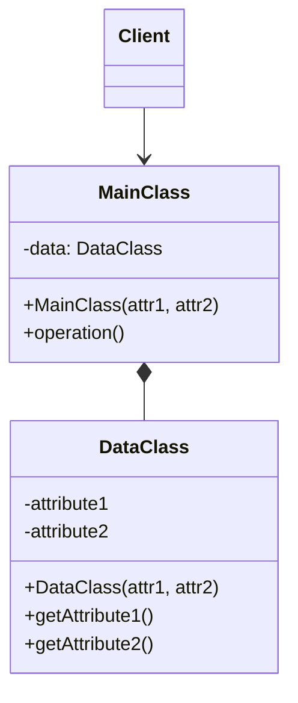

# Private Class Data

## Description

The Private Class Data restricts access to and modification of a class's attributes by separating them into a data object of their own (the `Data` class). The main class stops exposing or directly manipulating its fields and instead holds a reference to that object, which offers only read access, or read access plus controlled changes.

Typically the data is passed to the data class's constructor and stays immutable afterward. That way, not even the main class's own methods can accidentally change values that should be set only once, such as at initialization. The pattern reduces the write surface of the state and makes clear which attributes are stable and which vary.

It isn't one of the 23 patterns in the Gang of Four book. It appears in complementary catalogs as an encapsulation technique, and in many modern languages it boils down to using `final`/`readonly` fields, records, or value objects.

## Problems it solves

- Attributes that should be set only at construction end up being changed by the class's own methods.
- Classes with many mutable fields, where it's hard to know who changes what and when.
- Unnecessary exposure of internal state through generic getters and setters.
- Difficulty maintaining invariants when any method can reassign fields.

## When to use

- When a set of attributes must be immutable after initialization.
- When you want to separate data (state) from behavior, making explicit what is read-only.
- When the language doesn't offer good native immutability features (`final`, `readonly`, `const`).
- When the object is shared between threads and needs state that's safe for concurrent reads.

### When to avoid

- When the language already offers simple immutability (records, `readonly`, `data class`, `frozen dataclass`) that solves the problem without an extra class.
- In small classes with few fields, where the indirection only adds code.
- When the data needs to change frequently; immutability would force objects to be recreated all the time.

## Trade-offs

| Benefit | Cost / Risk |
| --- | --- |
| Stronger encapsulation and less accidental writing of state | One more class and an indirection when accessing the data |
| Invariants guaranteed from construction | Changing a value requires creating a new data object |
| Immutable state, safe to share between threads | May duplicate what the language already offers natively |
| Clear separation between data and behavior | Risk of becoming a "bag of getters" with no domain meaning |

- **Coupling:** the main class depends only on the data class's read interface.
- **Testability:** immutable data objects are easy to create and compare in tests.
- **Performance:** recreating data objects on every change can cause extra allocations on critical paths.

## Diagram



The `Client` uses the `MainClass`, which internally composes a `DataClass`. The `DataClass` receives the values in its constructor and exposes only read methods, so the `MainClass` uses the data without being able to reassign it.

## Example

A `Circle` class receives its radius, color, and origin at creation, and those values can't change afterward. The data lives in `CircleData`, which allows read access only.

```java
public final class CircleData {
    private final double radius;
    private final String color;
    private final Point origin;

    public CircleData(double radius, String color, Point origin) {
        this.radius = radius;
        this.color = color;
        this.origin = origin;
    }

    public double getRadius() { return radius; }
    public String getColor() { return color; }
    public Point getOrigin() { return origin; }
}

public class Circle {
    private final CircleData data;

    public Circle(double radius, String color, Point origin) {
        this.data = new CircleData(radius, color, origin);
    }

    public double circumference() { return 2 * Math.PI * data.getRadius(); }
    public double area() { return Math.PI * data.getRadius() * data.getRadius(); }
    public void draw() { System.out.println("Drawing " + data.getColor() + " circle"); }
}
```

## Related patterns

- [Proxy](/coding/gof/structural/proxy) — also controls access to an object, but through a stand-in rather than by separating the state.
- [Facade](/coding/gof/structural/facade) — both reduce what's exposed to clients; the Facade simplifies a subsystem, Private Class Data protects the attributes.
- [Builder](/coding/gof/creational/builder) — often assembles immutable data objects when there are many initialization parameters.
- [Telescoping Constructor](/coding/gof/creational/telescoping-constructor) — a problem that appears when the data class receives many attributes in its constructor.
- [Memento](/coding/gof/behavioral/memento) — also keeps state in a separate, opaque object, but to save it and restore it later.
- [Flyweight](/coding/gof/structural/flyweight) — the shared intrinsic state must be immutable, which is exactly what Private Class Data guarantees.

## Reference

- [Design Patterns Cheat Sheet](https://iretha.github.io/design-patterns/cheat-sheet)
- [Private Class Data on SourceMaking](https://sourcemaking.com/design_patterns/private_class_data)
