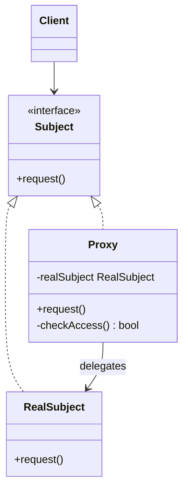

# Proxy

## Description

The Proxy provides a substitute (or stand-in) for another object, controlling access to it. The proxy implements the same interface as the real object (the `RealSubject`), so the client can't tell whether it's talking to the real object or to the intermediary.

When it receives a call, the proxy can run additional logic before or after delegating to the real object: create the object only when needed (virtual proxy), check permissions (protection proxy), forward the call to another process or machine (remote proxy), cache results (caching proxy), or log usage and count references (smart reference).

The difference from other wrappers lies in the intent: the Proxy doesn't add business functionality or change the interface, it controls *when*, *how*, and *whether* access to the real object happens.

## Problems it solves

- Objects that are expensive to create (large images, connections, documents) being instantiated even when they're never used.
- Needing to apply access control to an object without modifying its class.
- Calls to remote objects that require serialization, networking, and failure handling, polluting client code.
- Repetition of costly operations that could be cached transparently.
- Lack of a central point for logging, metrics, or reference counting of a resource.

## When to use

- When you need to defer the creation or loading of a heavy object until its first use (lazy initialization).
- When access to an object must be restricted according to the client's profile or permissions.
- When an object lives in another address space (another process, service, or server) and the client should use it as if it were local.
- When you want to add caching, auditing, or rate limiting transparently to the client.
- When the real object comes from a third-party library and can't be changed.

## When to avoid

- When the real object is cheap and there's no need for access control: the proxy only adds indirection.
- When the extra latency introduced by the intermediate layer is critical.
- When the goal is to add stackable, combinable behavior; in that case the Decorator is a better fit.
- When transparency hides important costs (for example, network calls that look local) and that leads to naive, inefficient use.

## Trade-offs

| Benefit | Cost / Risk |
| --- | --- |
| Control over the real object's lifecycle and access without the client knowing | Extra layer of indirection and more classes to maintain |
| Lazy loading reduces memory usage and startup time | The first access may have unexpected latency |
| Respects the open/closed principle: new policies without changing the `RealSubject` | The proxy's interface has to follow every change to the `Subject` interface |
| Caching and remote proxies simplify client code | Transparency can hide network failures, stale data, and real costs |

- **Coupling:** the client depends only on the `Subject` interface, which makes it easy to swap the real object for the proxy via dependency injection.
- **Testability:** proxies can be tested in isolation with a fake `RealSubject`; framework mocks are often dynamic proxies.
- **Concurrency:** proxies with lazy initialization or caching need care with concurrent access.
- **Tooling:** many languages offer dynamic proxies (Java `java.lang.reflect.Proxy`, JavaScript `Proxy`, AOP in frameworks), reducing boilerplate.

## Diagram



The `Client` works only with the `Subject` interface. Both `RealSubject` and `Proxy` implement it; the `Proxy` holds a reference to the `RealSubject` and decides when and whether to delegate the call, applying access control, lazy loading, or caching.

## Example

A document viewer displays thumbnails of several high-resolution images. Loading all of them from disk on open would be slow, so each image is represented by a proxy that only loads the file when it needs to be displayed.

```typescript
interface Image {
  display(): void;
}

class HighResImage implements Image {
  constructor(private path: string) {
    console.log(`Loading ${path} from disk...`); // expensive operation
  }
  display(): void {
    console.log(`Displaying ${this.path}`);
  }
}

class ImageProxy implements Image {
  private real?: HighResImage;
  constructor(private path: string) {}

  display(): void {
    if (!this.real) {
      this.real = new HighResImage(this.path); // lazy loading
    }
    this.real.display();
  }
}

const gallery: Image[] = [new ImageProxy("a.png"), new ImageProxy("b.png")];
gallery[0].display(); // loads and displays only a.png
```

## Related patterns

- [Adapter](/coding/gof/structural/adapter) — also wraps another object, but provides a different interface; the Proxy keeps the same interface.
- [Decorator](/coding/gof/structural/decorator) — almost identical structure, but the Decorator adds responsibilities and is stackable, whereas the Proxy controls access and usually manages the real object's lifecycle.
- [Facade](/coding/gof/structural/facade) — also an intermediary, but it simplifies an entire subsystem instead of representing a single object.
- [Flyweight](/coding/gof/structural/flyweight) — proxies can be used to share and reference flyweight objects transparently.
- [Singleton](/coding/gof/creational/singleton) — the proxy is often the controlled access point to a single, expensive resource.

## Reference

- [Design Patterns Cheat Sheet](https://iretha.github.io/design-patterns/cheat-sheet)
- [Proxy on Refactoring.Guru](https://refactoring.guru/design-patterns/proxy)
