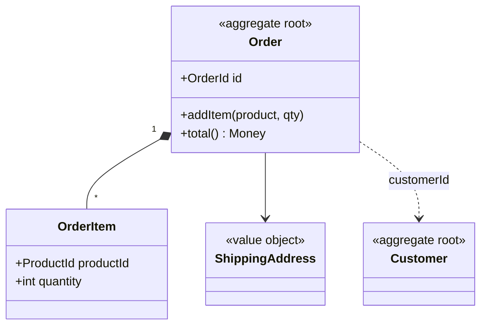

# Aggregate

## Description

An Aggregate is a group of entities and Value Objects treated as a single unit for purposes of data change. One entity is the root (the Aggregate Root), the only one with global identity and the only one referenced by outside objects; the other members have identity local to the aggregate.

The root enforces the invariants of the whole group. External objects only hold references to the root and only modify it through its methods. The boundary defines the scope of the transaction: a transaction changes a single aggregate, and consistency between aggregates is eventual.

References between aggregates should be made by identity rather than by direct object reference, which keeps aggregates small and decoupled.

## Problems it solves

- Tangled object graphs with no clear consistency boundary.
- Invariants violated by changes made directly to internal objects.
- Large transactions that lock a lot of data and cause contention.
- Difficulty deciding the scope of loading and persistence.

## When to use

- When there are invariants that must hold consistently across several objects.
- When you need to define the unit of transaction and persistence.
- When you want to limit coupling between parts of the model.

### When to avoid

- When aggregates grow too large, causing contention and loading costs.
- When the boundary is imposed for technical convenience, with no real invariants.

## Trade-offs

| Benefit | Cost / Risk |
| --- | --- |
| Invariants guaranteed within the boundary | Large aggregates cause contention and slowness |
| Clear unit of transaction and persistence | Consistency between aggregates is eventual |
| Reduced coupling through references by identity | Queries across aggregates require more work |

- **Size:** prefer small aggregates designed around real invariants.
- **Events:** changes that affect other aggregates are usually propagated through Domain Events.
- **Access:** the Repository works per aggregate root.

## Diagram



`Order` is the root and controls `OrderItem` and `ShippingAddress`. The reference to `Customer`, another aggregate, is made by identity only.

## Example

The order protects the item-limit invariant; nobody changes `OrderItem` directly.

```typescript
class Order {
  private items: OrderItem[] = [];
  constructor(readonly id: string, readonly customerId: string) {}

  addItem(productId: string, qty: number, price: Money): void {
    if (qty <= 0) throw new Error("Invalid quantity");
    if (this.items.length >= 20) throw new Error("Item limit exceeded");
    this.items.push(new OrderItem(productId, qty, price));
  }

  total(): Money {
    return this.items.reduce((sum, i) => sum.add(i.subtotal()), Money.zero());
  }
}
```

## Related patterns

- [Entity](/design/ddd/building-blocks/entity) — the aggregate root is an entity.
- [Value Object](/design/poeaa/base/value-object) — makes up the aggregate alongside internal entities.
- [Repository](/design/poeaa/object-relational-metadata-mapping/repository) — persists and retrieves one aggregate at a time, through the root.
- [Factory](/design/ddd/building-blocks/factory) — creates the whole aggregate, guaranteeing invariants at creation.
- [Domain Event](/architecture/microservices/service-collaboration/domain-event) — propagates changes between aggregates with eventual consistency.
- [Domain Model](/design/poeaa/domain-logic/domain-model) — the aggregate organizes the domain model into consistency boundaries.

## Reference

- [DDD Reference, Eric Evans (2015)](https://www.domainlanguage.com/ddd/reference/)
- [DDD Aggregate (bliki)](https://martinfowler.com/bliki/DDD_Aggregate.html)
- *Domain-Driven Design: Tackling Complexity in the Heart of Software*, Eric Evans (Addison-Wesley, 2003)
