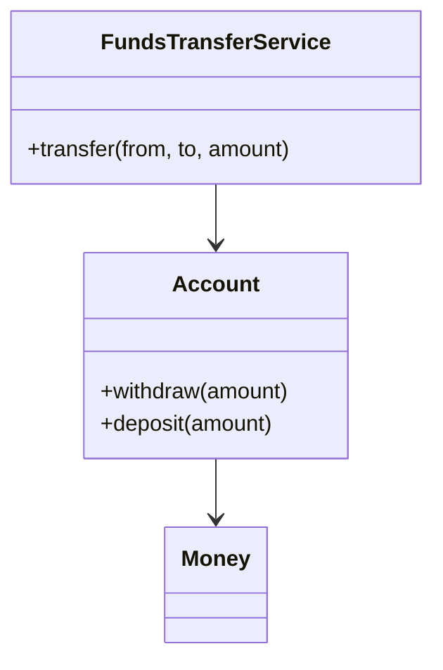

# Domain Service

## Description

A Domain Service (called "Services" in Evans's book) represents a significant domain operation that doesn't naturally belong to any entity or Value Object. It's an action, named with a verb from the ubiquitous language, such as transferring funds between accounts.

Evans proposes three characteristics: the operation refers to a domain concept that isn't a thing; the interface is defined in terms of model elements; and the service is stateless. Forcing this logic into an object would distort the model.

Don't confuse it with PoEAA's Service Layer or with application-layer services: those orchestrate use cases and transactions without containing business rules, while the Domain Service contains the domain's own logic.

## Problems it solves

- Operations that involve several objects and fit in none of them.
- Domain objects bloated with responsibilities that aren't theirs.
- Domain logic that leaks into the application layer or the interface.

## When to use

- When the operation is a domain concept, but not a thing with identity or value.
- When the operation involves multiple aggregates or entities.
- When the logic is stateless and expressed in terms of the model.

### When to avoid

- When the operation naturally belongs to an entity or Value Object.
- When the service would be just technical orchestration (that's the application layer).
- When overuse of services leads to an anemic model.

## Trade-offs

| Benefit | Cost / Risk |
| --- | --- |
| Explicit place for logic that doesn't fit in objects | Risk of an anemic model if overused |
| Ubiquitous language expressed in domain verbs | Easy to confuse with an application service |
| Leaner domain objects | Stateless, so it depends on the objects passed as arguments |

- **State:** the service is stateless; state lives in the entities.
- **Layer:** it lives in the domain layer; orchestration stays in the application layer.

## Diagram



`FundsTransferService` coordinates two accounts in an operation that belongs to neither of them.

## Example

A transfer between accounts involves two entities and a business rule, so it becomes a domain service.

```java
public class FundsTransferService {
    public void transfer(Account from, Account to, Money amount) {
        if (from.equals(to)) {
            throw new IllegalArgumentException("Same account");
        }
        from.withdraw(amount);
        to.deposit(amount);
    }
}
```

## Related patterns

- [Entity](/design/ddd/building-blocks/entity) — the service operates on entities.
- [Value Object](/design/poeaa/base/value-object) — frequent arguments and return values of the service.
- [Layered Architecture](/design/ddd/building-blocks/layered-architecture) — distinguishes domain services from application services.
- [Service Layer](/design/poeaa/domain-logic/service-layer) — PoEAA's application boundary, which contains no business rules.
- [Side-Effect-Free Functions](/design/ddd/supple-design/side-effect-free-functions) — services tend to be side-effect-free functions.

## Reference

- [DDD Reference, Eric Evans (2015)](https://www.domainlanguage.com/ddd/reference/)
- *Domain-Driven Design: Tackling Complexity in the Heart of Software*, Eric Evans (Addison-Wesley, 2003)
- [Evans Classification (Fowler's bliki)](https://martinfowler.com/bliki/EvansClassification.html)
