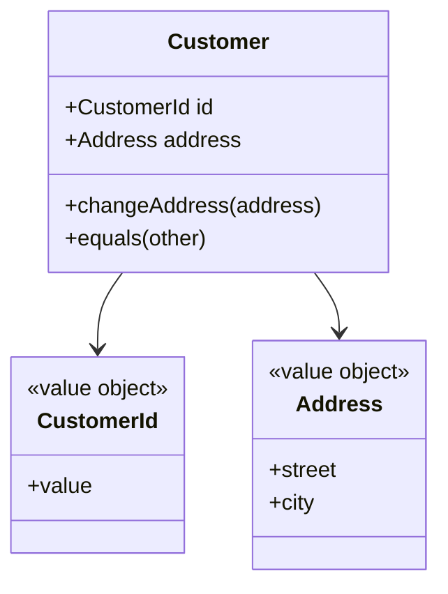

# Entity

## Description

An Entity is a model object defined primarily by its identity rather than its attributes. It remains "the same" over time and through state changes: a customer who changes address is still the same customer.

Evans stresses that you must define what it means to be the same object, choosing a unique, stable identifier (system-generated or coming from the business) and a comparison operation based on it. The entity has a lifecycle, with creation, changes, and eventual end, and it should have behavior, not just data.

To keep the model simple, it's best to reduce the entity to the essentials: the attributes and behavior that define its identity and lifecycle, delegating the rest to associated Value Objects.

## Problems it solves

- Confusion between objects that must be tracked over time and merely descriptive objects.
- Duplication and inconsistency caused by a lack of stable identity.
- Comparison by attributes when identity is what matters.
- Anemic models, where the entity is just a bag of data.

## When to use

- When the object must be distinguished from others even with identical attributes.
- When the concept has a lifecycle and history that matter to the business.
- When the object is referenced by others over time.

### When to avoid

- When the concept is defined only by its values and is interchangeable: prefer a [Value Object](/design/poeaa/base/value-object).
- When tracking identity and lifecycle would be cost with no benefit.

## Trade-offs

| Benefit | Cost / Risk |
| --- | --- |
| Clear tracking of objects over time | Requires defining and protecting the identity |
| Behavior and invariants concentrated in the object | Higher persistence and lifecycle cost than a value |
| Business language reflected in the model | Risk of bloated entities if everything becomes an entity |

- **Identity:** must be immutable and unique within its scope (global or local to the aggregate).
- **Equality:** compare by the identifier, never by all attributes.

## Diagram



`Customer` is identified by `CustomerId`. The `Address` can change without changing who the customer is.

## Example

A customer changes address but is still the same customer because equality uses the identifier.

```python
class Customer:
    def __init__(self, customer_id: str, name: str, address: "Address"):
        self._id = customer_id
        self.name = name
        self.address = address

    @property
    def id(self) -> str:
        return self._id

    def change_address(self, address: "Address") -> None:
        self.address = address

    def __eq__(self, other) -> bool:
        return isinstance(other, Customer) and self._id == other._id

    def __hash__(self) -> int:
        return hash(self._id)
```

## Related patterns

- [Value Object](/design/poeaa/base/value-object) — the counterpart without identity, used to describe the entity.
- [Aggregate](/design/ddd/building-blocks/aggregate) — entities are grouped under a root that enforces invariants.
- [Repository](/design/poeaa/object-relational-metadata-mapping/repository) — retrieves entities by identity.
- [Factory](/design/ddd/building-blocks/factory) — creates entities with valid identity and invariants from the start.
- [Identity Field](/design/poeaa/object-relational-structural/identity-field) — stores the entity's identity in the database.

## Reference

- [DDD Reference, Eric Evans (2015)](https://www.domainlanguage.com/ddd/reference/)
- [Evans Classification (bliki)](https://martinfowler.com/bliki/EvansClassification.html)
- *Domain-Driven Design: Tackling Complexity in the Heart of Software*, Eric Evans (Addison-Wesley, 2003)
