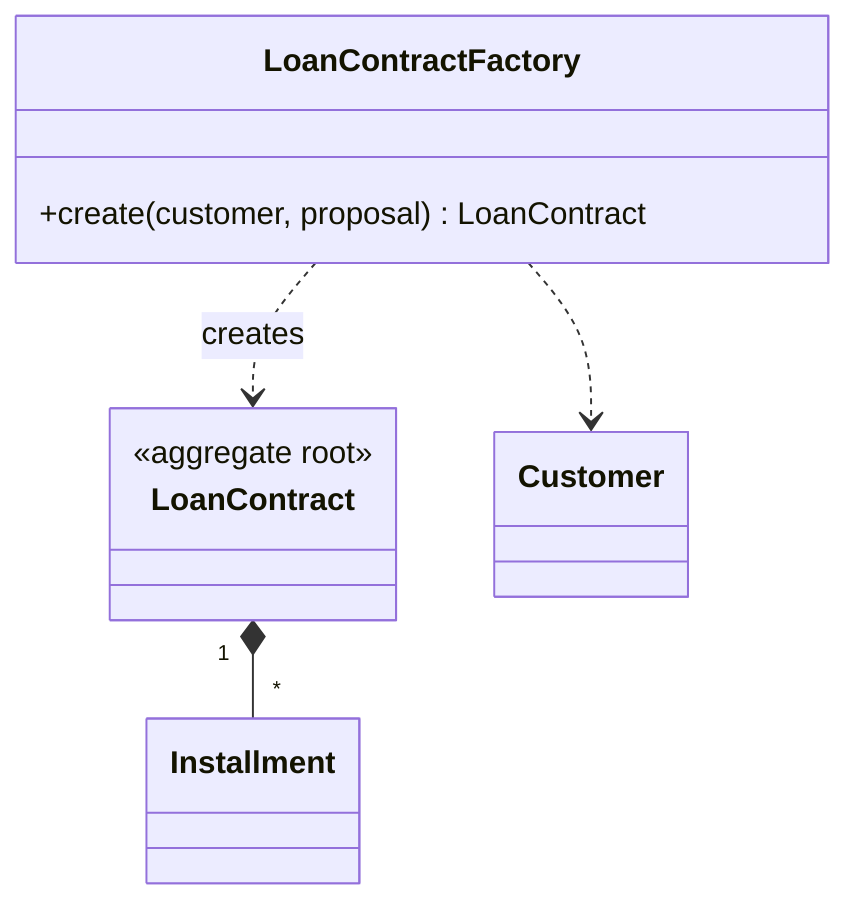

# Factory

## Description

In DDD, a Factory encapsulates the knowledge needed to create complex objects or entire aggregates, keeping that responsibility out of the main model. It ensures the object is born complete and with all invariants satisfied.

Creation is atomic: the client gets the whole aggregate in a consistent state, or creation fails. The Factory can be a Factory Method on an aggregate root, a dedicated class, or a static method, depending on the complexity. The client depends only on the interface, without knowing the concrete type or the assembly details.

Don't confuse it with the GoF Factory Method and Abstract Factory patterns, which are class-design solutions. The DDD Factory is a domain concept tied to the lifecycle: it creates and reconstitutes objects, while the Repository persists and retrieves them.

## Problems it solves

- Complex constructors that mix business rules and assembly.
- Clients that need to know the internal structure of an aggregate to create it.
- Objects created in an invalid or partial state.
- Reconstituting objects from persisted data without going through the creation rules.

## When to use

- When creation involves several steps, rules, or related objects.
- When you want to guarantee invariants from the moment the object is born.
- When the client shouldn't know the concrete class.

## When to avoid

- When a simple constructor is enough.
- When the Factory would be just an extra layer with no creation logic.

## Trade-offs

| Benefit | Cost / Risk |
| --- | --- |
| Invariants guaranteed at creation | One more class to maintain |
| Clients decoupled from assembly details | Risk of duplicating the constructor's logic |
| Cleaner main model | May hide complexity that deserves simplification |

- **Atomicity:** the created object must be consistent as a whole.
- **Reconstitution:** creating from persisted data follows different rules than new creation.

## Diagram



`LoanContractFactory` assembles the `LoanContract` with its `Installment` schedule and ensures the aggregate is valid when it's handed over.

## Example

The factory hands over the credit contract already carrying its installment schedule, and refuses to create one for a customer with a restriction.

```java
public class LoanContractFactory {
    public LoanContract create(Customer customer, CreditProposal proposal) {
        if (customer.hasRestriction()) {
            throw new IllegalStateException("Customer has a restriction");
        }
        LoanContract contract = new LoanContract(ContractId.next(), customer.id(), proposal.principal());
        List<Installment> schedule = proposal.amortization()
                .schedule(proposal.principal(), proposal.monthlyRate(), proposal.months());
        schedule.forEach(contract::addInstallment);
        return contract;
    }
}
```

## Related patterns

- [Aggregate](/design/ddd/building-blocks/aggregate) — the factory creates the whole aggregate and its invariants.
- [Entity](/design/ddd/building-blocks/entity) — creates entities with valid identity.
- [Value Object](/design/poeaa/base/value-object) — can also be created by factories.
- [Repository](/design/poeaa/object-relational-metadata-mapping/repository) — retrieves objects that already exist, while the factory creates new ones.
- [Factory](/coding/gof/creational/factory) — the simple factory from the GoF catalog, scoped to class design.
- [Factory Method](/coding/gof/creational/factory-method) — a GoF pattern that can be used in the implementation.
- [Abstract Factory](/coding/gof/creational/abstract-factory) — a GoF pattern for families of objects, distinct from the DDD Factory.

## Reference

- [DDD Reference, Eric Evans (2015)](https://www.domainlanguage.com/ddd/reference/)
- *Domain-Driven Design: Tackling Complexity in the Heart of Software*, Eric Evans (Addison-Wesley, 2003)
