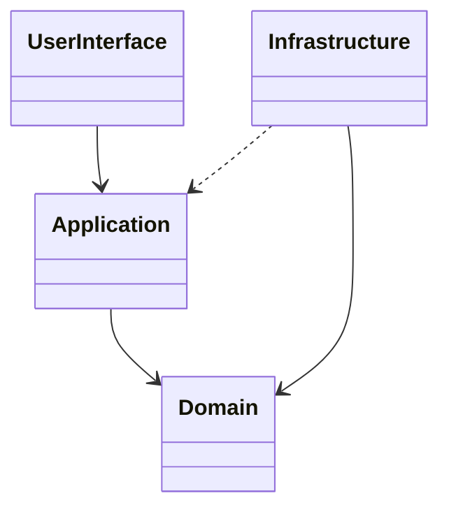

# Layered Architecture

## Description

Layered Architecture divides the system into cohesive layers, each with a well-defined responsibility and dependencies pointing in a single direction. Evans proposes four classic layers: user interface (presentation), application, domain, and infrastructure.

The domain layer concentrates the model and the business rules and is the heart of the software. The application layer coordinates use cases without containing business rules, and infrastructure provides technical support, such as persistence and messaging. Upper layers depend on lower ones, and the domain is isolated from interface and technology details.

The goal is for the model code to be readable, testable, and evolvable without mixing in technical concerns, enabling Model-Driven Design.

## Problems it solves

- Business rules scattered across screens, controllers, and SQL queries.
- Domain model coupled to the framework, database, and interface.
- Difficulty testing rules without spinning up infrastructure.
- Technical changes that force changes to domain code.

## When to use

- In systems with a rich domain, where the model needs to be expressed clearly.
- When the team wants to isolate business logic from technical concerns.
- When there are several interfaces (web, API, jobs) over the same model.

### When to avoid

- In simple CRUD applications with no relevant domain logic.
- When the layers become mere call pass-throughs, with no isolation benefit.

## Trade-offs

| Benefit | Cost / Risk |
| --- | --- |
| Isolated, testable domain | More mapping code between layers |
| Clear separation of responsibilities | Risk of anemic layers that only pass calls through |
| Technology swaps without affecting the model | Requires discipline to respect the direction of dependencies |

- **Dependencies:** dependency inversion lets the domain define interfaces implemented by infrastructure.
- **Variations:** hexagonal and onion architectures follow the same idea of isolating the domain.

## Diagram



The interface calls the application, which orchestrates the domain. Infrastructure implements the abstractions defined by the domain and serves the other layers.

## Example

In an order system, the controller (interface) calls an application service, which loads the aggregate, delegates the rule to the domain, and persists through the repository.

```typescript
// application
class CancelOrderService {
  constructor(private orders: OrderRepository) {}

  async execute(orderId: string): Promise<void> {
    const order = await this.orders.findById(orderId);
    order.cancel(); // rule lives in the domain
    await this.orders.save(order);
  }
}

// domain
interface OrderRepository {
  findById(id: string): Promise<Order>;
  save(order: Order): Promise<void>;
}
```

## Related patterns

- [Model-Driven Design](/design/ddd/model-in-practice/model-driven-design) — the domain layer isolates the model so it's reflected in the code.
- [Domain Service](/design/ddd/building-blocks/domain-service) — domain and application services occupy distinct layers.
- [Repository](/design/poeaa/object-relational-metadata-mapping/repository) — interface in the domain, implementation in infrastructure.
- [Bounded Context](/design/ddd/model-in-practice/bounded-context) — each context can have its own layer structure.
- [Service Layer](/design/poeaa/domain-logic/service-layer) — roughly equivalent to the application layer.

## Reference

- [DDD Reference, Eric Evans (2015)](https://www.domainlanguage.com/ddd/reference/)
- *Domain-Driven Design: Tackling Complexity in the Heart of Software*, Eric Evans (Addison-Wesley, 2003)
- [Presentation Domain Data Layering (Fowler's bliki)](https://martinfowler.com/bliki/PresentationDomainDataLayering.html)
