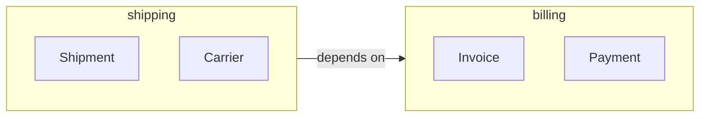

# Module

## Description

A Module (package or namespace) groups model concepts that are cohesive with one another, reducing the cognitive load on whoever reads the code. For Evans, modules are part of the model and tell a story about the domain; they aren't simple technical folders.

Modules should be named using the ubiquitous language and reflect business concepts, with high internal cohesion and low coupling between them. Grouping by technical type (all entities together, all repositories together) hides the domain; grouping by concept reveals it.

When the model changes, modules should be refactored too, so they keep expressing the current understanding.

## Problems it solves

- Code that's hard to navigate, with hundreds of classes in a single package.
- Purely technical groupings that hide domain concepts.
- Cyclic dependencies and excessive coupling between parts of the model.

## When to use

- When the model grows and needs to be split into understandable parts.
- When each group can be named with a business concept.
- To limit coupling between areas of the model.

### When to avoid

- In very small models, where the split would only add ceremony.
- When the modules would be a mere copy of the technical layers.

## Trade-offs

| Benefit | Cost / Risk |
| --- | --- |
| Lower cognitive load | Poorly chosen boundaries hurt more than they help |
| Low coupling and high cohesion | Refactoring modules has a cost |
| Business language visible in the structure | Requires keeping names aligned with the ubiquitous language |

- **Evolution:** modules are refactored along with the model.
- **Difference in scope:** a module organizes within a model; a Bounded Context delimits an entire model.

## Diagram



The `shipping` and `billing` modules group cohesive concepts, with an explicit, unidirectional dependency.

## Example

Instead of `entities`, `services`, and `repositories` packages, the code is organized by business concept.

```text
com.acme.shipping/
    Shipment.java
    Carrier.java
    ShipmentRepository.java
com.acme.billing/
    Invoice.java
    Payment.java
    InvoiceRepository.java
```

## Related patterns

- [Bounded Context](/design/ddd/model-in-practice/bounded-context) — a larger boundary, around an entire model.
- [Ubiquitous Language](/design/ddd/model-in-practice/ubiquitous-language) — names the modules.
- [Aggregate](/design/ddd/building-blocks/aggregate) — usually lives inside a module.
- [Layered Architecture](/design/ddd/building-blocks/layered-architecture) — organizes by layers, while the module organizes by concept.
- [Standalone Classes](/design/ddd/supple-design/standalone-classes) — reduces dependencies between modules.

## Reference

- [DDD Reference, Eric Evans (2015)](https://www.domainlanguage.com/ddd/reference/)
- *Domain-Driven Design: Tackling Complexity in the Heart of Software*, Eric Evans (Addison-Wesley, 2003)
