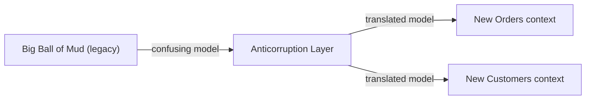

# Big Ball of Mud

## Description

Big Ball of Mud is the name, coined by Brian Foote and Joseph Yoder, for a system with no discernible structure: mixed models, inconsistent boundaries, dependencies in every direction. In the DDD Reference, the term appears as a warning when drawing the Context Map: parts of the system where the models are so tangled that it makes no sense to try to apply a single model there.

The recommendation is to draw a boundary around the confusing region and treat it as a single context, without trying to refine the model inside it. Around it, the other contexts protect themselves with an Anticorruption Layer to keep the chaos from spreading.

Recognizing a Big Ball of Mud is not approving of it; it's naming a reality so you can decide with clear eyes where to invest modeling effort and where to simply contain the damage.

## Problems it solves

- Futile attempts to apply refined modeling to a system whose state doesn't allow it.
- Contamination of new or well-modeled contexts by concepts from the confusing legacy system.
- The lack of a name and a boundary for a problematic region, which prevents planning.

## When to use

- When mapping legacy systems and identifying regions with no structure, to delimit them in the Context Map.
- When you need to explain the boundary between a new system and a tangled legacy one.
- When planning gradual migrations, to decide what to isolate before replacing it.

### When to avoid

- As a design goal: it describes a problem, not a solution to pursue.
- To label systems that are merely old or ugly; if there's a recognizable structure, it should be mapped.
- To justify the lack of modeling in new contexts, which still have a chance of being born well structured.

## Trade-offs

| Benefit | Cost / Risk |
| --- | --- |
| Explicit boundary around the confusing region | The inside remains confusing and expensive to maintain |
| The problem is contained by the Anticorruption Layer | Translation layers have a development cost |
| Conscious decision about where to invest modeling | Can normalize technical debt if there's no exit plan |
| Basis for incremental migration | The region remains an operational and change risk |

- **Containment:** treat the region as a single context and protect its neighbors.
- **Exit:** pair the recognition with a gradual replacement plan, such as Strangler Fig.
- **Effort:** concentrate refined modeling on the Core Domain instead of trying to fix the whole.

## Diagram

The tangled legacy system is surrounded by a boundary, and the new contexts access it only through a translation layer.

## Example

An insurance company has a policy system with twenty years of accumulated additions, in which billing, registration, and claims rules are mixed together in the same schema. The team draws the system as a single context, the "Policy Legacy", in the Context Map. The new Quoting and Claims contexts access the legacy system through an Anticorruption Layer and, over time, take over features incrementally, until the legacy system can be shut down.

## Related patterns

- [Context Map](/design/ddd/context-mapping/context-map) — where the region is delimited as a single context.
- [Anticorruption Layer](/architecture/cloud-design-patterns/integration-and-modernization/anti-corruption-layer) — protects the neighbors from the confusing model.
- [Bounded Context](/design/ddd/model-in-practice/bounded-context) — the boundary drawn around the region.
- [Separate Ways](/design/ddd/context-mapping/separate-ways) — an alternative when integrating with the legacy system isn't worth it.
- [Conformist](/design/ddd/context-mapping/conformist) — to be avoided with respect to a Big Ball of Mud, so you don't inherit the confusion.
- [Strangler Application](/architecture/cloud-design-patterns/integration-and-modernization/strangler-fig) — incremental replacement of the legacy system.
- [Strangler Fig](/architecture/cloud-design-patterns/integration-and-modernization/strangler-fig) — the same idea in the cloud catalog.

## Reference

- [DDD Reference, Eric Evans (2015)](https://www.domainlanguage.com/ddd/reference/)
- *Domain-Driven Design: Tackling Complexity in the Heart of Software*, Eric Evans (Addison-Wesley, 2003), ch. 14
- Brian Foote and Joseph Yoder, [*Big Ball of Mud*](http://www.laputan.org/mud/) (PLoP, 1997)
- [DDD Crew: Context Mapping](https://github.com/ddd-crew/context-mapping)
