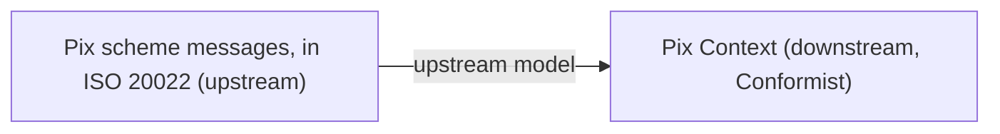

# Conformist

## Description

In Conformist, the downstream team decides to fully adopt the upstream context's model, with no translation. The upstream has no motivation to serve the downstream's needs, so instead of fighting that, the downstream conforms.

The decision eliminates the complexity of translating between models and gives the downstream a ready-made vocabulary: the upstream's. The price is that the downstream's model becomes limited and shaped by the upstream's design, which may not be ideal for the downstream's problems.

It's similar to Shared Kernel in outcome, but the difference is political: here the relationship is one-sided, with no cooperation and no decision-making power for the downstream.

## Problems it solves

- The cost and complexity of maintaining a translator for a reasonably good upstream model.
- Integration with third-party systems or products that don't adapt to their customers.
- Vocabulary divergence between downstream and upstream, which causes misunderstandings.

## When to use

- The upstream's model is adequate, or at least acceptable, for the downstream's needs.
- The upstream is large, external, or immutable (a product, an industry standard, a third-party API).
- The cost of an Anticorruption Layer isn't worth the gain of having your own model.

## When to avoid

- The upstream's model is confusing, low quality, or incompatible with the downstream's domain; in that case, protect yourself with an Anticorruption Layer.
- The downstream context is part of the Core Domain and needs its own expressive model.
- There's room to negotiate with the upstream; prefer Customer/Supplier.

## Trade-offs

| Benefit | Cost / Risk |
| --- | --- |
| Simple integration, no translation | Downstream model limited by the upstream's |
| Common language with the upstream | Upstream changes directly affect the downstream |
| Less code and fewer components to maintain | Loss of design freedom in the downstream |
| Fast delivery of the integration | The foreign model can contaminate the domain |

- **Conscious acceptance:** the decision should be made and recorded in the Context Map, not happen out of inertia.
- **Evolution:** if the upstream's model starts getting in the way, migrate to an Anticorruption Layer or Separate Ways.

## Diagram

The Pix context directly adopts the concepts of the scheme's messages, with no translation layer.

## Example

The fintech connects to the Pix network, whose messages follow the ISO 20022 standard and define concepts such as the `endToEndId`, the payer, the payee, and the reason codes for a return. Since the scheme is defined by the regulator and won't change to suit a single institution, the Pix team adopts those same terms and structures in its context, without building a translator. The decision saves weeks of development and is recorded in the Context Map. If the scheme's model ever starts getting in the way of the fintech's own rules, the decision will be revisited.

## Related patterns

- [Context Map](/design/ddd/context-mapping/context-map) — records the Conformist relationship.
- [Anticorruption Layer](/architecture/cloud-design-patterns/integration-and-modernization/anti-corruption-layer) — a defensive alternative when the upstream model doesn't fit.
- [Customer/Supplier Development](/design/ddd/context-mapping/customer-supplier-development) — an alternative when the upstream is willing to negotiate.
- [Shared Kernel](/design/ddd/context-mapping/shared-kernel) — sharing by agreement, not by submission.
- [Separate Ways](/design/ddd/context-mapping/separate-ways) — a way out when conforming costs more than it brings.
- [Published Language](/design/ddd/context-mapping/published-language) — the adopted model is often a language published by the upstream.

## Reference

- [DDD Reference, Eric Evans (2015)](https://www.domainlanguage.com/ddd/reference/)
- *Domain-Driven Design: Tackling Complexity in the Heart of Software*, Eric Evans (Addison-Wesley, 2003), ch. 14
- [DDD Crew: Context Mapping](https://github.com/ddd-crew/context-mapping)
