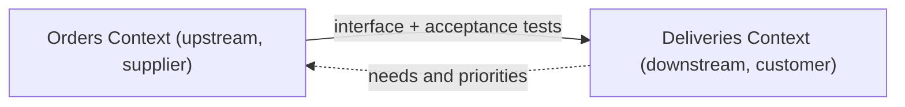

# Customer/Supplier Development

## Description

In Customer/Supplier Development, two contexts have an upstream/downstream relationship in which the upstream team (the supplier) serves the needs of the downstream team (the customer). The downstream is, in effect, a customer of the upstream, and its needs influence the supplier's planning.

For this to work, the teams establish a formal relationship: the downstream takes part in the upstream's planning, needs enter the backlog as stories, and both jointly define automated acceptance tests that validate the interface. These tests become part of the upstream's test suite, so it can change its code knowing it won't break the customer.

Without this agreement, the downstream is at the mercy of the upstream's priorities.

## Problems it solves

- A downstream team blocked by a dependency whose owner has other priorities.
- Upstream changes that break the downstream without warning.
- No formal channel for the downstream to request interface and model changes.
- The upstream's reluctance to change its own code because it doesn't know who depends on it.

## When to use

- There's a clear upstream/downstream relationship between two teams that belong to the same organization or to cooperating organizations.
- The upstream has both the interest and the authority to prioritize the downstream's needs.
- It's possible to maintain acceptance tests shared between both sides.

## When to avoid

- When the upstream has no incentive or power to serve the downstream, such as external vendors or off-the-shelf products; prefer Conformist or Anticorruption Layer.
- When the teams are already so close that a Partnership would be more appropriate.
- When there's no discipline to maintain the acceptance tests; without them the agreement is just a promise.

## Trade-offs

| Benefit | Cost / Risk |
| --- | --- |
| Downstream has a voice in the upstream's planning | The upstream must dedicate capacity to the downstream's demands |
| Acceptance tests protect the interface | Effort to maintain and evolve the shared tests |
| Fewer surprises from contract breakage | Depends on healthy relationships and management support |
| Each team's autonomy within a clear contract | The upstream can become overloaded with many customers |

- **Priority:** the agreement only works if management ensures the upstream treats the downstream as a customer.
- **Model scope:** the downstream keeps its own model; only the interface is negotiated.
- **Agreement failure:** if the upstream doesn't cooperate, the downstream should evolve toward Conformist or Separate Ways.

## Diagram

The interface flows from the supplier to the customer, while the customer's needs flow back as input to the supplier's planning.

## Example

The Deliveries context depends on Orders to get weight, volume, and delivery window. Deliveries also needs Orders to expose the handling restriction for fragile items. The teams agree that this need goes into Orders' backlog in the next iteration, and they write automated acceptance tests for the new API together. Orders' pipeline starts running those tests on every change, ensuring Deliveries isn't broken.

## Related patterns

- [Context Map](/design/ddd/context-mapping/context-map) — records the upstream/downstream relationship.
- [Conformist](/design/ddd/context-mapping/conformist) — what the downstream does when the upstream doesn't cooperate.
- [Anticorruption Layer](/architecture/cloud-design-patterns/integration-and-modernization/anti-corruption-layer) — protects the downstream when the upstream model doesn't fit.
- [Partnership](/design/ddd/context-mapping/partnership) — a more symmetrical relationship between the teams.
- [Open-host Service](/design/ddd/context-mapping/open-host-service) — when the upstream serves many customers with a common protocol.
- [Continuous Integration](/design/ddd/model-in-practice/continuous-integration) — the acceptance tests run in continuous integration.

## Reference

- [DDD Reference, Eric Evans (2015)](https://www.domainlanguage.com/ddd/reference/)
- *Domain-Driven Design: Tackling Complexity in the Heart of Software*, Eric Evans (Addison-Wesley, 2003), ch. 14
- [DDD Crew: Context Mapping](https://github.com/ddd-crew/context-mapping)
