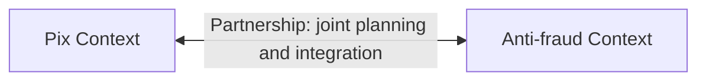

# Partnership

## Description

Partnership is a relationship between two Bounded Contexts, and between the teams that maintain them, in which the success of one depends on the success of the other. The teams coordinate the planning and development of the interfaces jointly, so that both parts evolve together or fail together.

In practice, the teams continuously integrate the features that cross over, agree on dates, resolve dependencies together, and adjust to each other when a change on one side affects the other. Neither is purely upstream or downstream: interface decisions are made in common.

The pattern doesn't appear in the 2003 book; it was added to the DDD Reference as a way of explicitly naming this close cooperation.

## Problems it solves

- Two contexts with interdependent features delivered by different teams, without coordination, leading to integrations that break at the last minute.
- Interfaces designed by one side and discovered by the other too late.
- Lack of shared responsibility for the end result that depends on both contexts.

## When to use

- Two teams with strongly coupled business goals, who only deliver value together.
- There's good communication between the teams and the ability to synchronize priorities and cadence.
- The contexts are still evolving rapidly and the interfaces change frequently.

## When to avoid

- Distributed teams with little communication, or incompatible time zones and priorities.
- When one side is an external or third-party vendor, with no way to coordinate planning.
- When the dependency is one-sided; Customer/Supplier or Conformist describe the situation better.

## Trade-offs

| Benefit | Cost / Risk |
| --- | --- |
| Aligned interfaces and fewer integration surprises | High coordination and meeting cost |
| Shared responsibility for the outcome | A delayed team delays the other |
| Model decisions made with context from both sides | Reduced autonomy for each team |
| Fast joint evolution while the product is uncertain | Hard to sustain as the organizations grow |

- **Organizational coupling:** the coupling is accepted on purpose; it should be reassessed if coordination becomes a bottleneck.
- **Evolution:** over time, it may migrate to Customer/Supplier or to contexts with more independence.

## Diagram

The bidirectional arrow indicates there's no upstream or downstream: both contexts coordinate changes and interfaces.

## Example

The fintech's Pix team and Anti-fraud team launch the nighttime limit for Pix transfers: from 8 p.m. to 6 a.m., each transfer has a lower cap, which the customer can raise only after a waiting period (illustrative hours and amounts). Pix needs to apply the limit and query Anti-fraud before sending the order, and Anti-fraud needs to assess late-night signals within the time budget of an instant payment. Neither can deliver without the other. The two teams plan the work in the same cycle, define the risk-check contract together, run joint integration tests every day, and release the feature only when both are ready.

## Related patterns

- [Context Map](/design/ddd/context-mapping/context-map) — where the partnership is recorded.
- [Shared Kernel](/design/ddd/context-mapping/shared-kernel) — can emerge within a partnership, to share part of the model.
- [Customer/Supplier Development](/design/ddd/context-mapping/customer-supplier-development) — an alternative when the dependency is one-sided.
- [Continuous Integration](/design/ddd/model-in-practice/continuous-integration) — a practice partner teams use to keep their models aligned.
- [Bounded Context](/design/ddd/model-in-practice/bounded-context) — the contexts that take part in the partnership.

## Reference

- [DDD Reference, Eric Evans (2015)](https://www.domainlanguage.com/ddd/reference/)
- *Domain-Driven Design: Tackling Complexity in the Heart of Software*, Eric Evans (Addison-Wesley, 2003), ch. 14
- [DDD Crew: Context Mapping](https://github.com/ddd-crew/context-mapping)
