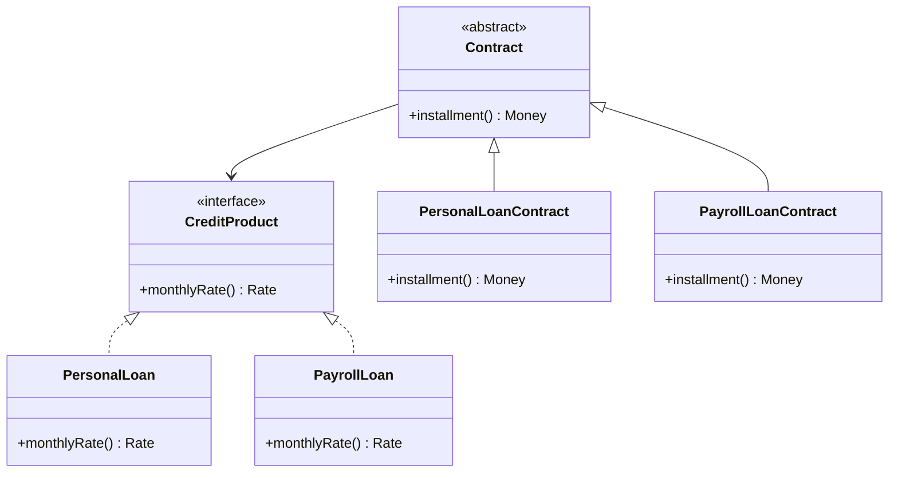

# Abstract Core

## Description

The Abstract Core is a separate module that holds the most fundamental concepts of the model, expressed as abstract classes and interfaces. It captures the essential vocabulary and interactions between subdomains, without the implementation details that vary from one to the next.

Specialized modules depend on the Abstract Core and implement or extend its types, but they don't depend directly on one another. This lets you understand the high-level model by reading only the abstract core, and it reduces coupling between the specialized parts.

It's a stronger tool than the [Highlighted Core](/design/ddd/distillation/highlighted-core) because it changes the structure of the code, but it can be less invasive than a [Segregated Core](/design/ddd/distillation/segregated-core) when the core is too large to move in its entirety. It's only worth it when there's a lot of interaction between modules and a clearly stable set of concepts.

## Problems it solves

- A large model in which many modules talk to each other and create a web of dependencies.
- Difficulty understanding the whole without walking through every specialized module.
- Concrete types scattered around, forcing cascading changes when one module evolves.
- The lack of a common vocabulary that cuts across subdomains.

## When to use

- When there's a lot of interaction between modules and a stable conceptual core can be identified.
- When the core is too large to be segregated in its entirety.
- When you want specialized modules to be able to vary without affecting one another.

## When to avoid

- When the model is still changing quickly and there aren't enough stable concepts to abstract.
- When few modules interact; the abstractions would be ceremony with no payoff.
- When abstracting hides important business rules or introduces excessive indirection.

## Trade-offs

| Benefit | Cost / Risk |
| --- | --- |
| High-level view in a single module | Premature abstractions can lock the model in |
| Specialized modules decoupled from one another | More indirection and more types to maintain |
| Common vocabulary across subdomains | Takes maturity to identify what is truly stable |
| Easier testing with alternative implementations | Changes to the abstract core affect every module |

- **Stability:** the abstract core changes rarely; modifying it has a wide impact and calls for care.
- **Dependencies:** they always point from the specialized modules to the core, never the other way around.
- **Commitment:** you have to decide what goes into the core; too much content turns it into a second copy of the model.

## Diagram



`Contract` and `CreditProduct` form the abstract core; the personal loan and payroll loan modules specialize it without knowing about each other.

## Example

A fintech offers personal loans and payroll-deducted loans, with modules that evolve at different paces. Both need to take part in offer campaigns, renegotiations, and portfolio exposure reports, which led to direct dependencies between the modules.

The team creates the `credit-core` module, containing only `CreditProduct`, `Contract`, and `Installment`, in abstract terms. The `personal-loan` and `payroll-loan` modules implement it, and renegotiations and reports now depend only on the abstractions.

```java
// credit-core module
public interface CreditProduct { Rate monthlyRate(); }

public abstract class Contract {
    protected final CreditProduct product;
    protected final Money principal;
    protected final int months;
    protected Contract(CreditProduct product, Money principal, int months) {
        this.product = product; this.principal = principal; this.months = months;
    }
    public abstract Money installment();
}

// payroll-loan module (depends on credit-core)
public class PayrollLoanContract extends Contract {
    public PayrollLoanContract(PayrollLoan product, Money principal, int months) {
        super(product, principal, months);
    }
    // Fixed installment (Price), deducted from payroll.
    public Money installment() { return PriceTable.installment(principal, product.monthlyRate(), months); }
}
```

## Related patterns

- [Core Domain](/design/ddd/distillation/core-domain) — the Abstract Core is one way to organize and communicate the core.
- [Highlighted Core](/design/ddd/distillation/highlighted-core) — a lighter alternative that doesn't change the structure.
- [Segregated Core](/design/ddd/distillation/segregated-core) — an alternative that moves the entire core, instead of extracting only abstractions.
- [Module](/design/ddd/building-blocks/module) — the abstract core lives in a module of its own.
- [Knowledge Level](/design/ddd/large-scale-structure/knowledge-level) — another way to separate abstract concepts from configurable rules.
- [Pluggable Component Framework](/design/ddd/large-scale-structure/pluggable-component-framework) — uses abstract interfaces to allow interchangeable components.
- [Separated Interface](/design/poeaa/base/separated-interface) — a technique for placing interface and implementation in distinct packages.
- [Abstract Factory](/coding/gof/creational/abstract-factory) — commonly used to create implementations without knowing the concrete types.

## Reference

- [DDD Reference, Eric Evans (2015)](https://www.domainlanguage.com/ddd/reference/)
- *Domain-Driven Design: Tackling Complexity in the Heart of Software*, Eric Evans (Addison-Wesley, 2003)
