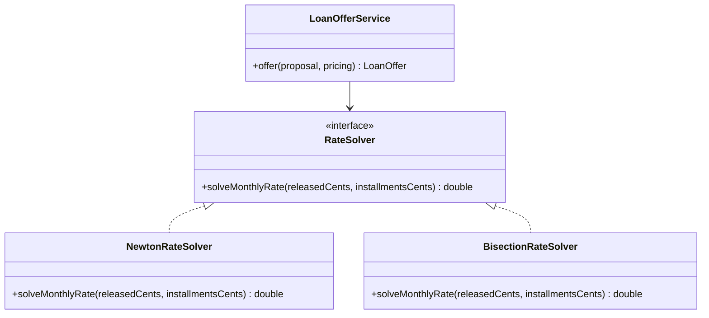

# Cohesive Mechanisms

## Description

Cohesive Mechanisms are complex computational mechanisms, such as graph algorithms, rules engines, or constraint solving, that creep into the domain model and fill it with procedural detail. The pattern proposes extracting that mechanism into a separate structure with an intention-revealing interface.

The domain model then expresses the what (business concepts and rules) while the mechanism takes care of the how (the mechanics of the computation). The mechanism is cohesive, has a clear responsibility, and can be tested and evolved without touching the business rules.

It's different from a [Generic Subdomain](/design/ddd/distillation/generic-subdomains): a generic subdomain deals with business concepts that provide no differentiation, while a mechanism is a technical computing concern that is sometimes published as a framework or library.

## Problems it solves

- Complex algorithms mixed into domain entities and services, hiding the business rules.
- Difficulty testing domain logic in isolation from the mechanics of the computation.
- A model that's hard to read because the intent gets lost in implementation details.
- Being unable to swap or optimize the algorithm without changing the domain.

## When to use

- When a piece of code is mainly computation (graphs, optimization, rules, numerical calculation) rather than business knowledge.
- When the mechanism can be described by a simple, intention-oriented interface.
- When the same algorithm can serve more than one point in the model or be replaced in the future.

## When to avoid

- When the calculation is part of the business rule and should be explicit domain knowledge; extracting it would hide the core.
- When the logic is too simple to justify a separate structure.
- When the abstraction would have to expose so many internal details that the interface wouldn't stay lean.

## Trade-offs

| Benefit | Cost / Risk |
| --- | --- |
| A domain that's more readable and focused on concepts | One more structure to maintain |
| A mechanism that can be tested and evolved on its own | The boundary between rule and mechanism can be hard to draw |
| Swapping or optimizing the algorithm without affecting the domain | Risk of over-abstracting and hiding business rules |
| Possibility of reuse by several components | May require specialized technical knowledge |

- **Interface:** it should be expressed in domain terms ([Intention-Revealing Interfaces](/design/ddd/supple-design/intention-revealing-interfaces)), not in terms of the algorithm's details.
- **Boundary:** this is the most sensitive point; the mechanism solves the how, and decisions about the what stay in the model.
- **Reuse:** it often turns into a library or an internal framework.

## Diagram



The `LoanOfferService` domain service expresses the problem in business terms and delegates the numerical calculation of the CET rate to a replaceable mechanism behind `RateSolver`.

## Example

A credit fintech builds loan offers with a rate, installments, fees, and IOF, and has to disclose the CET (total effective cost) of each one. The CET is the rate that equates the installments, discounted to present value, to the amount actually released to the customer; that equation has no closed-form solution and requires a numerical method, such as Newton-Raphson or bisection. Putting those iterations inside `LoanOffer` or `PricingRule` would make those classes unreadable.

The team extracts the calculation into a mechanism with an intention-oriented interface, and the domain simply invokes it with its own concepts.

```java
public interface RateSolver {
    // Monthly rate that equates the present value of the installments to the released amount.
    double solveMonthlyRate(long releasedCents, List<Long> installmentsCents);
}

public class LoanOfferService {
    private final RateSolver solver;

    public LoanOfferService(RateSolver solver) {
        this.solver = solver;
    }

    public LoanOffer offer(CreditProposal proposal, PricingRule pricing) {
        List<Long> installmentsCents = pricing.installmentsFor(proposal);
        long releasedCents = proposal.amountCents() - pricing.upfrontChargesCents(proposal);
        double monthlyCet = solver.solveMonthlyRate(releasedCents, installmentsCents);
        return LoanOffer.of(proposal, installmentsCents, monthlyCet);   // business rule
    }
}
```

## Related patterns

- [Generic Subdomains](/design/ddd/distillation/generic-subdomains) — a conceptual neighbor, but aimed at business concepts rather than computational mechanisms.
- [Core Domain](/design/ddd/distillation/core-domain) — the mechanism is pulled out to keep the core expressive.
- [Intention-Revealing Interfaces](/design/ddd/supple-design/intention-revealing-interfaces) — gives the mechanism an interface in domain terms.
- [Domain Service](/design/ddd/building-blocks/domain-service) — the point in the model that typically invokes the mechanism.
- [Strategy](/coding/gof/behavioral/strategy) — a common way to make the algorithm replaceable.
- [Separated Interface](/design/poeaa/base/separated-interface) — separates the interface from the implementation in distinct packages.

## Reference

- [DDD Reference, Eric Evans (2015)](https://www.domainlanguage.com/ddd/reference/)
- *Domain-Driven Design: Tackling Complexity in the Heart of Software*, Eric Evans (Addison-Wesley, 2003)
