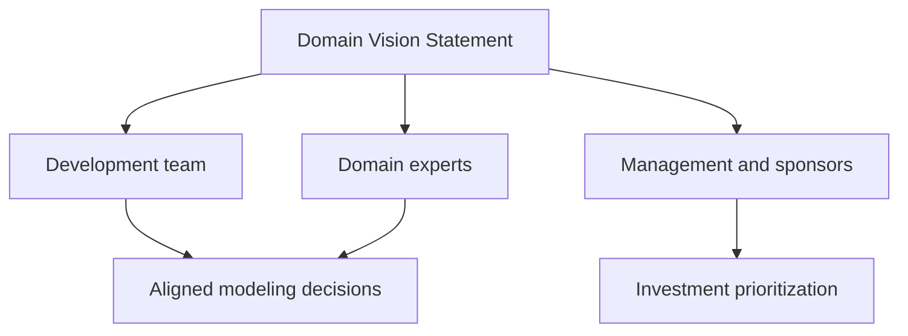

# Domain Vision Statement

## Description

The Domain Vision Statement is a short document, a page or less, that describes the [Core Domain](/design/ddd/distillation/core-domain) and the value it delivers, without getting into technical details. It shows what makes the model special and how it serves the interests of the business.

Written early in the project and revised as understanding matures, it serves as a high-level narrative for developers, managers, and domain experts. The text should leave out anything nonessential, highlight the business value, and not depend on implementation decisions that change often.

When there are several contexts or teams, the document helps keep everyone aligned with the same intent, even when the details of the model diverge. It doesn't replace the model's documentation; it only points the way.

## Problems it solves

- The absence of a shared description of what the central model should achieve.
- New or external teams that don't understand why the core matters.
- Design decisions made without reference to business value.
- Effort wasted on improvements that don't reinforce the differentiator.

## When to use

- At the start of the project or when the core is identified.
- When multiple teams or contexts need a common north star.
- When you need to explain to managers and sponsors what justifies the investment in the model.

### When to avoid

- When the document would become generic text with no domain-specific information.
- When nobody commits to keeping it up to date, since an outdated vision confuses more than it guides.
- In small projects, where the team already shares context naturally.

## Trade-offs

| Benefit | Cost / Risk |
| --- | --- |
| Quick alignment between technical and business people | Can turn into empty text with no practical use |
| A reference for prioritizing changes to the core | Needs to be revised as understanding evolves |
| Faster onboarding of new members | Requires synthesis and clarity, which are hard to achieve |
| Low production cost | Can be ignored if it isn't integrated into day-to-day work |

- **Scope:** it describes value and direction, not implementation; technical details belong in other artifacts.
- **Length:** it should fit on one page; if it grows, it loses its power of synthesis.
- **Governance:** it needs a clear owner, usually the modeling lead or the product owner.

## Diagram

The single document feeds different audiences, who then decide and prioritize based on the same description of the core's value.

## Example

A logistics company writes the following summary for its routing core: "The model lets the dispatcher plan routes that respect delivery windows, vehicle capacity, and driver constraints, recalculating them within minutes when traffic or orders change. The goal is to reduce the cost per delivery while meeting the promised deadlines."

The text doesn't mention databases, queues, or frameworks. It's pinned on the wiki, reviewed every quarter, and used in planning meetings to decide whether a proposal, such as a financial reporting feature, reinforces the core or merely distracts from it.

## Related patterns

- [Core Domain](/design/ddd/distillation/core-domain) — the subject the statement describes.
- [Highlighted Core](/design/ddd/distillation/highlighted-core) — a complement that points to where the core is within the model and the code.
- [Ubiquitous Language](/design/ddd/model-in-practice/ubiquitous-language) — the statement's vocabulary should be the same one used in the model and the code.
- [Context Map](/design/ddd/context-mapping/context-map) — shows how the contexts relate to the described core.
- [Evolving Order](/design/ddd/large-scale-structure/evolving-order) — another lightweight way to guide the model's evolution without imposing rigid rules.

## Reference

- [DDD Reference, Eric Evans (2015)](https://www.domainlanguage.com/ddd/reference/)
- *Domain-Driven Design: Tackling Complexity in the Heart of Software*, Eric Evans (Addison-Wesley, 2003)
